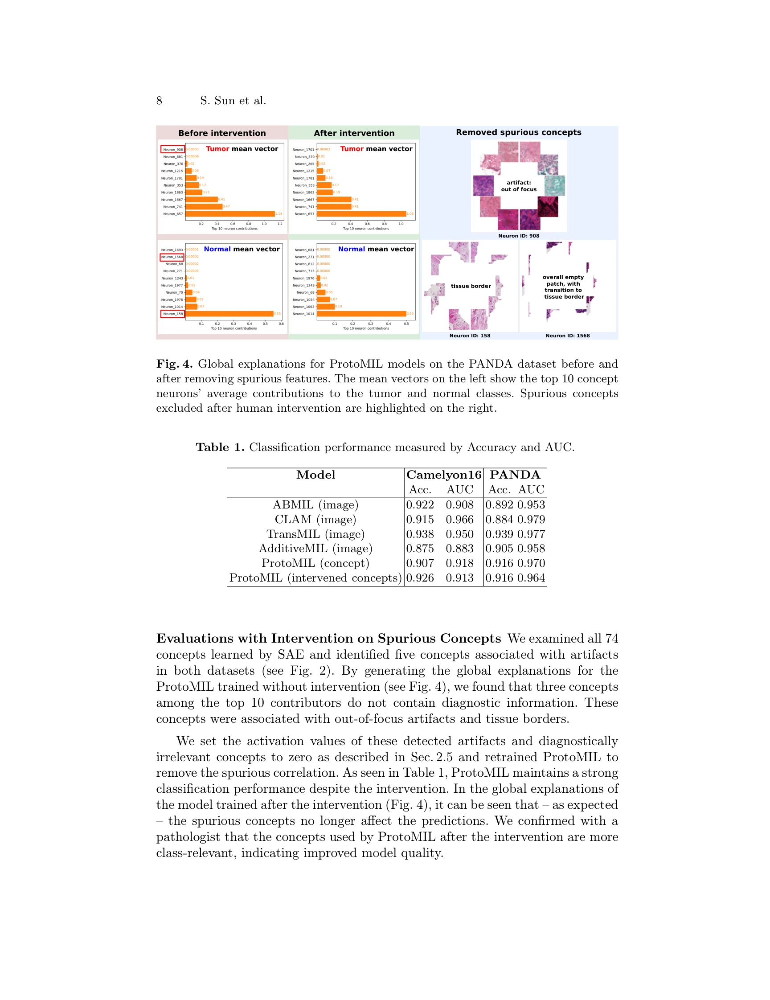

## Prototype-Based Multiple Instance Learning for Gigapixel Whole Slide Image Classification

> data: CAMELYON16、PANDA
>
> MICCAI 2025（PDF 与作者代码） · [论文](https://papers.miccai.org/miccai-2025/paper/0542_paper.pdf) · [作者代码](https://github.com/ss-sun/ProtoMIL)

#### 引言

用稀疏自编码器发现可解释概念，再将切片预测表示为概念的线性组合，支持人为修改概念以检查和干预模型决策。

#### 方法

（1）概念发现：以稀疏自编码器学习可解释的病理特征。

（2）概念预测：把切片决策写成概念的线性组合。

（3）人为干预：删除或修改输入概念，检查是否依赖无关信息。

<!-- wsi-complete-model -->
##### 模型结构图

**图 1 · 模型结构**（PDF 第 2 页）

> 原文图注：Fig. 1. The ProtoMIL Pipeline: (a) A sparse autoencoder is trained to discover human- interpretable concepts from the image embedding space. (b) The concepts are linked to visual representations, allowing pathologists to examine them and identify spurious features. (c) ProtoMIL is trained to use the discovered concepts as inputs, with the option to disable spurious concepts via human intervention.

[查看原尺寸](assest/ProtoMIL/figure-1-complete.webp)

<!-- /wsi-complete-model -->

#### 实验

##### 实验设置

C16 保留官方测试集，训练/验证为 80/20；PANDA 公开训练部分按 80/10/10 划分。

##### 主要结果

概念输入下分类表现与传统图像特征 MIL 相近，同时允许人工删除不相关概念；核心不是单纯追求最高 AUC。

<!-- wsi-complete-results -->
##### 完整实验指标与对照

下列实验原页保留表头、全部行列、子图、误差说明和脚注，点击可查看原尺寸。比较时请对应相同的数据集、特征编码器和训练设置；`±`、置信区间、百分比和小数均保留原文的单位与统计口径。

| 原表/图中指标 | 读取方式 |
| --- | --- |
| ROC-AUC / AUROC | 越高越好；若原表明确为 PR-AUC，则按 PR 曲线面积读取 |
| ACC / Accuracy | 越高越好；平衡准确率、平均准确率以原表标注为准 |

| 原文页 | 阅读内容 | 图表及正文引用 |
| --- | --- | --- |
| PDF 第 8 页 | 实验结果 | Table 1 |

**实验原页 · PDF 第 8 页**（图表及正文引用：Table 1）

[查看原尺寸](assest/ProtoMIL/experiment-page-08.webp)

<!-- /wsi-complete-results -->

##### 消融与讨论

比较干预前后性能及概念原型，检查预测是否依赖与诊断无关的概念。

#### 参考文献

> Prototype-Based Multiple Instance Learning for Gigapixel Whole Slide Image Classification
>
> MICCAI 2025（PDF 与作者代码） · [论文](https://papers.miccai.org/miccai-2025/paper/0542_paper.pdf) · [作者代码](https://github.com/ss-sun/ProtoMIL)
