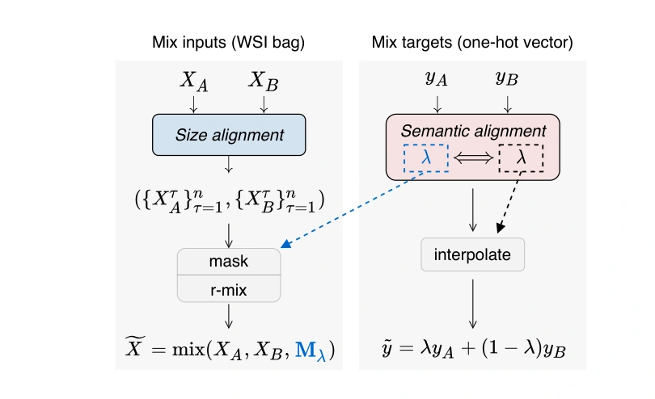
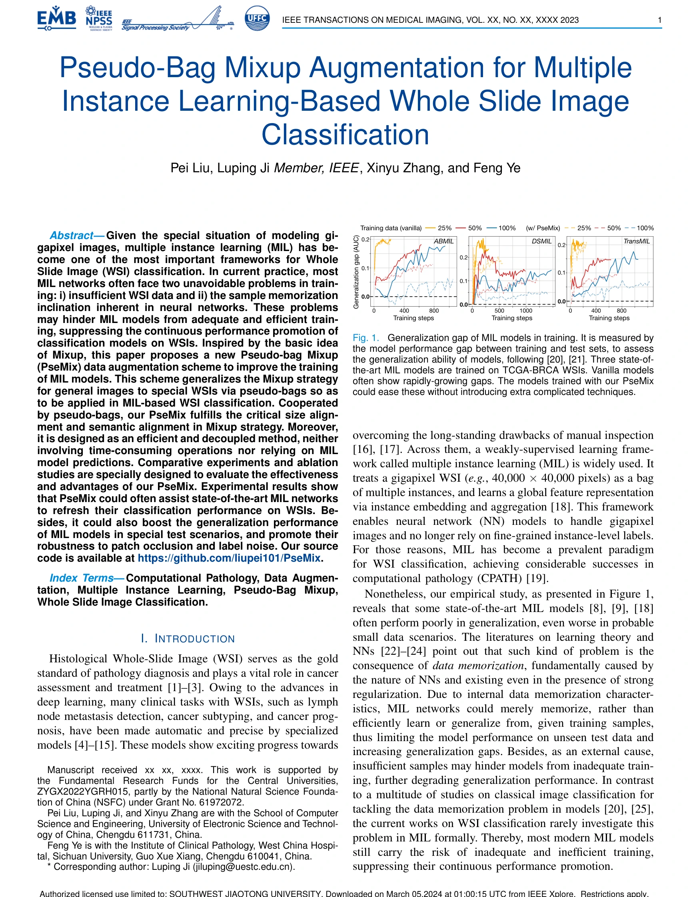
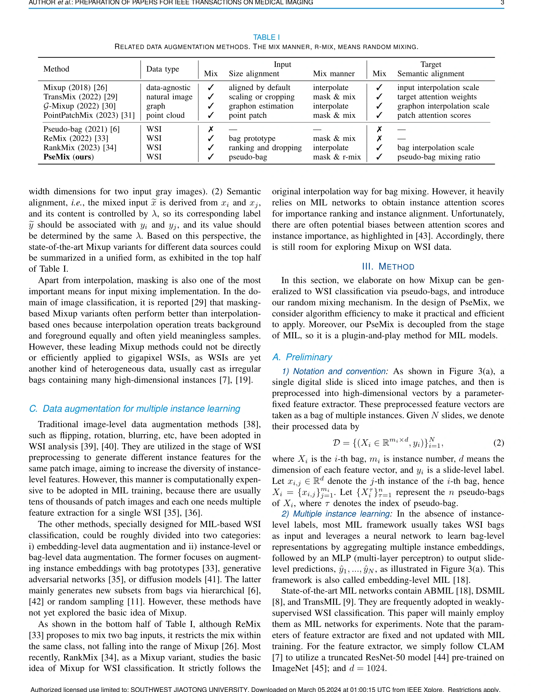
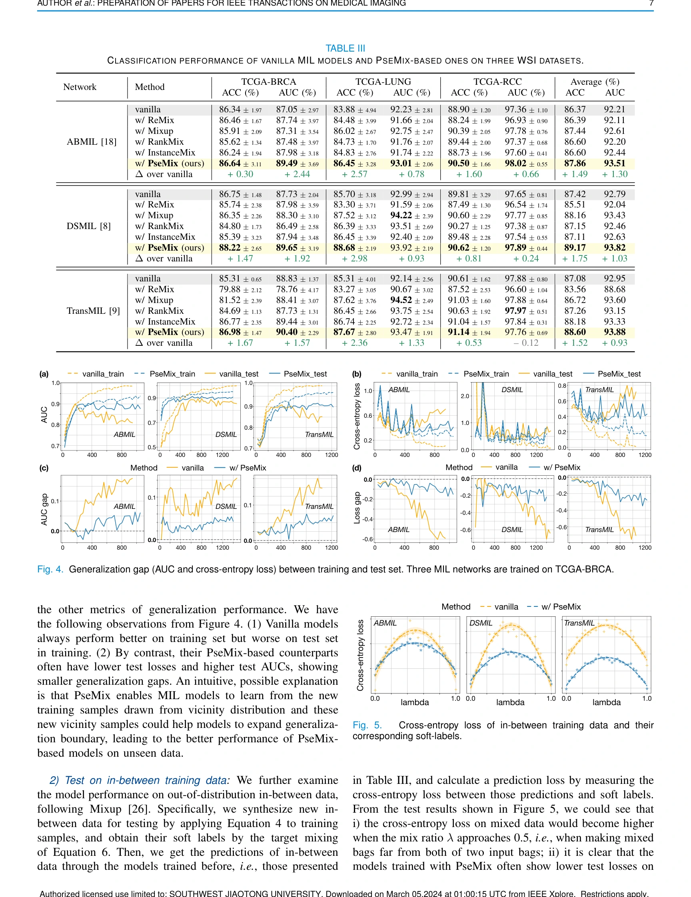
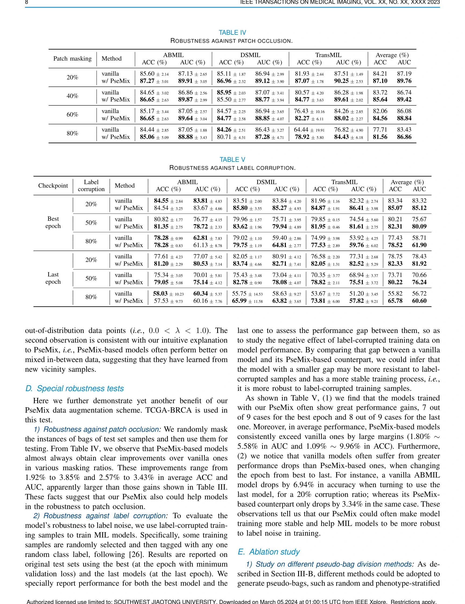
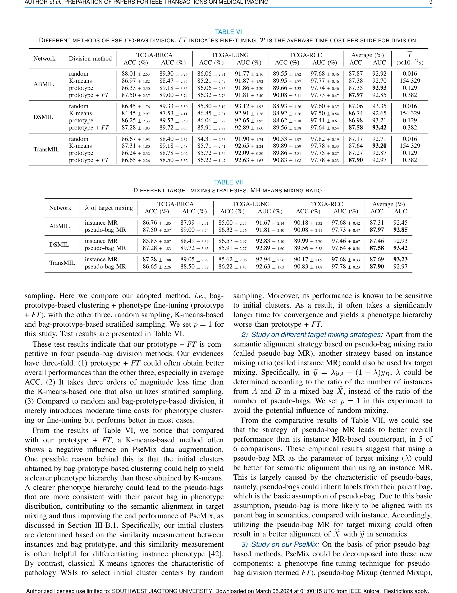
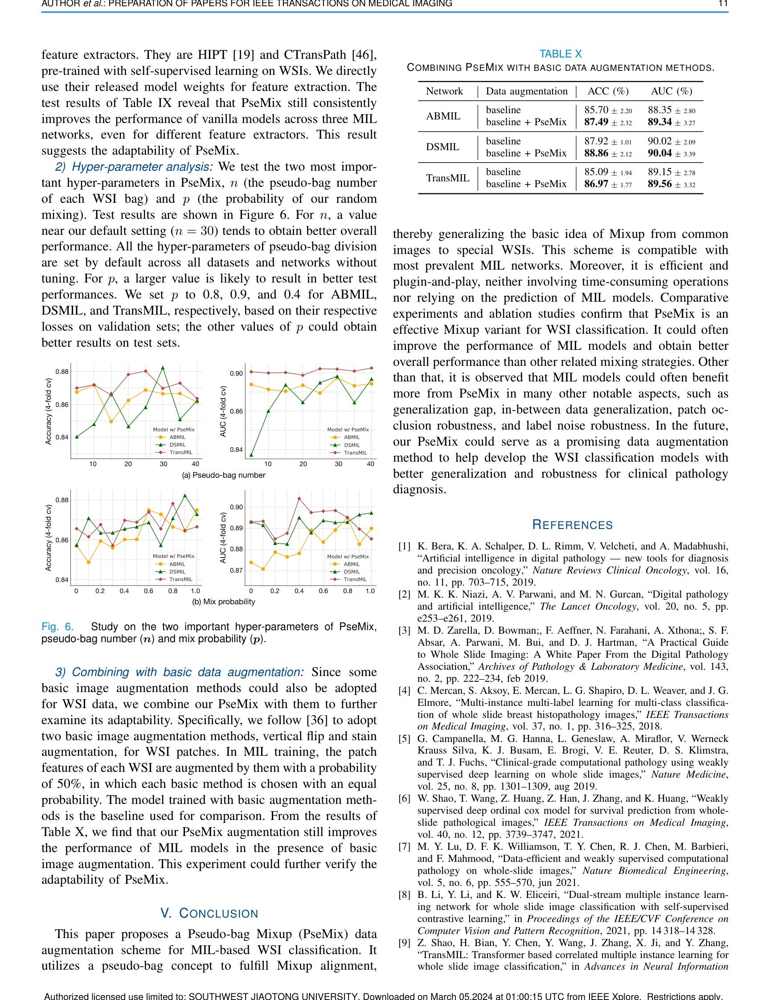
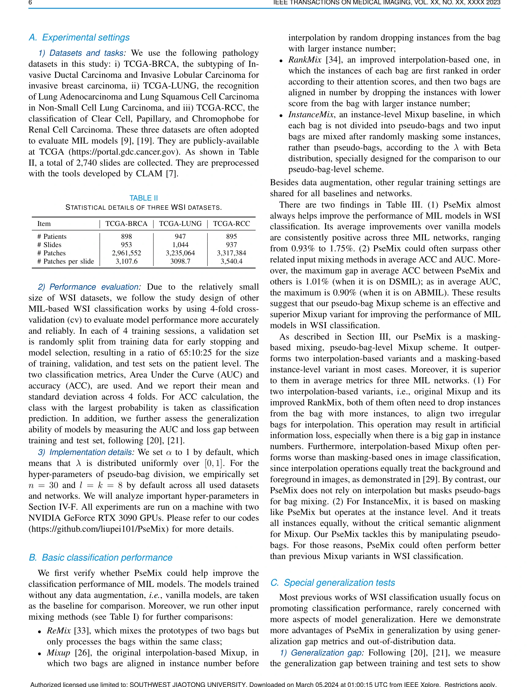
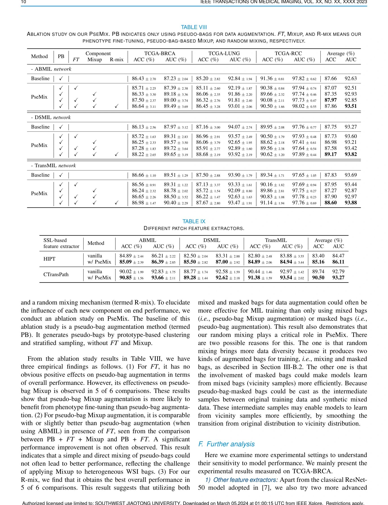

## Pseudo-Bag Mixup Augmentation for Multiple Instance Learning-Based Whole Slide Image Classification

> data: TCGA-BRCA、TCGA-LUNG、TCGA-RCC，共 2,740 张切片
>
> IEEE Transactions on Medical Imaging 2024 · [论文](https://doi.org/10.1109/TMI.2024.3351213) · [作者代码](https://github.com/liupei101/PseMix)

#### 引言

通过伪包解决 WSI Mixup 中的大小和语义对齐问题，生成额外训练样本，改善数据不足时的泛化及对遮挡、标签噪声的鲁棒性。

#### 方法

（1）伪包划分：按表型与实例组成把切片拆分成可混合单元。

（2）包级混合：借助伪包实现不同原始包之间的大小对齐。

（3）目标混合：使用与输入混合相匹配的监督，保持语义比例一致。

<!-- wsi-complete-model -->
##### 模型结构图

**图 2 · 模型结构**（PDF 第 2 页）

> 原文图注：Fig. 2. A conceptual framework of PseMix for MIL-based WSI classifica- tion. Size alignment means that two input representations (e.g., feature vectors and image matrices) are aligned in size at every dimension involving mixing. Xτ A and Xτ B denote pseudo-bags. Mλ is a binary mask. R-mix means random mixing. PseMix generalizes Mixup and fulfills its critical size alignment and semantic alignment via pseudo- bags.

[查看原尺寸](assest/PseMix/figure-2-complete.webp)

<!-- /wsi-complete-model -->

#### 实验

##### 实验设置

在多种 MIL 聚合器上比较增强前后性能，并测试 patch 遮挡、标签噪声与特殊测试分布。

##### 主要结果

证据重点是伪包增强的可组合性与泛化，而不是发明新的聚合器；分类与鲁棒性结果需要分别阅读。

<!-- wsi-complete-results -->
##### 完整实验指标与对照

下列实验原页保留表头、全部行列、子图、误差说明和脚注，点击可查看原尺寸。比较时请对应相同的数据集、特征编码器和训练设置；`±`、置信区间、百分比和小数均保留原文的单位与统计口径。

| 原表/图中指标 | 读取方式 |
| --- | --- |
| ROC-AUC / AUROC | 越高越好；若原表明确为 PR-AUC，则按 PR 曲线面积读取 |

| 原文页 | 阅读内容 | 图表及正文引用 |
| --- | --- | --- |
| PDF 第 1 页 | 实验结果 | Figure 1 |
| PDF 第 3 页 | 实验结果 | Table I |
| PDF 第 6 页 | 数据与实验设置 | Table II |
| PDF 第 7 页 | 实验结果 | Table III、Figure 4 |
| PDF 第 8 页 | 实验结果 | Table IV、Table V |
| PDF 第 9 页 | 实验结果 | Table VI、Table VII |
| PDF 第 10 页 | 消融与参数分析 | Table VIII、Table IX |
| PDF 第 11 页 | 实验结果 | Table X |

**实验原页 · PDF 第 1 页**（图表及正文引用：Figure 1）

[查看原尺寸](assest/PseMix/experiment-page-01.webp)

**实验原页 · PDF 第 3 页**（图表及正文引用：Table I）

[查看原尺寸](assest/PseMix/experiment-page-03.webp)

**实验原页 · PDF 第 7 页**（图表及正文引用：Table III、Figure 4）

[查看原尺寸](assest/PseMix/experiment-page-07.webp)

**实验原页 · PDF 第 8 页**（图表及正文引用：Table IV、Table V）

[查看原尺寸](assest/PseMix/experiment-page-08.webp)

**实验原页 · PDF 第 9 页**（图表及正文引用：Table VI、Table VII）

[查看原尺寸](assest/PseMix/experiment-page-09.webp)

**实验原页 · PDF 第 11 页**（图表及正文引用：Table X）

[查看原尺寸](assest/PseMix/experiment-page-11.webp)

展开消融、参数、数据设置及效率原页

**实验原页 · PDF 第 6 页**（图表及正文引用：Table II）

[查看原尺寸](assest/PseMix/experiment-page-06.webp)

**实验原页 · PDF 第 10 页**（图表及正文引用：Table VIII、Table IX）

[查看原尺寸](assest/PseMix/experiment-page-10.webp)

<!-- /wsi-complete-results -->

##### 消融与讨论

比较表型划分、伪包大小和混合策略，检验大小对齐与语义对齐两个必要条件。

#### 参考文献

> Pseudo-Bag Mixup Augmentation for Multiple Instance Learning-Based Whole Slide Image Classification
>
> IEEE Transactions on Medical Imaging 2024 · [论文](https://doi.org/10.1109/TMI.2024.3351213) · [作者代码](https://github.com/liupei101/PseMix)
