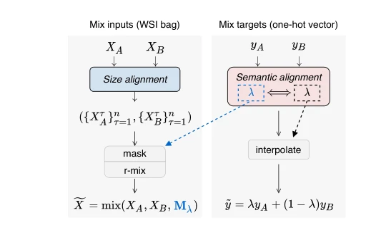

## Pseudo-Bag Mixup Augmentation for Multiple Instance Learning-Based Whole Slide Image Classification

> data: TCGA-BRCA、TCGA-LUNG、TCGA-RCC，共 2,740 张切片
>
> IEEE Transactions on Medical Imaging 2024 · [论文](https://doi.org/10.1109/TMI.2024.3351213) · [作者代码](https://github.com/liupei101/PseMix)

#### 引言

通过伪包解决 WSI Mixup 中的大小和语义对齐问题，生成额外训练样本，改善数据不足时的泛化及对遮挡、标签噪声的鲁棒性。

#### 方法

（1）伪包划分：按表型与实例组成把切片拆分成可混合单元。

（2）包级混合：借助伪包实现不同原始包之间的大小对齐。

（3）目标混合：使用与输入混合相匹配的监督，保持语义比例一致。

原文Fig. 2，PDF 第 2 页。

#### 实验

##### 实验设置

在多种 MIL 聚合器上比较增强前后性能，并测试 patch 遮挡、标签噪声与特殊测试分布。

##### 主要结果

证据重点是伪包增强的可组合性与泛化，而不是发明新的聚合器；分类与鲁棒性结果需要分别阅读。

##### 消融与讨论

比较表型划分、伪包大小和混合策略，检验大小对齐与语义对齐两个必要条件。

#### 参考文献

> Pseudo-Bag Mixup Augmentation for Multiple Instance Learning-Based Whole Slide Image Classification
>
> IEEE Transactions on Medical Imaging 2024 · [论文](https://doi.org/10.1109/TMI.2024.3351213) · [作者代码](https://github.com/liupei101/PseMix)
