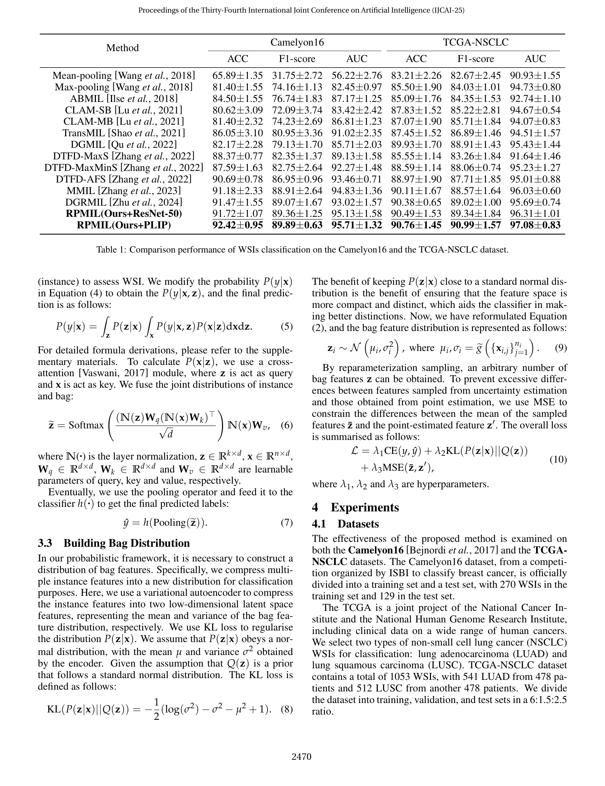
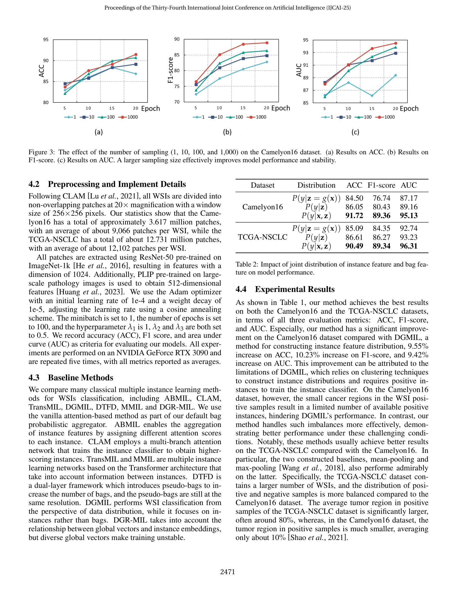
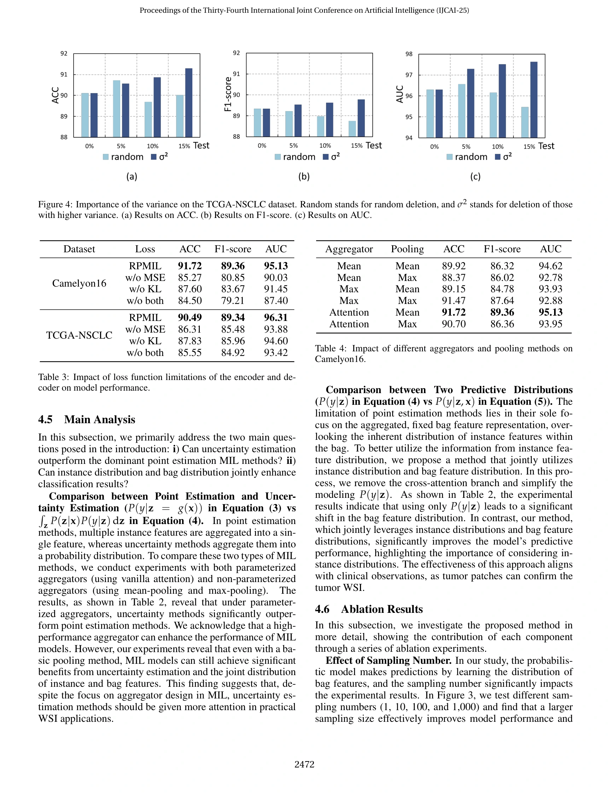

## RPMIL: Rethinking Uncertainty-Aware Probabilistic Multiple Instance Learning for Whole Slide Pathology Diagnosis

> data: CAMELYON16、TCGA-NSCLC
>
> IJCAI 2025 · [论文](https://www.ijcai.org/proceedings/2025/275)

#### 引言

用变分自编码器将实例聚合为具有均值和方差的包级分布，联合实例与包的概率表示进行预测，替代固定嵌入的点估计。

#### 方法

（1）概率编码：将实例汇总为低维随机变量而非固定切片点向量。

（2）变分训练：学习包分布的均值和方差。

（3）联合分布：把实例分布与包分布共同用于最终分类。

<!-- wsi-complete-model -->
##### 模型结构图

**图 2 · 模型结构**（PDF 第 3 页）

> 原文图注：Figure 2: The overall architecture of our proposed uncertainty-aware probabilistic MIL method. RPMIL learns a probabilistic aggregator and maps the WSI to the bag feature distribution rather than the deterministic bag feature. Furthermore, we drive the prediction by jointly leveraging the instance feature distribution and bag feature distribution.

[查看原尺寸](assest/RPMIL/figure-2-complete.webp)

<!-- /wsi-complete-model -->

#### 实验

##### 实验设置

比较固定嵌入聚合与概率聚合；C16 保留官方 270/129 划分，TCGA 以患者为单位组织数据。

##### 主要结果

与 DGMIL 相比，C16 的 ACC/F1/AUC 增益为 9.55/10.23/9.42 个百分点；这不是对所有基线的统一增益。

<!-- wsi-complete-results -->
##### 完整实验指标与对照

下列实验原页保留表头、全部行列、子图、误差说明和脚注，点击可查看原尺寸。比较时请对应相同的数据集、特征编码器和训练设置；`±`、置信区间、百分比和小数均保留原文的单位与统计口径。

| 原表/图中指标 | 读取方式 |
| --- | --- |
| ROC-AUC / AUROC | 越高越好；若原表明确为 PR-AUC，则按 PR 曲线面积读取 |
| ACC / Accuracy | 越高越好；平衡准确率、平均准确率以原表标注为准 |
| F1 | 越高越好；保留 macro / weighted / micro 等平均方式 |

| 原文页 | 阅读内容 | 图表及正文引用 |
| --- | --- | --- |
| PDF 第 4 页 | 实验结果 | Table 1 |
| PDF 第 5 页 | 实验结果 | Figure 3、Table 2 |
| PDF 第 6 页 | 实验结果 | Figure 4、Table 3、Table 4 |

**实验原页 · PDF 第 4 页**（图表及正文引用：Table 1）

[查看原尺寸](assest/RPMIL/experiment-page-04.webp)

**实验原页 · PDF 第 5 页**（图表及正文引用：Figure 3、Table 2）

[查看原尺寸](assest/RPMIL/experiment-page-05.webp)

**实验原页 · PDF 第 6 页**（图表及正文引用：Figure 4、Table 3、Table 4）

[查看原尺寸](assest/RPMIL/experiment-page-06.webp)

<!-- /wsi-complete-results -->

##### 消融与讨论

消融实例/包联合分布与概率表示，比较变分估计和单点表示。

#### 参考文献

> RPMIL: Rethinking Uncertainty-Aware Probabilistic Multiple Instance Learning for Whole Slide Pathology Diagnosis
>
> IJCAI 2025 · [论文](https://www.ijcai.org/proceedings/2025/275)
