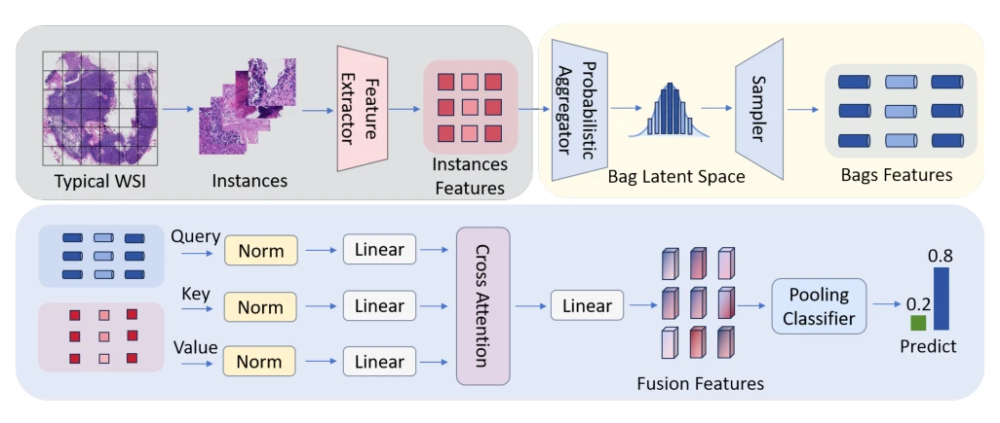
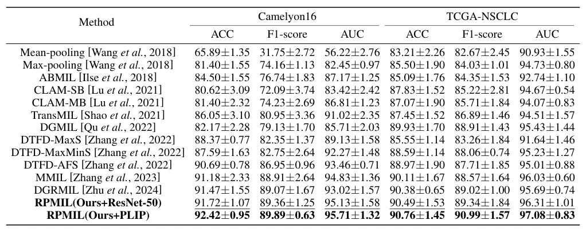

## RPMIL: Rethinking Uncertainty-Aware Probabilistic Multiple Instance Learning for Whole Slide Pathology Diagnosis

> data: CAMELYON16、TCGA-NSCLC
>
> IJCAI 2025 · [论文](https://www.ijcai.org/proceedings/2025/275)

#### 引言

用变分自编码器将实例聚合为具有均值和方差的包级分布，联合实例与包的概率表示进行预测，替代固定嵌入的点估计。

#### 方法

（1）概率编码：将实例汇总为低维随机变量而非固定切片点向量。

（2）变分训练：学习包分布的均值和方差。

（3）联合分布：把实例分布与包分布共同用于最终分类。

原文Figure 2，PDF 第 3 页。

#### 实验

##### 实验设置

比较固定嵌入聚合与概率聚合；C16 保留官方 270/129 划分，TCGA 以患者为单位组织数据。

##### 主要结果

与 DGMIL 相比，C16 的 ACC/F1/AUC 增益为 9.55/10.23/9.42 个百分点；这不是对所有基线的统一增益。

原文Table 1，PDF 第 4 页。

##### 消融与讨论

消融实例/包联合分布与概率表示，比较变分估计和单点表示。

#### 参考文献

> RPMIL: Rethinking Uncertainty-Aware Probabilistic Multiple Instance Learning for Whole Slide Pathology Diagnosis
>
> IJCAI 2025 · [论文](https://www.ijcai.org/proceedings/2025/275)
