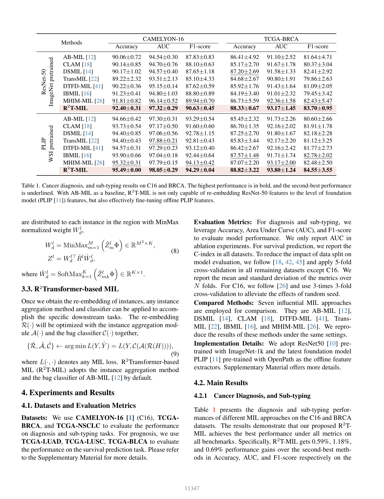
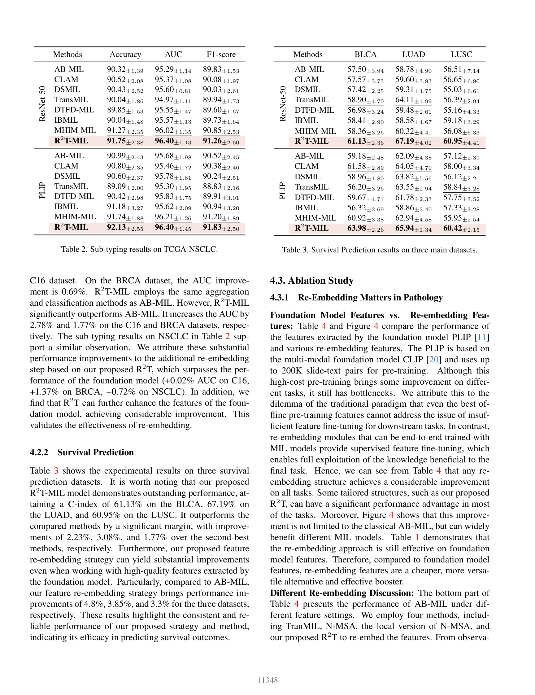
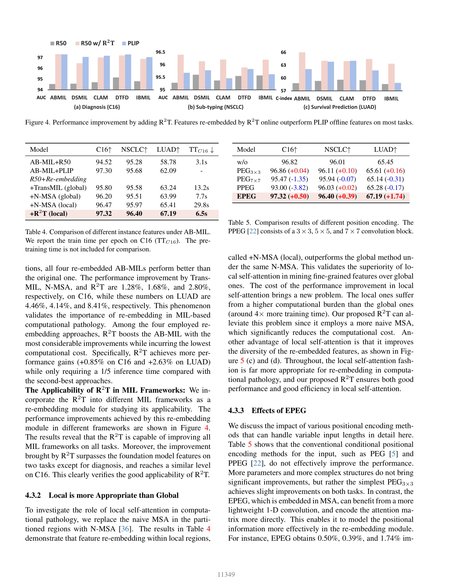
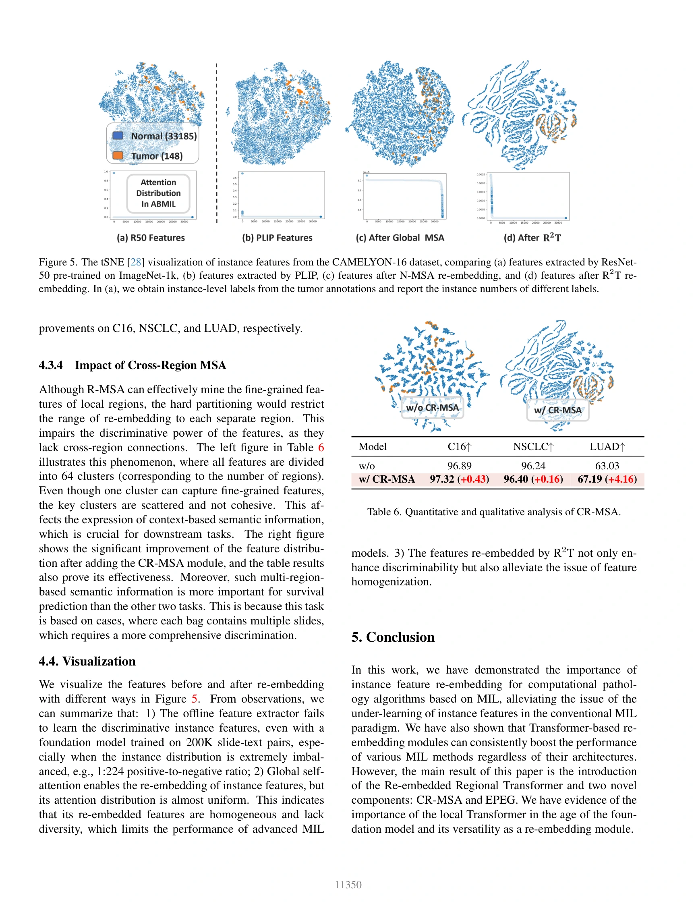

## Feature Re-Embedding: Towards Foundation Model-Level Performance in Computational Pathology

> data:
>
> **CAMELYON-16 [[1\]](javascript:void())** (C16)、**TCGA-BRCA**和**TCGA-NSCLC**
>
> **TCGA-LUAD、TCGA-LUSC 和 TCGA-BLCA**
>
> code: [Github](https://github.com/DearCaat/RRT-MIL)

#### 方法

$\begin{equation*} \hat{Y}\succ \mathcal{M}(X):=\mathcal{C}(\mathcal{A}(\mathcal{R}(\mathcal{F}(X)))), \tag{2} \end{equation*}$

创新点就是R()重新嵌入的映射函数

$\begin{align*} & \boldsymbol{ Step 1: } H \in \mathbb{R}^{I \times D} \xrightarrow{\text{Squaring }} H \in \mathbb{R}^{L^2 \times M^2 \times D}, \\ & \boldsymbol{ Step 2: } H \xrightarrow{\text{Partition }}\left\{H^l\right\}_{l=1}^{L^2}, H^l \in \mathbb{R}^{M \times M \times D},\\ & \boldsymbol{ Step 3: } \hat{Z}:=\left\{\hat{Z}^l\right\}_{l=1}^{L^2}, \hat{Z}^l=\mathcal{S}\left(H^l\right) \in \mathbb{R}^{M \times M \times D}, \tag{5} \end{align*}$

s()是EPEG

#### 结果

> 参考文献
>
> Tang, Wenhao et al. “Feature Re-Embedding: Towards Foundation Model-Level Performance in Computational Pathology.” *2024 IEEE/CVF Conference on Computer Vision and Pattern Recognition (CVPR)* (2024): 11343-11352.
<!-- wsi-archive-enrichment -->

#### 论文信息与实验补充

> data: CAMELYON16、TCGA-BRCA、TCGA-NSCLC；TCGA-LUAD/LUSC/BLCA 生存任务
>
> CVPR 2024 · [论文](https://arxiv.org/abs/2402.17228) · [作者代码](https://github.com/DearCaat/RRT-MIL)

##### 方法补充

（1）区域内重嵌入：将离线特征重新组织成区域，提炼局部关系。

（2）位置增强：通过 EPEG 等位置编码补充组织空间线索。

（3）区域间联系：再次聚合区域信息，并将更新特征交给既有 MIL 预测器。

<!-- wsi-complete-model -->
##### 模型结构图

**图 2 · 模型结构**（PDF 第 4 页）

> 原文图注：Figure 2. Overview of proposed R2T-MIL. A set of patches is first cropped from the tissue regions of a slide and embedded in features by an offline extractor. Then, the sequence is processed with the R2T module: (1) region partition, (2) feature re-embedding within each region, and (3) cross-region feature fusion. Finally, a MIL model predicts the bag labels using the re-embedded instance features.

[查看原尺寸](assest/RRT-MIL/figure-2-complete.webp)

<!-- /wsi-complete-model -->

##### 实验设置

分类用 ACC/AUC/F1，预后用 C-index；C16 使用三次三折，其余数据主要采用五折评估。

##### 主要结果补充

核心证据是在线重嵌入同时增强 ResNet50 和 PLIP 特征，而非仅更换预训练编码器；不同特征与聚合器组合见主表。

<!-- wsi-complete-results -->
##### 完整实验指标与对照

下列实验原页保留表头、全部行列、子图、误差说明和脚注，点击可查看原尺寸。比较时请对应相同的数据集、特征编码器和训练设置；`±`、置信区间、百分比和小数均保留原文的单位与统计口径。

| 原表/图中指标 | 读取方式 |
| --- | --- |
| ROC-AUC / AUROC | 越高越好；若原表明确为 PR-AUC，则按 PR 曲线面积读取 |
| ACC / Accuracy | 越高越好；平衡准确率、平均准确率以原表标注为准 |
| F1 | 越高越好；保留 macro / weighted / micro 等平均方式 |
| C-index | 越高越好；用于生存预测，需保留终点及删失设置 |
| 时间 / FLOPs / 参数量 | 结合硬件、包长度和计时范围比较；小模型不一定推理更快 |

| 原文页 | 阅读内容 | 图表及正文引用 |
| --- | --- | --- |
| PDF 第 5 页 | 实验结果 | Table 1 |
| PDF 第 6 页 | 实验结果 | Table 2、Table 3 |
| PDF 第 7 页 | 实验结果 | Figure 4、Table 4、Table 5 |
| PDF 第 8 页 | 实验结果 | Table 6 |

**实验原页 · PDF 第 5 页**（图表及正文引用：Table 1）

[查看原尺寸](assest/RRT-MIL/experiment-page-05.webp)

**实验原页 · PDF 第 6 页**（图表及正文引用：Table 2、Table 3）

[查看原尺寸](assest/RRT-MIL/experiment-page-06.webp)

**实验原页 · PDF 第 7 页**（图表及正文引用：Figure 4、Table 4、Table 5）

[查看原尺寸](assest/RRT-MIL/experiment-page-07.webp)

**实验原页 · PDF 第 8 页**（图表及正文引用：Table 6）

[查看原尺寸](assest/RRT-MIL/experiment-page-08.webp)

<!-- /wsi-complete-results -->

##### 消融与讨论

比较区域关系、位置编码和重嵌入模块，并报告训练开销；预训练成本未包含在部分时间比较中。
