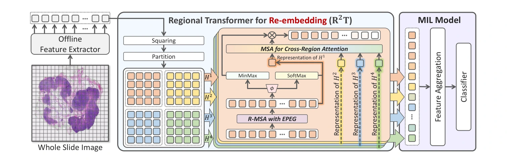

## Feature Re-Embedding: Towards Foundation Model-Level Performance in Computational Pathology

> data: CAMELYON16、TCGA-BRCA、TCGA-NSCLC；TCGA-LUAD/LUSC/BLCA 生存任务
>
> CVPR 2024 · [论文](https://arxiv.org/abs/2402.17228) · [作者代码](https://github.com/DearCaat/RRT-MIL)

#### 引言

R²T-MIL 在固定 patch 编码器和现有 MIL 聚合器之间插入一个重嵌入模块。它让下游任务直接调整实例表示，弥补离线特征缺少切片上下文的问题。

#### 方法

整体预测可写为 $\hat{Y}=\mathcal C(\mathcal A(\mathcal R(\mathcal F(X))))$。其中 $\mathcal R$ 表示区域重嵌入，插在编码与聚合之间。区域内注意力使用 EPEG 增强位置关系，随后交换区域间信息。

##### 模型结构图

图 2（PDF 第 4 页）

#### 实验

##### 实验设置

分类用 ACC/AUC/F1，预后用 C-index；C16 使用三次三折，其余数据主要采用五折评估。

##### 关键指标 { #key-results }

| 设置 | CAMELYON16 AUC（%） | NSCLC AUC（%） | LUAD C-index（%） |
| --- | --- | --- | --- |
| 原特征 | 94.52 | 95.28 | 58.78 |
| 加 R²T | 97.32 | 96.40 | 67.19 |

数据来源为原文表 4，PDF 第 7 页，同一 AB-MIL 聚合器，ResNet50 特征。

##### 结果解读

固定编码器和 AB-MIL 后，R²T 在分类和预后上都有提升。表中比较的是重嵌入模块，另有不同聚合器和 PLIP 特征的对照。

##### 消融与讨论

比较区域关系、位置编码和重嵌入模块，并报告训练开销；预训练成本未包含在部分时间比较中。
