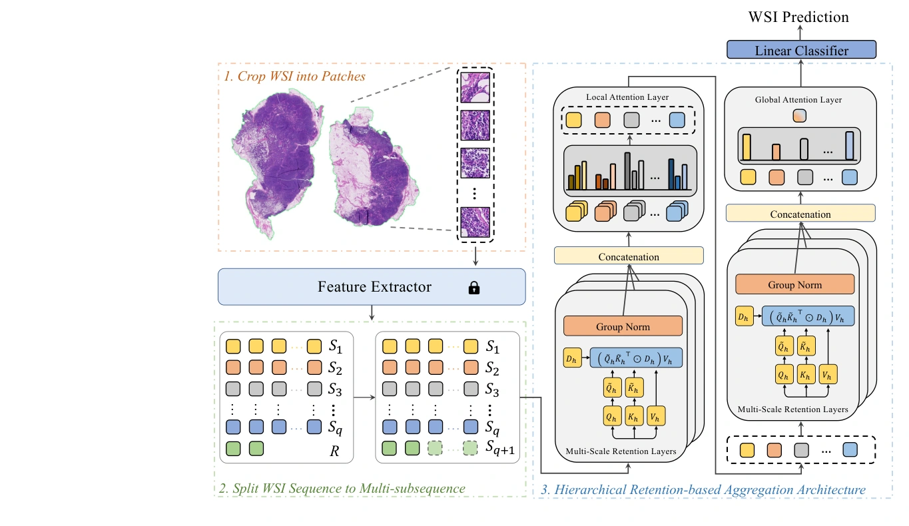

## RetMIL: Retentive Multiple Instance Learning for Histopathological Whole Slide Image Classification

> data: CAMELYON16→CAMELYON17、BRACS、TCGA/内部 LUNG
>
> MICCAI 2024 · [论文](https://arxiv.org/abs/2403.10858)

#### 引言

以分层结构处理切片：局部子序列通过并行 retention 更新，全局序列通过串行 retention 融合，再用注意力池化获得切片表示。

#### 方法

（1）局部 retention：先把长序列拆成子序列，进行并行线性更新。

（2）子序列聚合：用注意力形成各局部片段表示。

（3）全局 retention：串行整合子序列，再以全局池化输出 WSI 预测。

##### 模型结构图

图 1（PDF 第 3 页）

#### 实验

##### 实验设置

CAMELYON16 做四折并外测 CAMELYON17；BRACS 保留官方 395/65/87 划分，重复四组初始化。

##### 关键指标 { #key-results }

| F1（%） | 平衡 ACC（%） |
| --- | --- |
| 87.24 ± 4.22 | 87.53 ± 3.92 |

数据来源为原文表 1，PDF 第 6 页，CAMELYON16 → CAMELYON17。

##### 结果解读

相对次优基线，CAMELYON 的 F1/平衡 ACC 增益为 3.18/3.43 个百分点；同时报告长序列推理开销。

##### 消融与讨论

比较局部/全局 retention 和不同序列长度；内部 LUNG 外测与公开数据划分分别记录。

#### 参考文献

> RetMIL: Retentive Multiple Instance Learning for Histopathological Whole Slide Image Classification
>
> MICCAI 2024 · [论文](https://arxiv.org/abs/2403.10858)
