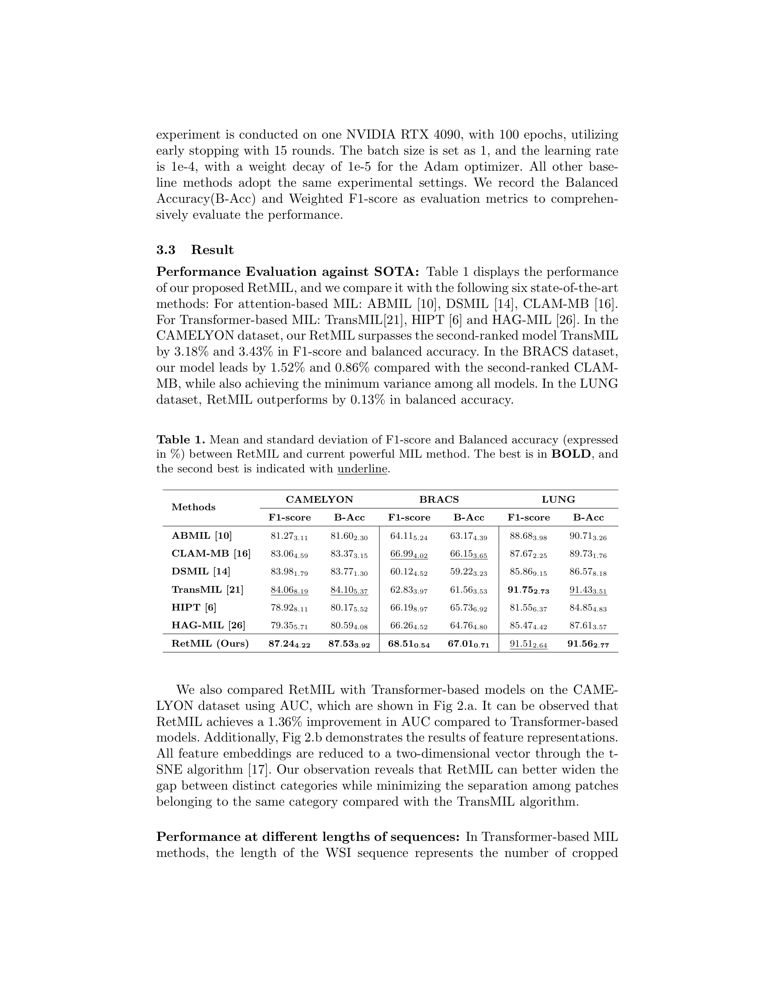
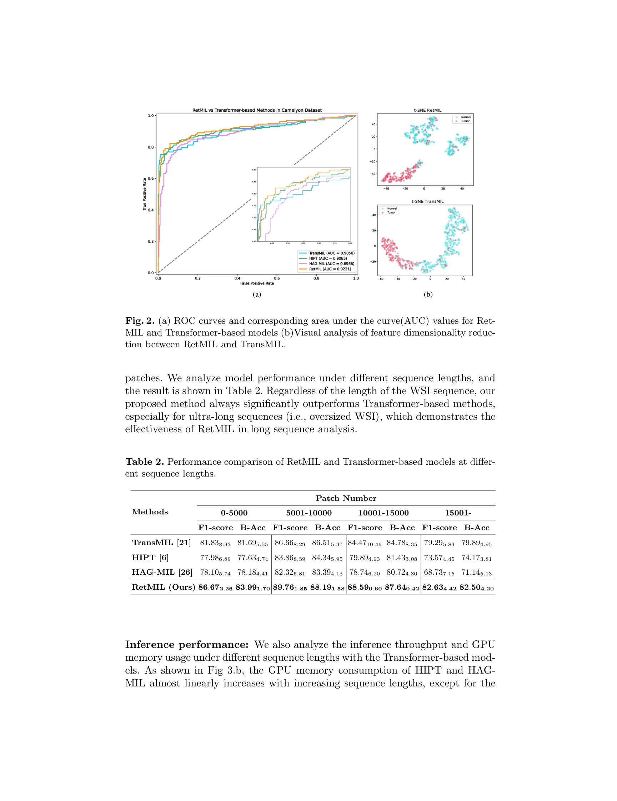

## RetMIL: Retentive Multiple Instance Learning for Histopathological Whole Slide Image Classification

> data: CAMELYON16→CAMELYON17、BRACS、TCGA/内部 LUNG
>
> MICCAI 2024 · [论文](https://arxiv.org/abs/2403.10858)

#### 引言

以分层结构处理切片：局部子序列通过并行 retention 更新，全局序列通过串行 retention 融合，再用注意力池化获得切片表示。

#### 方法

（1）局部 retention：先把长序列拆成子序列，进行并行线性更新。

（2）子序列聚合：用注意力形成各局部片段表示。

（3）全局 retention：串行整合子序列，再以全局池化输出 WSI 预测。

<!-- wsi-complete-model -->
##### 模型结构图

**图 1 · 模型结构**（PDF 第 3 页）

> 原文图注：Fig. 1. Overall framework of RetMIL

[查看原尺寸](assest/RetMIL/figure-1-complete.webp)

<!-- /wsi-complete-model -->

#### 实验

##### 实验设置

CAMELYON16 做四折并外测 CAMELYON17；BRACS 保留官方 395/65/87 划分，重复四组初始化。

##### 主要结果

相对次优基线，CAMELYON 的 F1/平衡 ACC 增益为 3.18/3.43 个百分点；同时报告长序列推理开销。

<!-- wsi-complete-results -->
##### 完整实验指标与对照

下列实验原页保留表头、全部行列、子图、误差说明和脚注，点击可查看原尺寸。比较时请对应相同的数据集、特征编码器和训练设置；`±`、置信区间、百分比和小数均保留原文的单位与统计口径。

| 原表/图中指标 | 读取方式 |
| --- | --- |
| ROC-AUC / AUROC | 越高越好；若原表明确为 PR-AUC，则按 PR 曲线面积读取 |
| ACC / Accuracy | 越高越好；平衡准确率、平均准确率以原表标注为准 |
| F1 | 越高越好；保留 macro / weighted / micro 等平均方式 |

| 原文页 | 阅读内容 | 图表及正文引用 |
| --- | --- | --- |
| PDF 第 6 页 | 实验结果 | Table 1 |
| PDF 第 7 页 | 实验结果 | Figure 2、Table 2 |

**实验原页 · PDF 第 6 页**（图表及正文引用：Table 1）

[查看原尺寸](assest/RetMIL/experiment-page-06.webp)

**实验原页 · PDF 第 7 页**（图表及正文引用：Figure 2、Table 2）

[查看原尺寸](assest/RetMIL/experiment-page-07.webp)

<!-- /wsi-complete-results -->

##### 消融与讨论

比较局部/全局 retention 和不同序列长度；内部 LUNG 外测与公开数据划分分别记录。

#### 参考文献

> RetMIL: Retentive Multiple Instance Learning for Histopathological Whole Slide Image Classification
>
> MICCAI 2024 · [论文](https://arxiv.org/abs/2403.10858)
