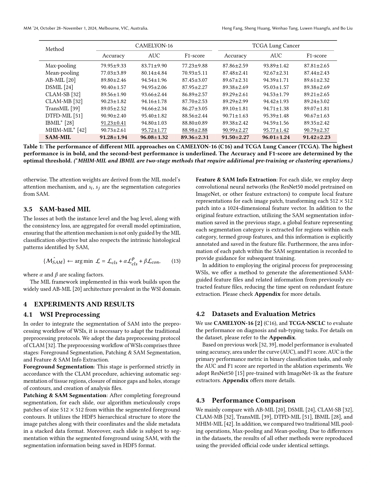
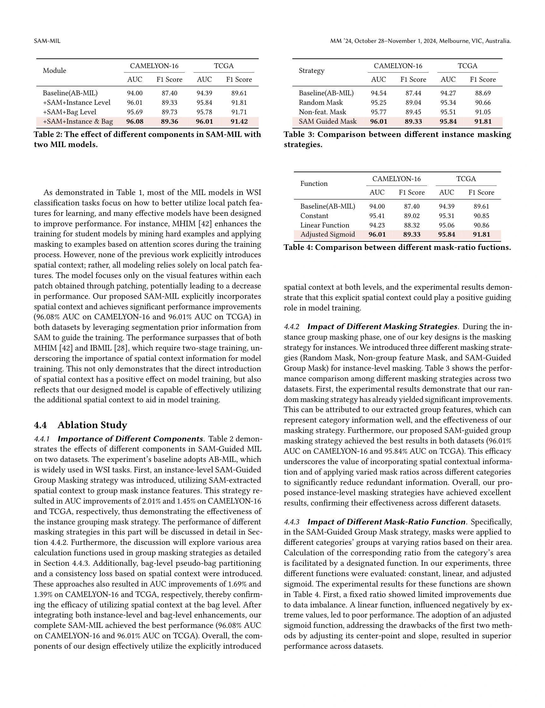
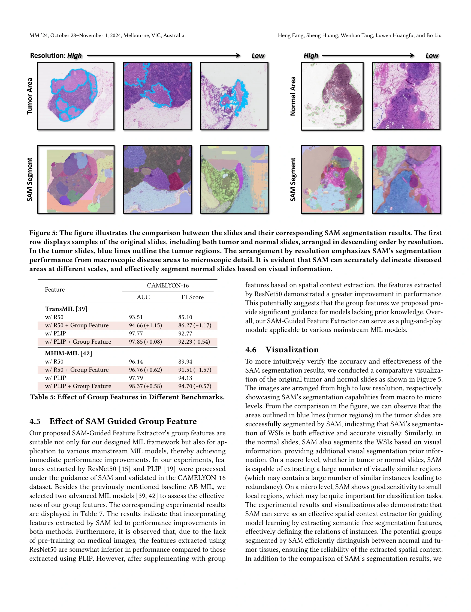
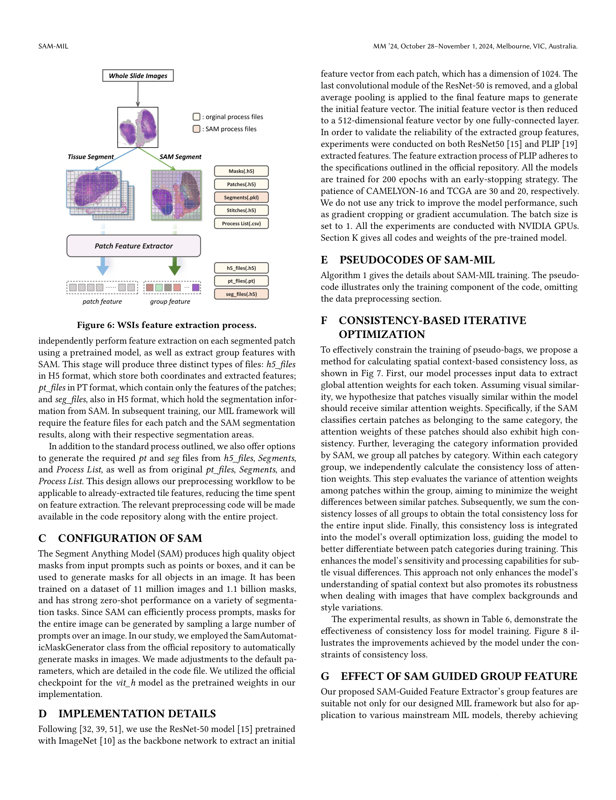
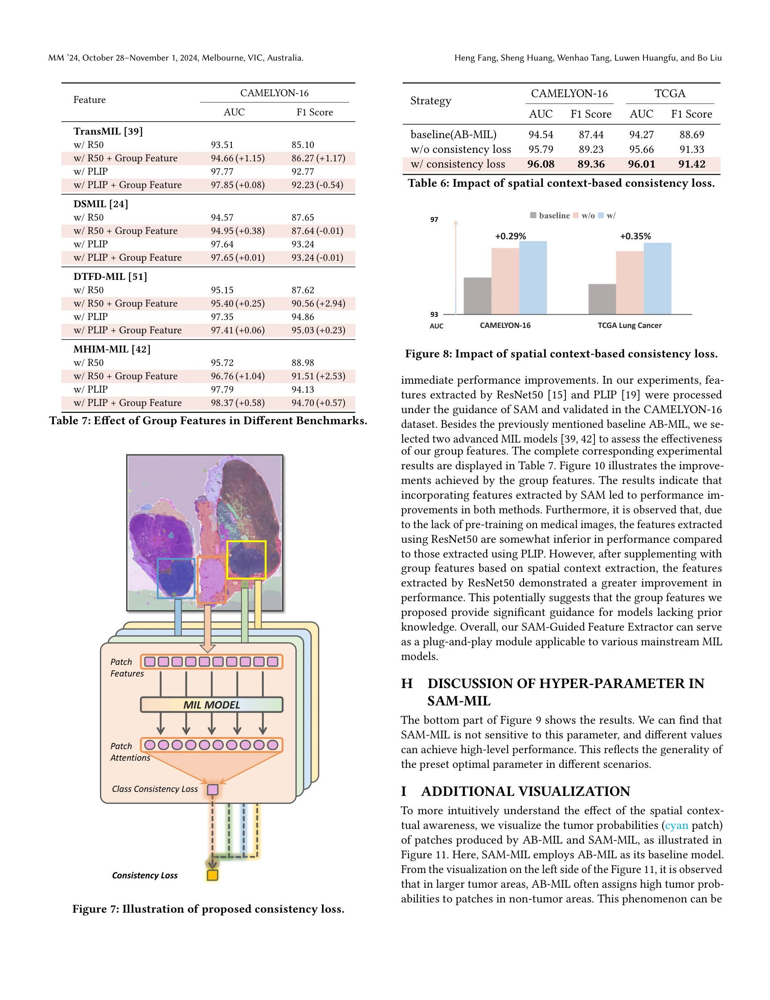

## SAM-MIL: A Spatial Contextual Aware Multiple Instance Learning Approach for Whole Slide Image Classification

> data: CAMELYON16、TCGA Lung Cancer
>
> ACM MM 2024（收藏 PDF 为预印本） · [论文](https://arxiv.org/abs/2407.17689) · [作者代码](https://github.com/FangHeng/SAM-MIL)

#### 引言

用 Segment Anything 提取组织分组和空间上下文，再结合分组掩码、伪包增强及空间一致性约束，补充独立 patch 特征缺失的结构信息。

#### 方法

（1）空间分组：以 SAM 分割得到组织区域，补充独立 patch 的全局结构信息。

（2）分组掩码：按不同分割类别调整遮蔽比例，并保留代表性分组特征。

（3）伪包一致性：分割实例为额外训练包，约束不同伪包的空间上下文一致。

<!-- wsi-complete-model -->
##### 模型结构图

**图 2 · 模型结构**（PDF 第 4 页）

> 原文图注：Figure 2: Overview of the proposed SAM-Guided WSI classification model. In the Feature Extractor stage, WSI slides are segmented into corresponding tissues. Following the patching operation, each tissue sequentially extracts features from each patch. Simultaneously, SAM performs segmentation on the entire slide, extracting representative features from each region as group features based on spatial context. In the Feature Aggregation stage, the spatial context of SAM is utilized at two levels. At the Instance level, instance grouping masks are applied under the guidance of SAM, while at the Bag level, pseudo-bag training loss and consistency loss are calculated under SAM’s guidance to constrain the model’s training. This approach ensures that both detailed instance-level features and the broader bag-level insights contribute to the model’s learning process.

[查看原尺寸](assest/SAM-MIL/figure-2-complete.webp)

<!-- /wsi-complete-model -->

#### 实验

##### 实验设置

在相同任务下比较主流 MIL，并分别启用空间分组、分组掩码和伪包一致性。

##### 主要结果

论文报告两个数据集 AUC 为 96.08% 和 96.01%；主要证据是空间上下文加入后的增益。

<!-- wsi-complete-results -->
##### 完整实验指标与对照

下列实验原页保留表头、全部行列、子图、误差说明和脚注，点击可查看原尺寸。比较时请对应相同的数据集、特征编码器和训练设置；`±`、置信区间、百分比和小数均保留原文的单位与统计口径。

| 原表/图中指标 | 读取方式 |
| --- | --- |
| ROC-AUC / AUROC | 越高越好；若原表明确为 PR-AUC，则按 PR 曲线面积读取 |
| ACC / Accuracy | 越高越好；平衡准确率、平均准确率以原表标注为准 |
| F1 | 越高越好；保留 macro / weighted / micro 等平均方式 |

| 原文页 | 阅读内容 | 图表及正文引用 |
| --- | --- | --- |
| PDF 第 6 页 | 实验结果 | Table 1 |
| PDF 第 7 页 | 实验结果 | Table 2、Table 3、Table 4 |
| PDF 第 8 页 | 实验结果 | Figure 5、Table 5 |
| PDF 第 11 页 | 实验结果 | Figure 6 |
| PDF 第 12 页 | 消融与参数分析 | Table 7、Table 6 |

**实验原页 · PDF 第 6 页**（图表及正文引用：Table 1）

[查看原尺寸](assest/SAM-MIL/experiment-page-06.webp)

**实验原页 · PDF 第 7 页**（图表及正文引用：Table 2、Table 3、Table 4）

[查看原尺寸](assest/SAM-MIL/experiment-page-07.webp)

**实验原页 · PDF 第 8 页**（图表及正文引用：Figure 5、Table 5）

[查看原尺寸](assest/SAM-MIL/experiment-page-08.webp)

**实验原页 · PDF 第 11 页**（图表及正文引用：Figure 6）

[查看原尺寸](assest/SAM-MIL/experiment-page-11.webp)

展开消融、参数、数据设置及效率原页

**实验原页 · PDF 第 12 页**（图表及正文引用：Table 7、Table 6）

[查看原尺寸](assest/SAM-MIL/experiment-page-12.webp)

<!-- /wsi-complete-results -->

##### 消融与讨论

用组件消融区分 SAM 上下文、掩码与伪包学习的贡献，避免把全部提升归于分割基础模型本身。

#### 参考文献

> SAM-MIL: A Spatial Contextual Aware Multiple Instance Learning Approach for Whole Slide Image Classification
>
> ACM MM 2024（收藏 PDF 为预印本） · [论文](https://arxiv.org/abs/2407.17689) · [作者代码](https://github.com/FangHeng/SAM-MIL)
