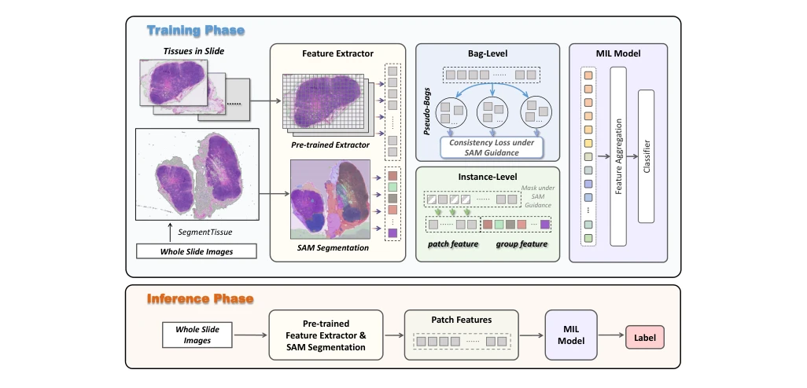

## SAM-MIL: A Spatial Contextual Aware Multiple Instance Learning Approach for Whole Slide Image Classification

> data: CAMELYON16、TCGA Lung Cancer
>
> ACM MM 2024（收藏 PDF 为预印本） · [论文](https://arxiv.org/abs/2407.17689) · [作者代码](https://github.com/FangHeng/SAM-MIL)

#### 引言

用 Segment Anything 提取组织分组和空间上下文，再结合分组掩码、伪包增强及空间一致性约束，补充独立 patch 特征缺失的结构信息。

#### 方法

（1）空间分组：以 SAM 分割得到组织区域，补充独立 patch 的全局结构信息。

（2）分组掩码：按不同分割类别调整遮蔽比例，并保留代表性分组特征。

（3）伪包一致性：分割实例为额外训练包，约束不同伪包的空间上下文一致。

原文Figure 2，PDF 第 4 页。

#### 实验

##### 实验设置

在相同任务下比较主流 MIL，并分别启用空间分组、分组掩码和伪包一致性。

##### 主要结果

论文报告两个数据集 AUC 为 96.08% 和 96.01%；主要证据是空间上下文加入后的增益。

##### 消融与讨论

用组件消融区分 SAM 上下文、掩码与伪包学习的贡献，避免把全部提升归于分割基础模型本身。

#### 参考文献

> SAM-MIL: A Spatial Contextual Aware Multiple Instance Learning Approach for Whole Slide Image Classification
>
> ACM MM 2024（收藏 PDF 为预印本） · [论文](https://arxiv.org/abs/2407.17689) · [作者代码](https://github.com/FangHeng/SAM-MIL)
