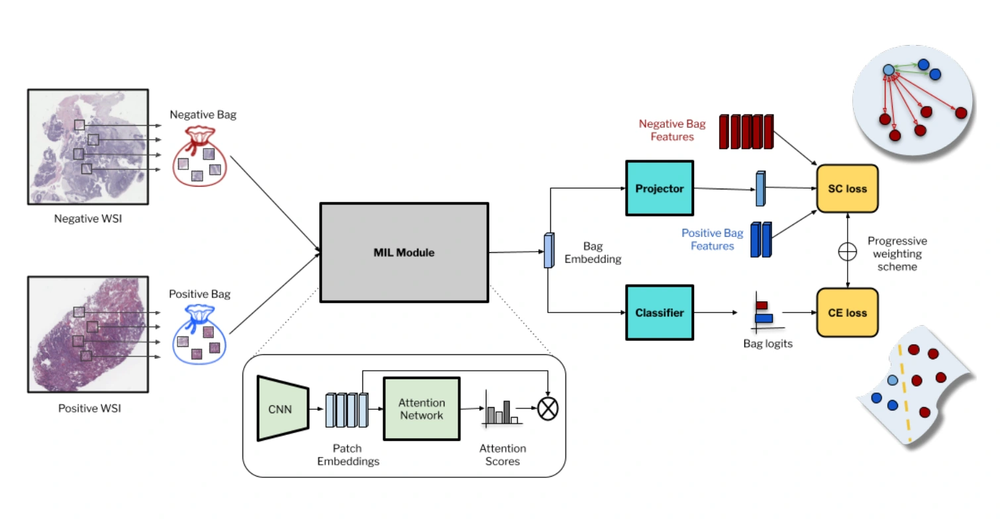
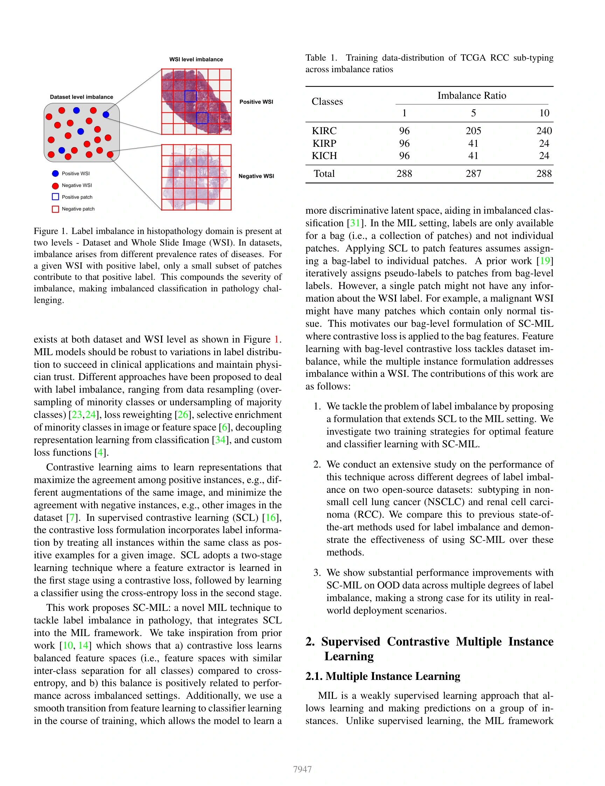
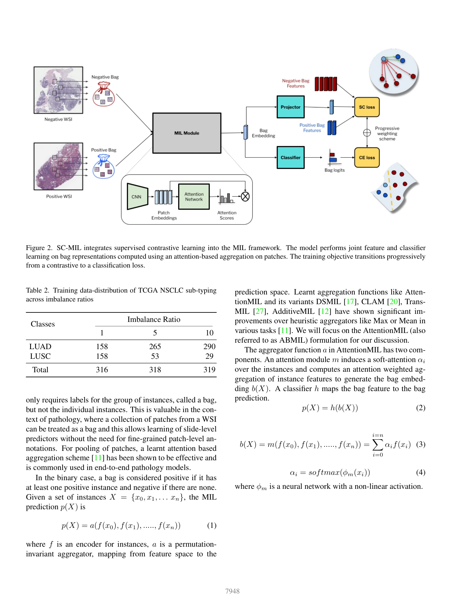
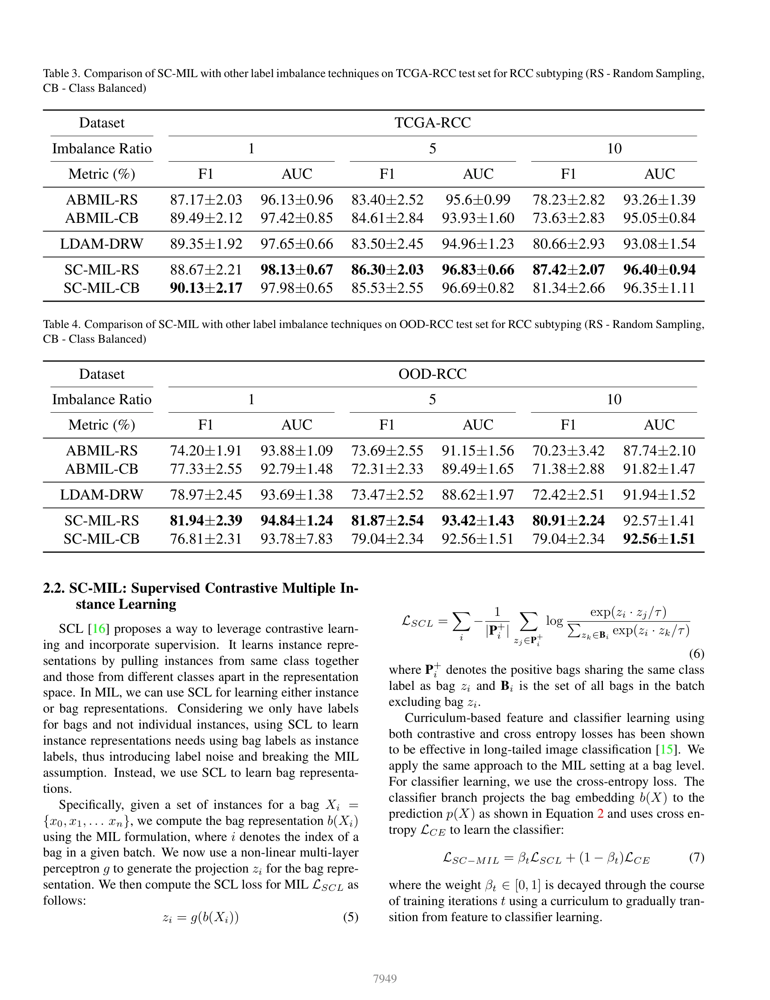
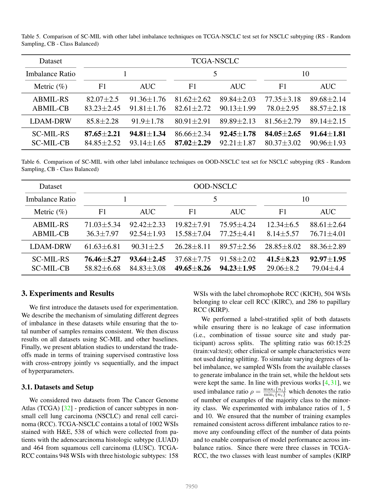
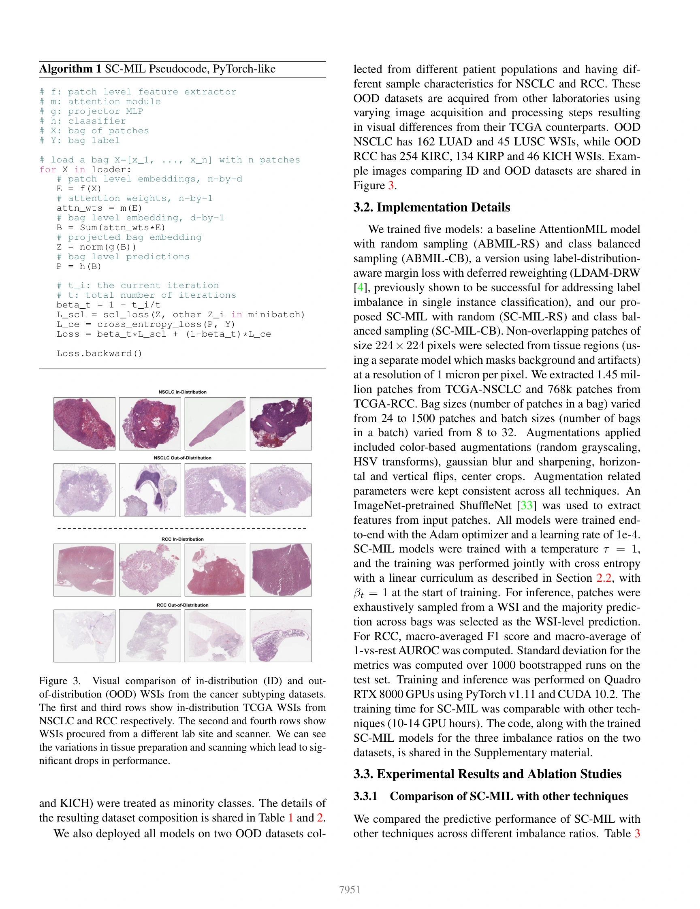
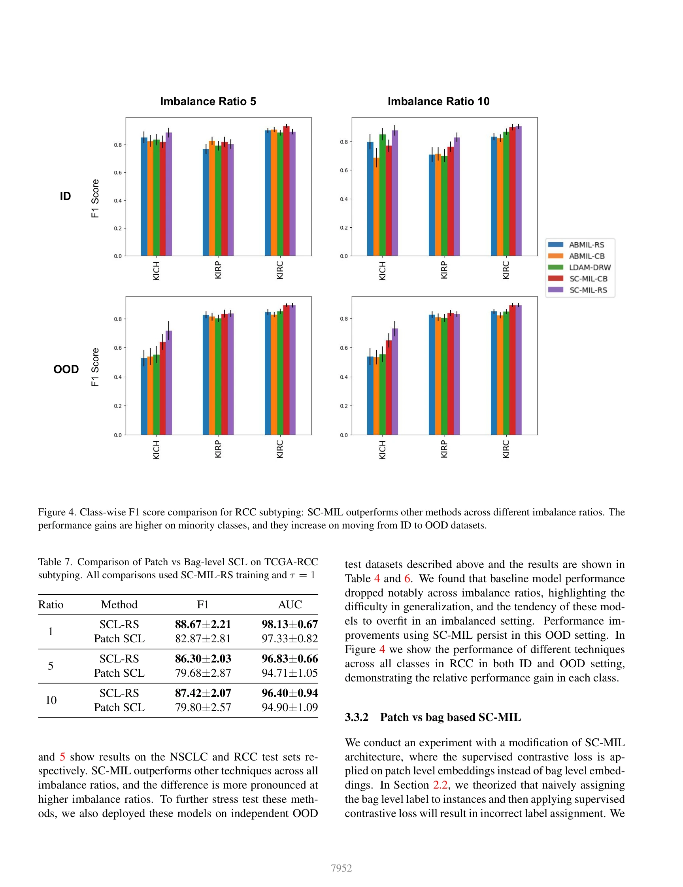
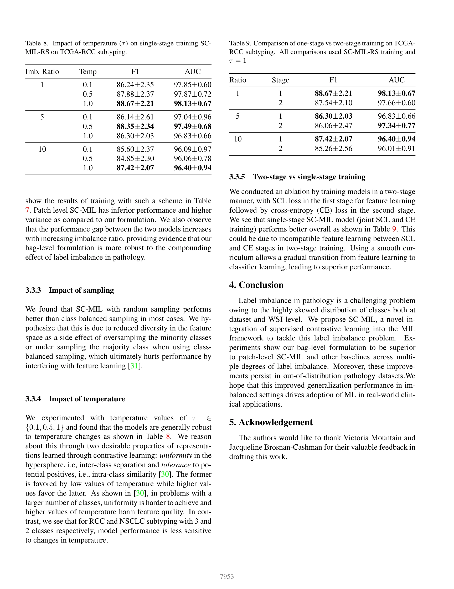

## SC-MIL: Supervised Contrastive Multiple Instance Learning for Imbalanced Classification in Pathology

> data: TCGA-NSCLC、TCGA-RCC，及域外来源的同类亚型数据
>
> WACV 2024 · [论文](https://openaccess.thecvf.com/content/WACV2024/html/Juyal_SC-MIL_Supervised_Contrastive_Multiple_Instance_Learning_for_Imbalanced_Classification_in_WACV_2024_paper.html)

#### 引言

将监督式对比学习应用于包表示，并逐步从表征学习转向分类器学习，处理数据集类别不平衡及阳性切片中病灶稀少的问题。

#### 方法

（1）包级对比：在切片嵌入之间应用监督对比损失，避免给所有 patch 赋同一标签。

（2）分类学习：以交叉熵学习最终决策边界。

（3）平滑过渡：训练中逐步调整两类目标的侧重，处理标签不平衡。

<!-- wsi-complete-model -->
##### 模型结构图

**图 2 · 模型结构**（PDF 第 3 页）

> 原文图注：Figure 2. SC-MIL integrates supervised contrastive learning into the MIL framework. The model performs joint feature and classifier learning on bag representations computed using an attention-based aggregation on patches. The training objective transitions progressively from a contrastive to a classification loss.

[查看原尺寸](assest/SC-MIL/figure-2-complete.webp)

<!-- /wsi-complete-model -->

#### 实验

##### 实验设置

按病例隔离划分 60:15:25；只调整训练集不平衡比例，固定验证/测试集。

##### 主要结果

核心证据是在多种不平衡程度和域外数据上比较稳定收益，而不是只在平衡训练集比较平均 AUC。

<!-- wsi-complete-results -->
##### 完整实验指标与对照

下列实验原页保留表头、全部行列、子图、误差说明和脚注，点击可查看原尺寸。比较时请对应相同的数据集、特征编码器和训练设置；`±`、置信区间、百分比和小数均保留原文的单位与统计口径。

| 原表/图中指标 | 读取方式 |
| --- | --- |
| ROC-AUC / AUROC | 越高越好；若原表明确为 PR-AUC，则按 PR 曲线面积读取 |
| F1 | 越高越好；保留 macro / weighted / micro 等平均方式 |

| 原文页 | 阅读内容 | 图表及正文引用 |
| --- | --- | --- |
| PDF 第 2 页 | 实验结果 | Table 1 |
| PDF 第 3 页 | 实验结果 | Table 2 |
| PDF 第 4 页 | 实验结果 | Table 3、Table 4 |
| PDF 第 5 页 | 实验结果 | Table 5、Table 6 |
| PDF 第 6 页 | 实验结果 | Figure 3 |
| PDF 第 7 页 | 实验结果 | Figure 4、Table 7 |
| PDF 第 8 页 | 实验结果 | Table 8、Table 9 |

**实验原页 · PDF 第 2 页**（图表及正文引用：Table 1）

[查看原尺寸](assest/SC-MIL/experiment-page-02.webp)

**实验原页 · PDF 第 3 页**（图表及正文引用：Table 2）

[查看原尺寸](assest/SC-MIL/experiment-page-03.webp)

**实验原页 · PDF 第 4 页**（图表及正文引用：Table 3、Table 4）

[查看原尺寸](assest/SC-MIL/experiment-page-04.webp)

**实验原页 · PDF 第 5 页**（图表及正文引用：Table 5、Table 6）

[查看原尺寸](assest/SC-MIL/experiment-page-05.webp)

**实验原页 · PDF 第 6 页**（图表及正文引用：Figure 3）

[查看原尺寸](assest/SC-MIL/experiment-page-06.webp)

**实验原页 · PDF 第 7 页**（图表及正文引用：Figure 4、Table 7）

[查看原尺寸](assest/SC-MIL/experiment-page-07.webp)

**实验原页 · PDF 第 8 页**（图表及正文引用：Table 8、Table 9）

[查看原尺寸](assest/SC-MIL/experiment-page-08.webp)

<!-- /wsi-complete-results -->

##### 消融与讨论

比较对比损失与交叉熵的联合/顺序训练，并考察训练权重调度；必须防止患者跨划分泄漏。

#### 参考文献

> SC-MIL: Supervised Contrastive Multiple Instance Learning for Imbalanced Classification in Pathology
>
> WACV 2024 · [论文](https://openaccess.thecvf.com/content/WACV2024/html/Juyal_SC-MIL_Supervised_Contrastive_Multiple_Instance_Learning_for_Imbalanced_Classification_in_WACV_2024_paper.html)
