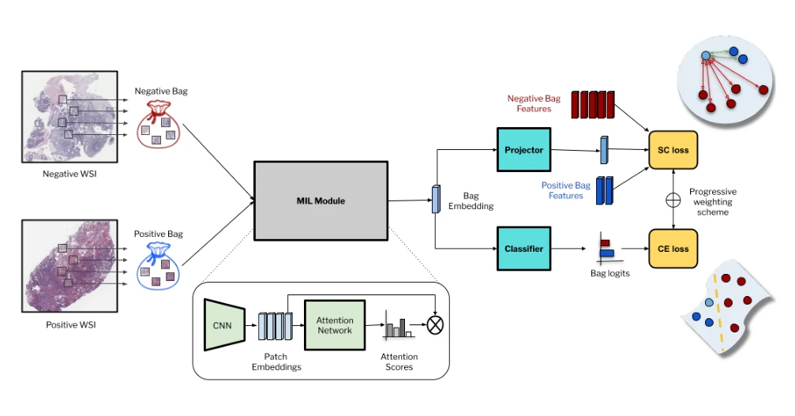
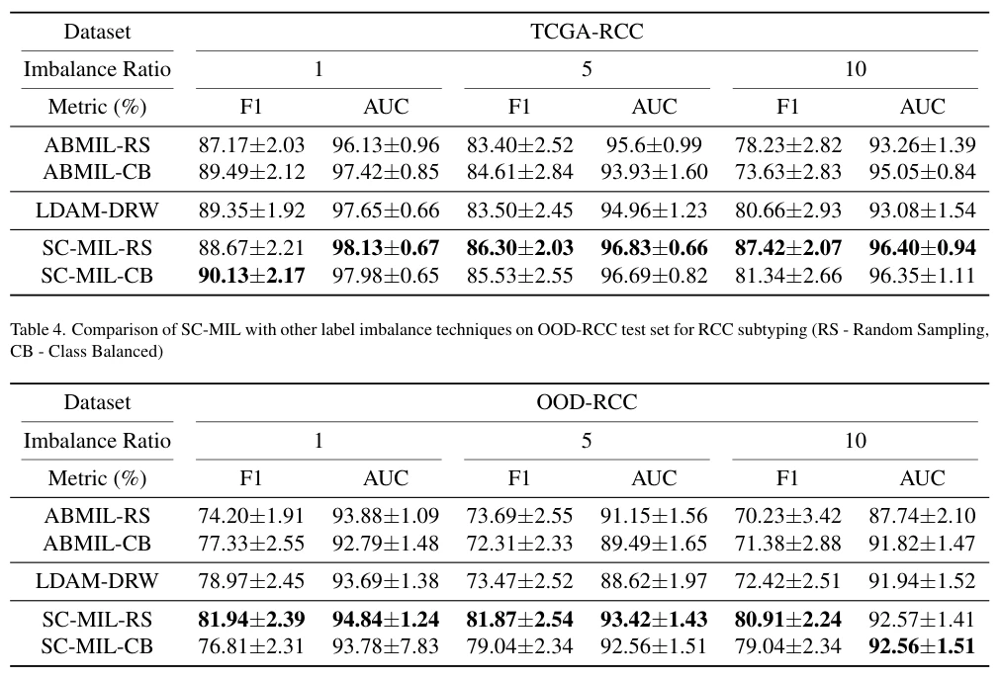

## SC-MIL: Supervised Contrastive Multiple Instance Learning for Imbalanced Classification in Pathology

> data: TCGA-NSCLC、TCGA-RCC，及域外来源的同类亚型数据
>
> WACV 2024 · [论文](https://openaccess.thecvf.com/content/WACV2024/html/Juyal_SC-MIL_Supervised_Contrastive_Multiple_Instance_Learning_for_Imbalanced_Classification_in_WACV_2024_paper.html)

#### 引言

将监督式对比学习应用于包表示，并逐步从表征学习转向分类器学习，处理数据集类别不平衡及阳性切片中病灶稀少的问题。

#### 方法

（1）包级对比：在切片嵌入之间应用监督对比损失，避免给所有 patch 赋同一标签。

（2）分类学习：以交叉熵学习最终决策边界。

（3）平滑过渡：训练中逐步调整两类目标的侧重，处理标签不平衡。

原文Figure 2，PDF 第 3 页。

#### 实验

##### 实验设置

按病例隔离划分 60:15:25；只调整训练集不平衡比例，固定验证/测试集。

##### 主要结果

核心证据是在多种不平衡程度和域外数据上比较稳定收益，而不是只在平衡训练集比较平均 AUC。

原文Table 3，PDF 第 4 页。

##### 消融与讨论

比较对比损失与交叉熵的联合/顺序训练，并考察训练权重调度；必须防止患者跨划分泄漏。

#### 参考文献

> SC-MIL: Supervised Contrastive Multiple Instance Learning for Imbalanced Classification in Pathology
>
> WACV 2024 · [论文](https://openaccess.thecvf.com/content/WACV2024/html/Juyal_SC-MIL_Supervised_Contrastive_Multiple_Instance_Learning_for_Imbalanced_Classification_in_WACV_2024_paper.html)
