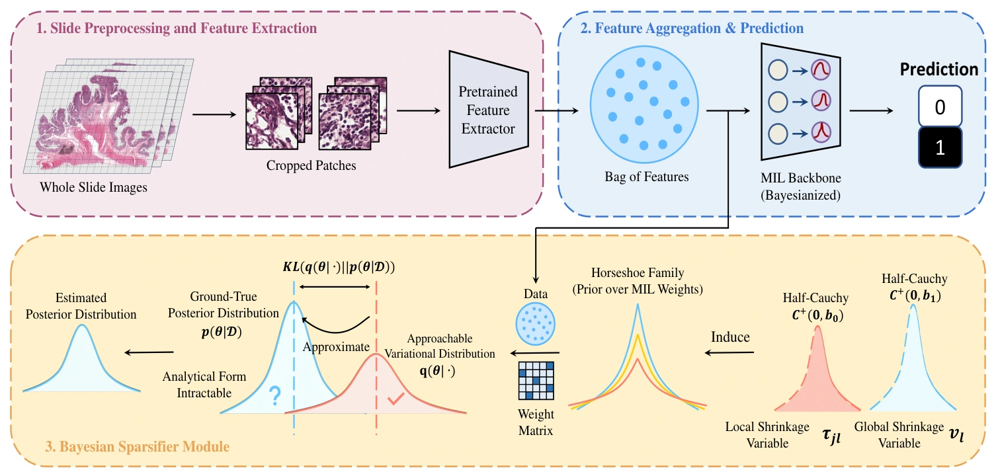
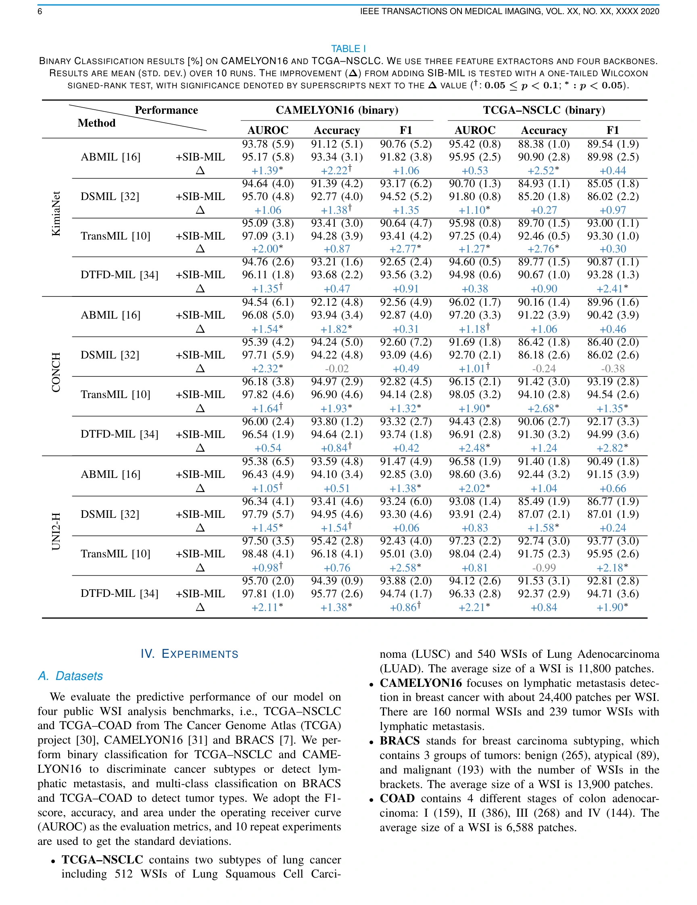
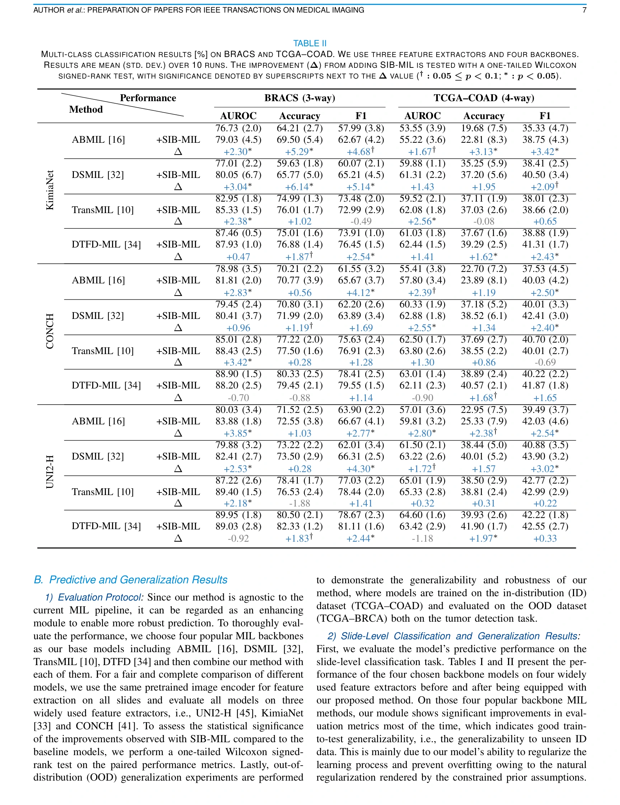
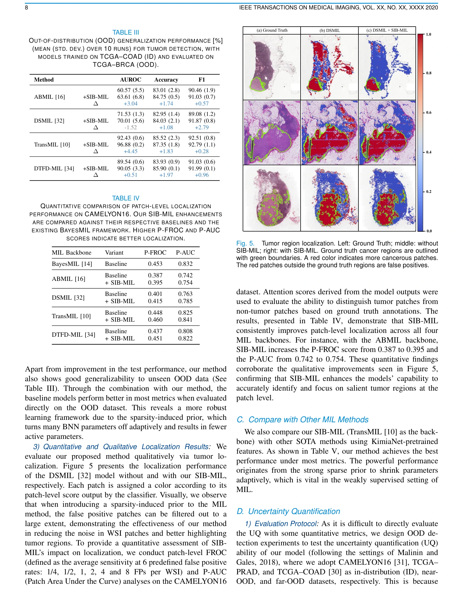
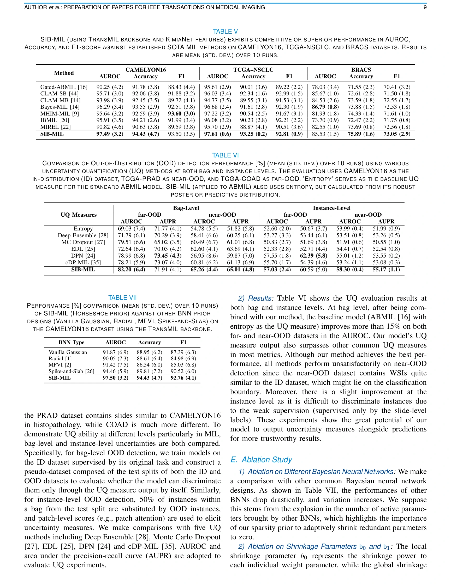
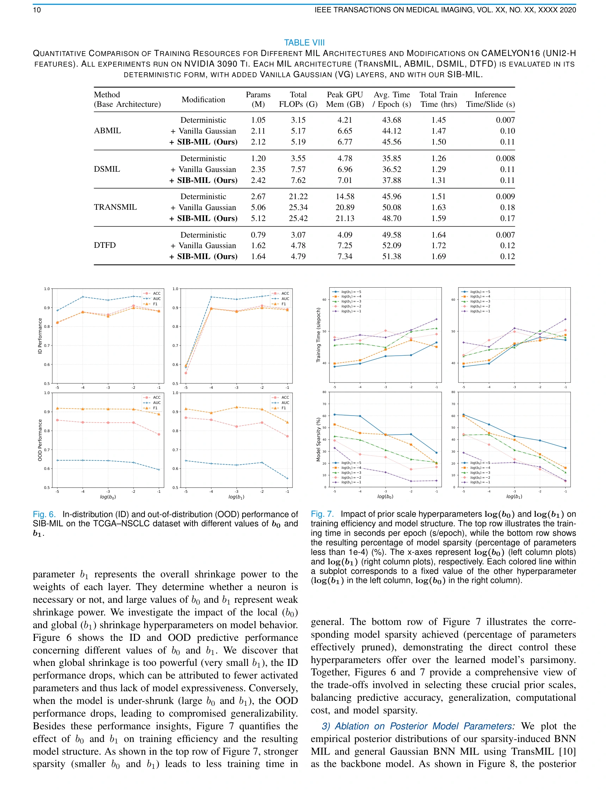
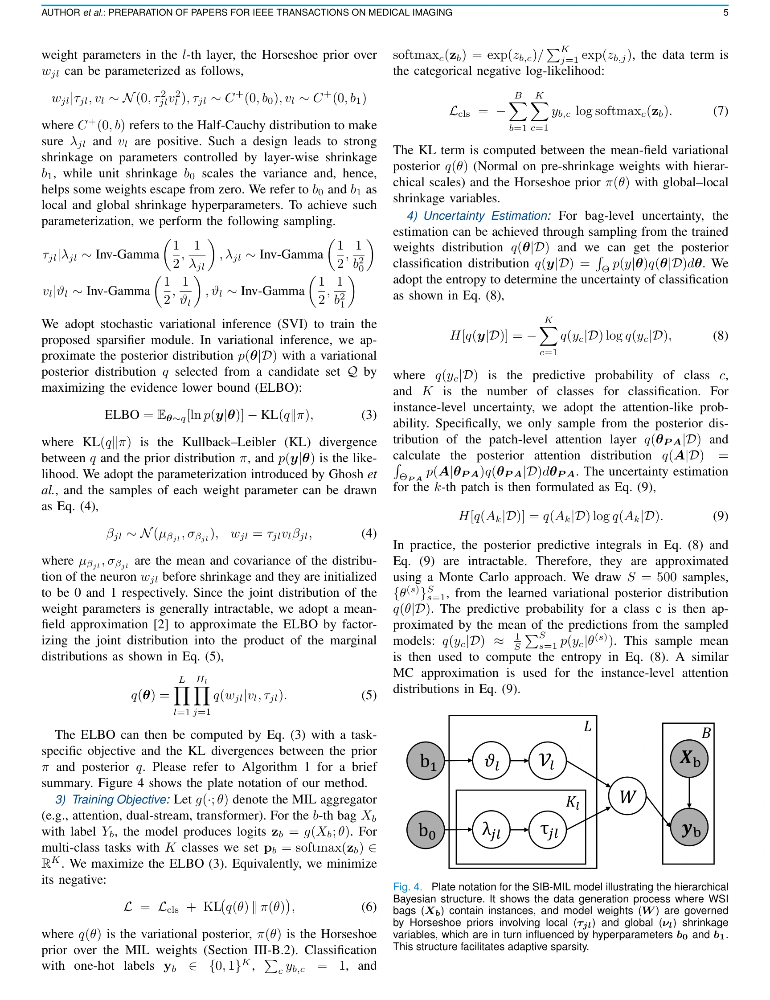
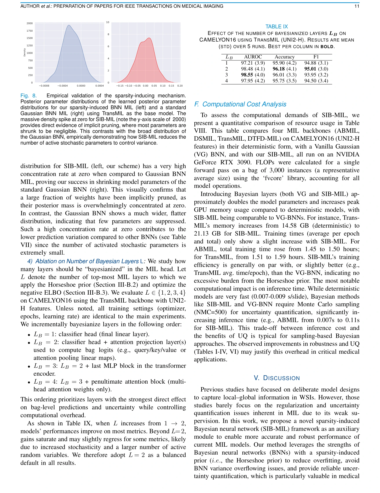

## SIB-MIL: Sparsity-Induced Bayesian Neural Network for Robust Multiple Instance Learning on Whole Slide Image Analysis

> data: CAMELYON16、TCGA-NSCLC、BRACS、TCGA-COAD；COAD→BRCA 域外验证
>
> IEEE Transactions on Medical Imaging 2026 · [论文](https://doi.org/10.1109/TMI.2025.3638243) · [作者代码](https://github.com/HKU-MedAI/SIB-MIL)

#### 引言

在贝叶斯 MIL 网络参数上引入 Horseshoe 稀疏先验，抑制弱监督下的噪声与预测方差，同时支持不确定性量化。

#### 方法

（1）稀疏先验：用 Horseshoe 替代常见高斯先验。

（2）贝叶斯学习：通过后验表达参数不确定性，并关闭无效参数。

（3）MIL 接入：增强多种聚合器，兼顾包分类与异常/定位分析。

<!-- wsi-complete-model -->
##### 模型结构图

**图 3 · 模型结构**（PDF 第 3 页）

> 原文图注：Fig. 3. Overview of the SIB-MIL framework. WSIs are preprocessed into patches, from which features are extracted. These features are fed into an MIL backbone whose relevant layers (e.g., linear, convolutional) are Bayesianized using the Horseshoe prior via the Bayesian Sparsifier Module. This module induces sparsity in model weights, aiming to filter noise and highlight salient features. Predictions and uncertainty estimates are obtained by sampling from the learned posterior distribution of the model parameters.

[查看原尺寸](assest/SIB-MIL/figure-3-complete.webp)

<!-- /wsi-complete-model -->

#### 实验

##### 实验设置

与四种 MIL backbone、三种特征编码器组合，主表报告十次运行的均值和标准差；另测定位与不确定性。

##### 主要结果

ABMIL 配置下，P-FROC 从 0.387 到 0.395，P-AUC 从 0.742 到 0.754；定位指标与分类 AUC 不是同一个量。

<!-- wsi-complete-results -->
##### 完整实验指标与对照

下列实验原页保留表头、全部行列、子图、误差说明和脚注，点击可查看原尺寸。比较时请对应相同的数据集、特征编码器和训练设置；`±`、置信区间、百分比和小数均保留原文的单位与统计口径。

| 原表/图中指标 | 读取方式 |
| --- | --- |
| ROC-AUC / AUROC | 越高越好；若原表明确为 PR-AUC，则按 PR 曲线面积读取 |
| ACC / Accuracy | 越高越好；平衡准确率、平均准确率以原表标注为准 |
| F1 | 越高越好；保留 macro / weighted / micro 等平均方式 |
| FROC | 越高越好；对应预设假阳性工作点下的定位敏感度 |

| 原文页 | 阅读内容 | 图表及正文引用 |
| --- | --- | --- |
| PDF 第 5 页 | 消融与参数分析 | Figure 4 |
| PDF 第 6 页 | 实验结果 | Table I |
| PDF 第 7 页 | 实验结果 | Table II |
| PDF 第 8 页 | 实验结果 | Table III、Table IV |
| PDF 第 9 页 | 实验结果 | Table V、Table VI、Table VII |
| PDF 第 10 页 | 实验结果 | Table VIII、Figure 6 |
| PDF 第 11 页 | 消融与参数分析 | Table IX |

**实验原页 · PDF 第 6 页**（图表及正文引用：Table I）

[查看原尺寸](assest/SIB-MIL/experiment-page-06.webp)

**实验原页 · PDF 第 7 页**（图表及正文引用：Table II）

[查看原尺寸](assest/SIB-MIL/experiment-page-07.webp)

**实验原页 · PDF 第 8 页**（图表及正文引用：Table III、Table IV）

[查看原尺寸](assest/SIB-MIL/experiment-page-08.webp)

**实验原页 · PDF 第 9 页**（图表及正文引用：Table V、Table VI、Table VII）

[查看原尺寸](assest/SIB-MIL/experiment-page-09.webp)

**实验原页 · PDF 第 10 页**（图表及正文引用：Table VIII、Figure 6）

[查看原尺寸](assest/SIB-MIL/experiment-page-10.webp)

展开消融、参数、数据设置及效率原页

**实验原页 · PDF 第 5 页**（图表及正文引用：Figure 4）

[查看原尺寸](assest/SIB-MIL/experiment-page-05.webp)

**实验原页 · PDF 第 11 页**（图表及正文引用：Table IX）

[查看原尺寸](assest/SIB-MIL/experiment-page-11.webp)

<!-- /wsi-complete-results -->

##### 消融与讨论

比较稀疏 Horseshoe 先验与常规高斯 BNN，并观察后验波动及活跃参数数量。

#### 参考文献

> SIB-MIL: Sparsity-Induced Bayesian Neural Network for Robust Multiple Instance Learning on Whole Slide Image Analysis
>
> IEEE Transactions on Medical Imaging 2026 · [论文](https://doi.org/10.1109/TMI.2025.3638243) · [作者代码](https://github.com/HKU-MedAI/SIB-MIL)
