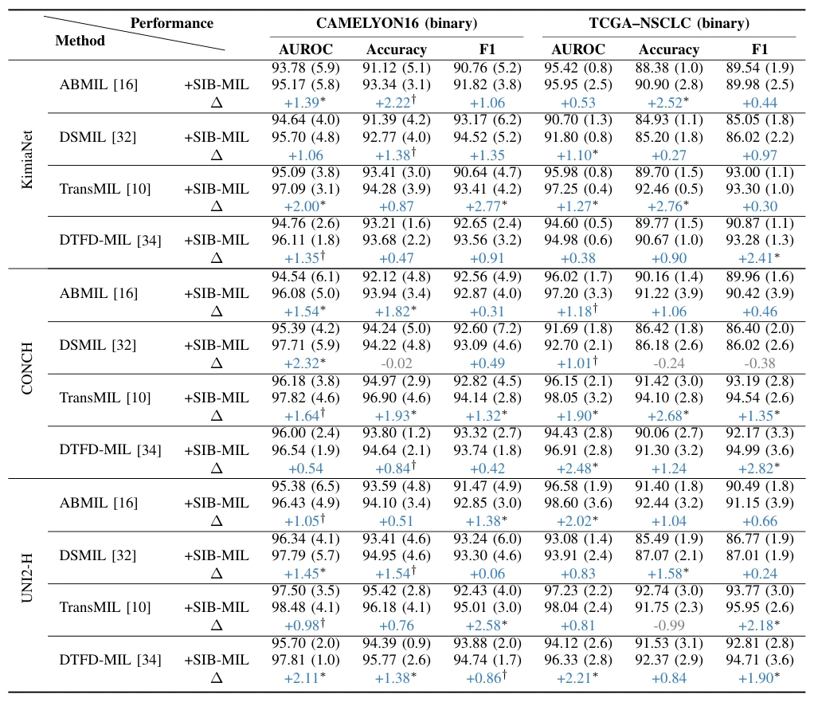

## SIB-MIL: Sparsity-Induced Bayesian Neural Network for Robust Multiple Instance Learning on Whole Slide Image Analysis

> data: CAMELYON16、TCGA-NSCLC、BRACS、TCGA-COAD；COAD→BRCA 域外验证
>
> IEEE Transactions on Medical Imaging 2026 · [论文](https://doi.org/10.1109/TMI.2025.3638243) · [作者代码](https://github.com/HKU-MedAI/SIB-MIL)

#### 引言

在贝叶斯 MIL 网络参数上引入 Horseshoe 稀疏先验，抑制弱监督下的噪声与预测方差，同时支持不确定性量化。

#### 方法

（1）稀疏先验：用 Horseshoe 替代常见高斯先验。

（2）贝叶斯学习：通过后验表达参数不确定性，并关闭无效参数。

（3）MIL 接入：增强多种聚合器，兼顾包分类与异常/定位分析。

#### 实验

##### 实验设置

与四种 MIL backbone、三种特征编码器组合，主表报告十次运行的均值和标准差；另测定位与不确定性。

##### 主要结果

ABMIL 配置下，P-FROC 从 0.387 到 0.395，P-AUC 从 0.742 到 0.754；定位指标与分类 AUC 不是同一个量。

原文TABLE I，PDF 第 6 页。

##### 消融与讨论

比较稀疏 Horseshoe 先验与常规高斯 BNN，并观察后验波动及活跃参数数量。

#### 参考文献

> SIB-MIL: Sparsity-Induced Bayesian Neural Network for Robust Multiple Instance Learning on Whole Slide Image Analysis
>
> IEEE Transactions on Medical Imaging 2026 · [论文](https://doi.org/10.1109/TMI.2025.3638243) · [作者代码](https://github.com/HKU-MedAI/SIB-MIL)
