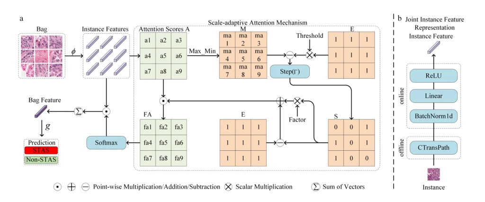

## SMILE: A Scale-aware Multiple Instance Learning Method for Multicenter STAS Lung Cancer Histopathology Diagnosis

> data: STAS-CSU、STAS-TCGA、STAS-CPTAC
>
> IJCAI 2025（PDF 与作者项目） · [论文](https://www.ijcai.org/proceedings/2025/1093) · [作者代码](https://github.com/panliangrui/IJCAI25)

#### 引言

面向肺癌气腔播散（STAS）诊断，引入尺度自适应注意力以处理病灶稀疏与异质性，并提供多中心切片数据和基线。

#### 方法

（1）尺度自适应：根据注意力调整实例响应，避免固定地依赖局部高分块。

（2）病灶汇总：学习稀疏且异质的 STAS 区域。

（3）弱监督分类：以切片级 STAS 标签训练并输出诊断分数。

原文Figure 3，PDF 第 5 页。

#### 实验

##### 实验设置

共整理 2,970 张切片，三位病理专家复核；采用五折评估，报告 AUC、ACC、Precision、Recall、F1。

##### 主要结果

TCGA 上 SMILE AUC 为 0.5736，低于 DGRMIL 的 0.6084；CPTAC 上 ACC/AUC 为 0.645/0.6517，跨数据集优势并不一致。

##### 消融与讨论

考察尺度因子与阈值，分开分析内部与公共队列；应保留作者表中不占优的结果。

#### 参考文献

> SMILE: A Scale-aware Multiple Instance Learning Method for Multicenter STAS Lung Cancer Histopathology Diagnosis
>
> IJCAI 2025（PDF 与作者项目） · [论文](https://www.ijcai.org/proceedings/2025/1093) · [作者代码](https://github.com/panliangrui/IJCAI25)
