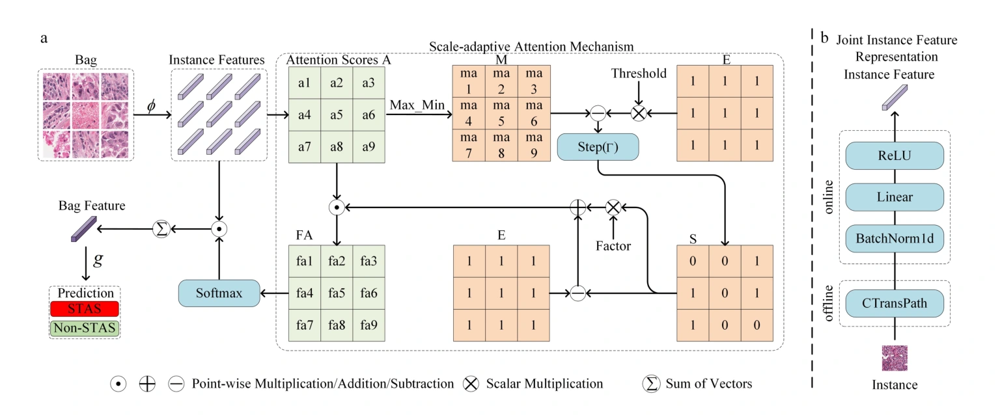
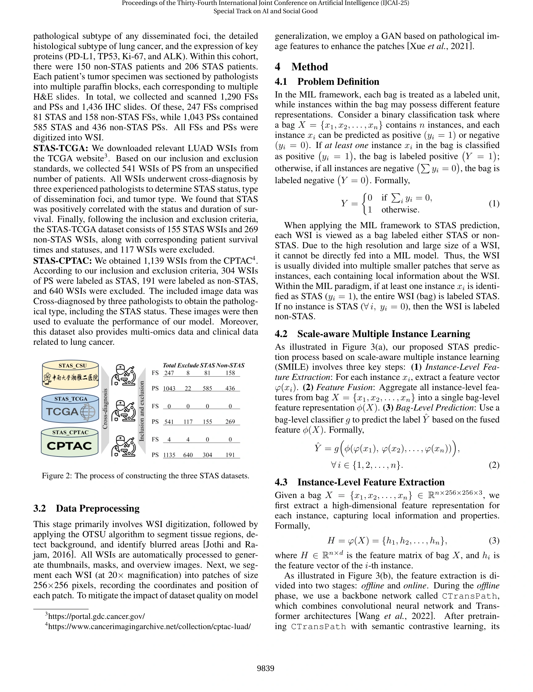
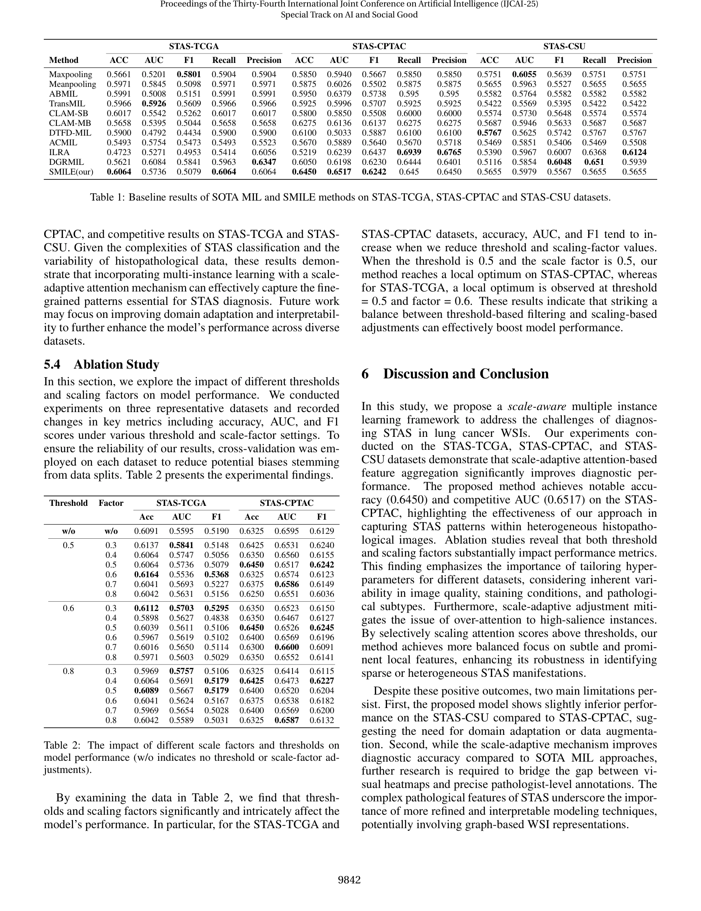

## SMILE: A Scale-aware Multiple Instance Learning Method for Multicenter STAS Lung Cancer Histopathology Diagnosis

> data: STAS-CSU、STAS-TCGA、STAS-CPTAC
>
> IJCAI 2025（PDF 与作者项目） · [论文](https://www.ijcai.org/proceedings/2025/1093) · [作者代码](https://github.com/panliangrui/IJCAI25)

#### 引言

面向肺癌气腔播散（STAS）诊断，引入尺度自适应注意力以处理病灶稀疏与异质性，并提供多中心切片数据和基线。

#### 方法

（1）尺度自适应：根据注意力调整实例响应，避免固定地依赖局部高分块。

（2）病灶汇总：学习稀疏且异质的 STAS 区域。

（3）弱监督分类：以切片级 STAS 标签训练并输出诊断分数。

<!-- wsi-complete-model -->
##### 模型结构图

**图 3 · 模型结构**（PDF 第 5 页）

> 原文图注：Figure 3: (a) Overall workflow of the proposed SMILE approach. (b) The process of feature preprocessing. We process the given bag through a joint feature representation module to transform them into instance features. These features are then processed through a scale- adaptive attention module to obtain scaled bag-level feature representations. Finally, the final STAS prediction results are obtained through the classifier g.

[查看原尺寸](assest/SMILE/figure-3-complete.webp)

<!-- /wsi-complete-model -->

#### 实验

##### 实验设置

共整理 2,970 张切片，三位病理专家复核；采用五折评估，报告 AUC、ACC、Precision、Recall、F1。

##### 主要结果

TCGA 上 SMILE AUC 为 0.5736，低于 DGRMIL 的 0.6084；CPTAC 上 ACC/AUC 为 0.645/0.6517，跨数据集优势并不一致。

<!-- wsi-complete-results -->
##### 完整实验指标与对照

下列实验原页保留表头、全部行列、子图、误差说明和脚注，点击可查看原尺寸。比较时请对应相同的数据集、特征编码器和训练设置；`±`、置信区间、百分比和小数均保留原文的单位与统计口径。

| 原表/图中指标 | 读取方式 |
| --- | --- |
| ROC-AUC / AUROC | 越高越好；若原表明确为 PR-AUC，则按 PR 曲线面积读取 |
| ACC / Accuracy | 越高越好；平衡准确率、平均准确率以原表标注为准 |
| F1 | 越高越好；保留 macro / weighted / micro 等平均方式 |
| Precision | 越高越好；需结合 Recall 及分类阈值 |
| Recall / Sensitivity | 越高越好；与固定敏感度下的特异度区别读取 |

| 原文页 | 阅读内容 | 图表及正文引用 |
| --- | --- | --- |
| PDF 第 4 页 | 实验结果 | Figure 2 |
| PDF 第 7 页 | 实验结果 | Table 1、Table 2 |

**实验原页 · PDF 第 4 页**（图表及正文引用：Figure 2）

[查看原尺寸](assest/SMILE/experiment-page-04.webp)

**实验原页 · PDF 第 7 页**（图表及正文引用：Table 1、Table 2）

[查看原尺寸](assest/SMILE/experiment-page-07.webp)

<!-- /wsi-complete-results -->

##### 消融与讨论

考察尺度因子与阈值，分开分析内部与公共队列；应保留作者表中不占优的结果。

#### 参考文献

> SMILE: A Scale-aware Multiple Instance Learning Method for Multicenter STAS Lung Cancer Histopathology Diagnosis
>
> IJCAI 2025（PDF 与作者项目） · [论文](https://www.ijcai.org/proceedings/2025/1093) · [作者代码](https://github.com/panliangrui/IJCAI25)
