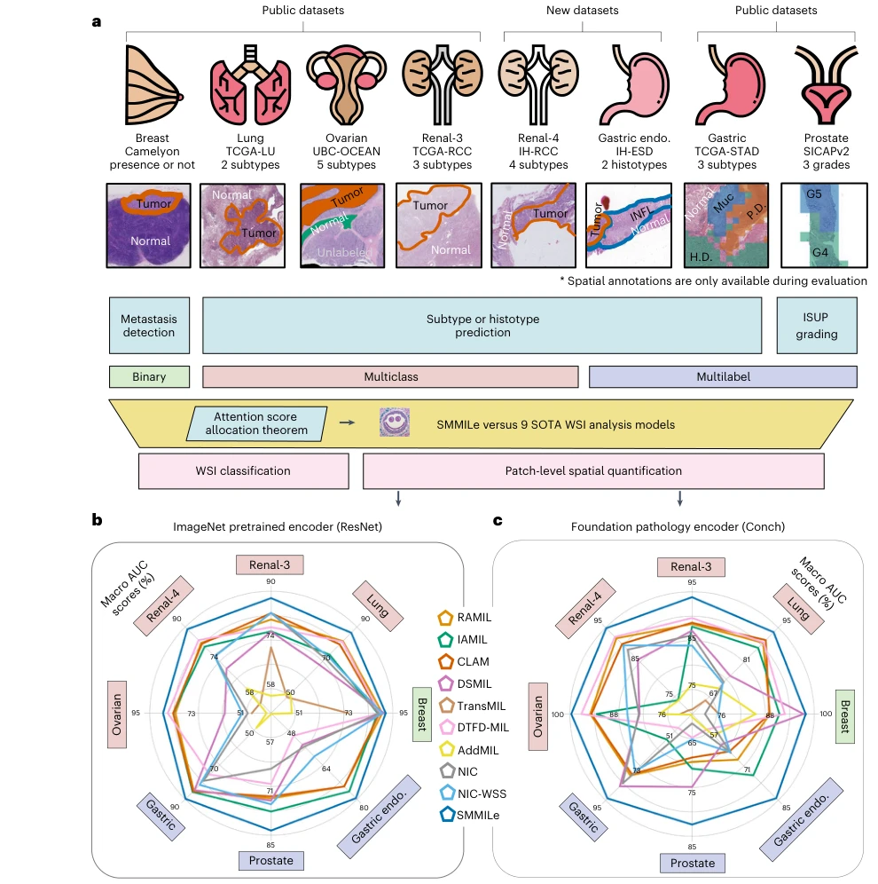

## SMMILe enables accurate spatial quantification in digital pathology using multiple-instance learning

> data: 八个病理数据集，六类癌症，共 3,850 张 WSI
>
> Nature Cancer 2025 · [论文](https://doi.org/10.1038/s43018-025-01060-8) · [作者代码](https://github.com/ZeyuGaoAi/SMMILe)

#### 引言

通过 superpatch 和实例级聚合兼顾切片分类与空间定量，重点检查 MIL 是否能在保持分类能力时准确刻画病灶分布。

#### 方法

（1）Superpatch：以更有组织的空间单元汇总实例。

（2）可度量实例聚合：使整片预测与区域贡献之间有明确联系。

（3）空间细化：结合实例丢弃、采样、细化网络与 MRF 约束。

原文Fig. 1，PDF 第 3 页。

#### 实验

##### 实验设置

同时评价切片预测与空间定量，比较 ImageNet 编码器及 CONCH；消融主要在 Lung/Renal-3/Prostate。

##### 主要结果

基础模型特征使多个方法切片 AUC 接近饱和，因此本研究还单独检验空间预测，不能只凭切片分类判断定位。

##### 消融与讨论

考察一致性、实例 dropout、离域采样、实例细化与 MRF；空间定量与整片分类分别报告。

#### 参考文献

> SMMILe enables accurate spatial quantification in digital pathology using multiple-instance learning
>
> Nature Cancer 2025 · [论文](https://doi.org/10.1038/s43018-025-01060-8) · [作者代码](https://github.com/ZeyuGaoAi/SMMILe)
