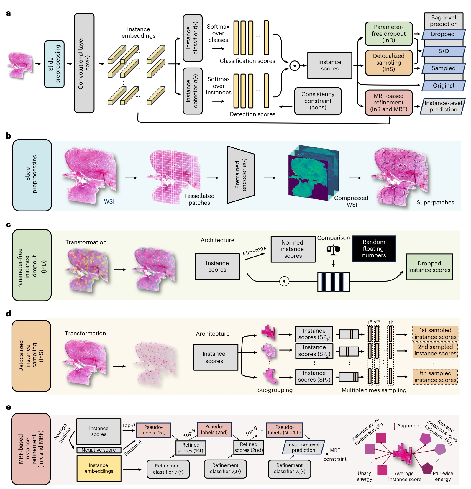
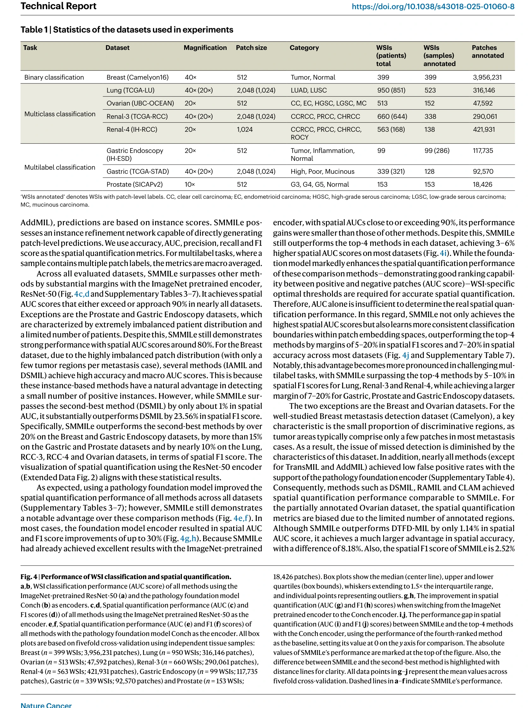
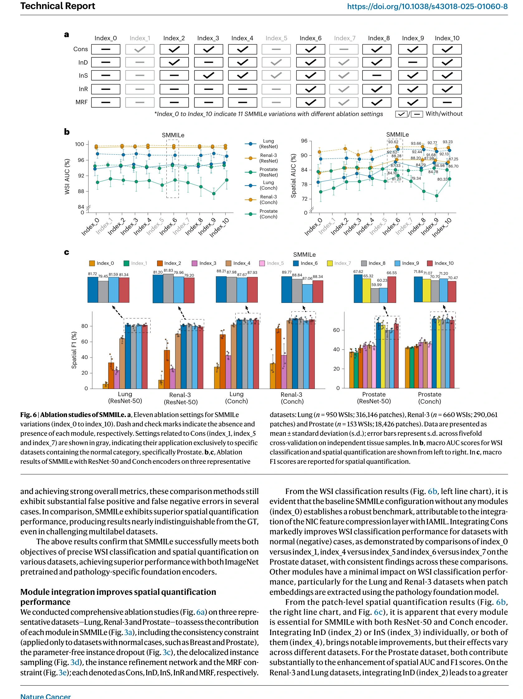

## SMMILe enables accurate spatial quantification in digital pathology using multiple-instance learning

> data: 八个病理数据集，六类癌症，共 3,850 张 WSI
>
> Nature Cancer 2025 · [论文](https://doi.org/10.1038/s43018-025-01060-8) · [作者代码](https://github.com/ZeyuGaoAi/SMMILe)

#### 引言

通过 superpatch 和实例级聚合兼顾切片分类与空间定量，重点检查 MIL 是否能在保持分类能力时准确刻画病灶分布。

#### 方法

（1）Superpatch：以更有组织的空间单元汇总实例。

（2）可度量实例聚合：使整片预测与区域贡献之间有明确联系。

（3）空间细化：结合实例丢弃、采样、细化网络与 MRF 约束。

<!-- wsi-complete-model -->
##### 模型结构图

**图 3 · 模型结构**（PDF 第 5 页）

> 原文图注：Fig. 3 | Model schema of SMMILe. a, Overview of SMMILe. b, Slide preprocessing. Each WSI is tessellated into patches and mapped into embeddings by the pretrained encoder. Then, we obtain the compressed WSI using NIC, which prepares it for the application of convolution operations. Concurrently, SMMILe forms a series of superpatches (SP; subscript S denotes the total number of superpatches) by oversegmentation at compressed WSI. c, Parameter-free

[查看原尺寸](assest/SMMILe/figure-3-complete.webp)

<!-- /wsi-complete-model -->

#### 实验

##### 实验设置

同时评价切片预测与空间定量，比较 ImageNet 编码器及 CONCH；消融主要在 Lung/Renal-3/Prostate。

##### 主要结果

基础模型特征使多个方法切片 AUC 接近饱和，因此本研究还单独检验空间预测，不能只凭切片分类判断定位。

<!-- wsi-complete-results -->
##### 完整实验指标与对照

下列实验原页保留表头、全部行列、子图、误差说明和脚注，点击可查看原尺寸。比较时请对应相同的数据集、特征编码器和训练设置；`±`、置信区间、百分比和小数均保留原文的单位与统计口径。

| 原表/图中指标 | 读取方式 |
| --- | --- |
| ROC-AUC / AUROC | 越高越好；若原表明确为 PR-AUC，则按 PR 曲线面积读取 |

| 原文页 | 阅读内容 | 图表及正文引用 |
| --- | --- | --- |
| PDF 第 6 页 | 数据与实验设置 | Table 1 |
| PDF 第 9 页 | 消融与参数分析 | Figure 6 |

**实验原页 · PDF 第 6 页**（图表及正文引用：Table 1）

[查看原尺寸](assest/SMMILe/experiment-page-06.webp)

展开消融、参数、数据设置及效率原页

**实验原页 · PDF 第 9 页**（图表及正文引用：Figure 6）

[查看原尺寸](assest/SMMILe/experiment-page-09.webp)

<!-- /wsi-complete-results -->

##### 消融与讨论

考察一致性、实例 dropout、离域采样、实例细化与 MRF；空间定量与整片分类分别报告。

#### 参考文献

> SMMILe enables accurate spatial quantification in digital pathology using multiple-instance learning
>
> Nature Cancer 2025 · [论文](https://doi.org/10.1038/s43018-025-01060-8) · [作者代码](https://github.com/ZeyuGaoAi/SMMILe)
