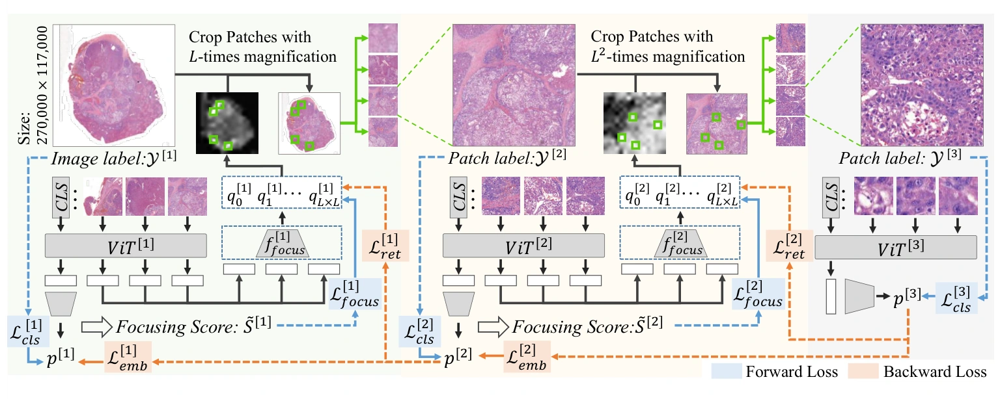
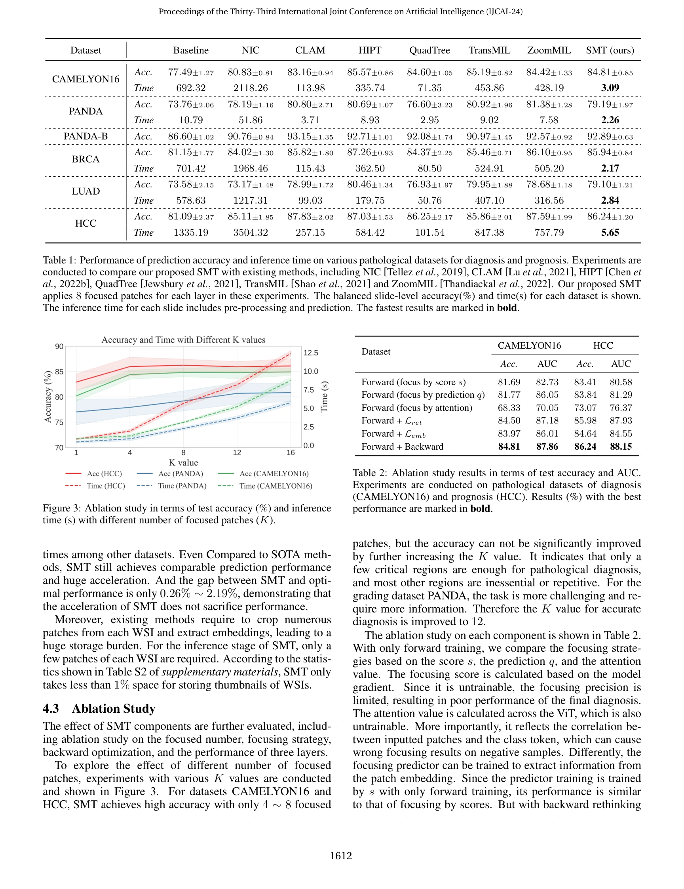

## Hundredfold Accelerating for Pathological Images Diagnosis and Prognosis through Self-reform Critical Region Focusing

> data: CAMELYON16、PANDA/PANDA-B、BRCA、LUAD、内部 HCC
>
> IJCAI 2024 · [论文](https://www.ijcai.org/proceedings/2024/0178)

#### 引言

从缩略图逐层聚焦到高倍率关键区域，并用反向修正改进前层定位，减少诊断和预后任务中需要处理的 patch 数量。

#### 方法

（1）缩略图定位：先在低倍率评估各区域重要性。

（2）逐层放大：只对选中区域提取更高倍率输入，限制计算量。

（3）反向修正：由后层反馈改善前层聚焦，形成多层交互。

<!-- wsi-complete-model -->
##### 模型结构图

**图 2 · 模型结构**（PDF 第 3 页）

> 原文图注：Figure 2: The illustration of Self-reform Multilayer Transformer (SMT). The framework contains three layers, which take inputs with the same size and different magnifications. In former two layers, Focusing predictors ffocus predicts the score qi1 on all patches. Based on the regions of top-K focused patches (green boxes), images with L-times larger magnification are cropped from the original WSI, which are used as the inputs of the next layer. The forward (blue) and backward (orange) losses are shown at the bottom of figure, where the solid and dotted lines denote the optimized object and the target, respectively. These losses are applied to train SMT for accurate classification and focusing.

[查看原尺寸](assest/SMT/figure-2-complete.webp)

<!-- /wsi-complete-model -->

#### 实验

##### 实验设置

同时比较预测表现和推理耗时；三层编码器参数不共享，默认每层聚焦 K=4 个区域。

##### 主要结果

论文强调速度与精度的折中；部分数据上 HIPT 仍取得最高准确率，因此不能把加速表述为处处精度最高。

<!-- wsi-complete-results -->
##### 完整实验指标与对照

下列实验原页保留表头、全部行列、子图、误差说明和脚注，点击可查看原尺寸。比较时请对应相同的数据集、特征编码器和训练设置；`±`、置信区间、百分比和小数均保留原文的单位与统计口径。

| 原表/图中指标 | 读取方式 |
| --- | --- |
| ROC-AUC / AUROC | 越高越好；若原表明确为 PR-AUC，则按 PR 曲线面积读取 |
| ACC / Accuracy | 越高越好；平衡准确率、平均准确率以原表标注为准 |
| 时间 / FLOPs / 参数量 | 结合硬件、包长度和计时范围比较；小模型不一定推理更快 |

| 原文页 | 阅读内容 | 图表及正文引用 |
| --- | --- | --- |
| PDF 第 6 页 | 实验结果 | Table 1、Figure 3、Table 2 |

**实验原页 · PDF 第 6 页**（图表及正文引用：Table 1、Figure 3、Table 2）

[查看原尺寸](assest/SMT/experiment-page-06.webp)

<!-- /wsi-complete-results -->

##### 消融与讨论

消融逐层聚焦与反向修正，改变聚焦 patch 数量，区分诊断分类与生存预测任务。

#### 参考文献

> Hundredfold Accelerating for Pathological Images Diagnosis and Prognosis through Self-reform Critical Region Focusing
>
> IJCAI 2024 · [论文](https://www.ijcai.org/proceedings/2024/0178)
