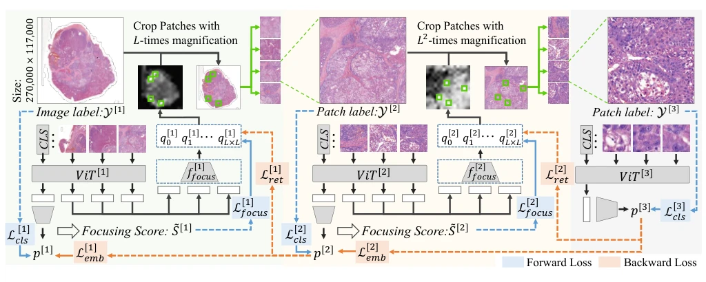
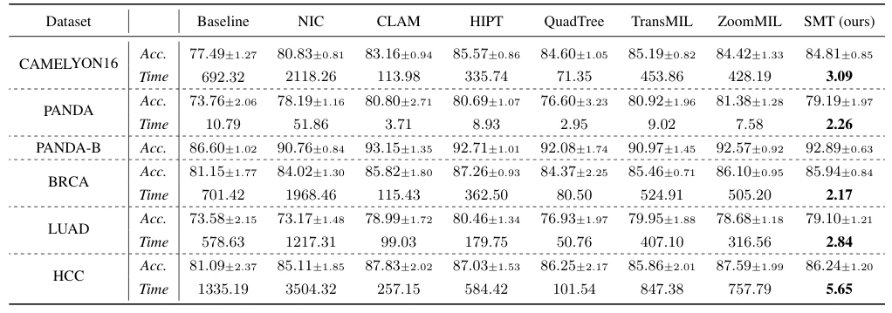

## Hundredfold Accelerating for Pathological Images Diagnosis and Prognosis through Self-reform Critical Region Focusing

> data: CAMELYON16、PANDA/PANDA-B、BRCA、LUAD、内部 HCC
>
> IJCAI 2024 · [论文](https://www.ijcai.org/proceedings/2024/0178)

#### 引言

从缩略图逐层聚焦到高倍率关键区域，并用反向修正改进前层定位，减少诊断和预后任务中需要处理的 patch 数量。

#### 方法

（1）缩略图定位：先在低倍率评估各区域重要性。

（2）逐层放大：只对选中区域提取更高倍率输入，限制计算量。

（3）反向修正：由后层反馈改善前层聚焦，形成多层交互。

原文Figure 2，PDF 第 3 页。

#### 实验

##### 实验设置

同时比较预测表现和推理耗时；三层编码器参数不共享，默认每层聚焦 K=4 个区域。

##### 主要结果

论文强调速度与精度的折中；部分数据上 HIPT 仍取得最高准确率，因此不能把加速表述为处处精度最高。

原文Table 1，PDF 第 6 页。

##### 消融与讨论

消融逐层聚焦与反向修正，改变聚焦 patch 数量，区分诊断分类与生存预测任务。

#### 参考文献

> Hundredfold Accelerating for Pathological Images Diagnosis and Prognosis through Self-reform Critical Region Focusing
>
> IJCAI 2024 · [论文](https://www.ijcai.org/proceedings/2024/0178)
