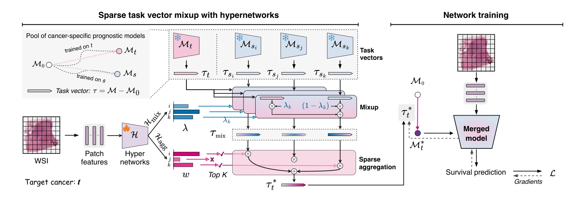
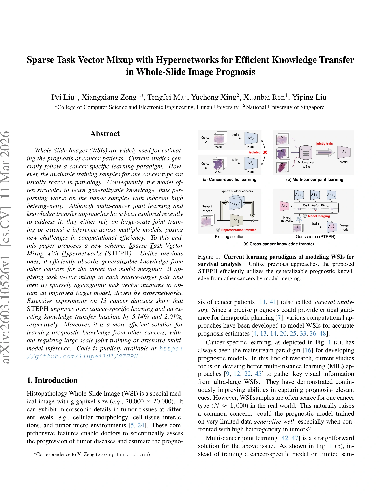
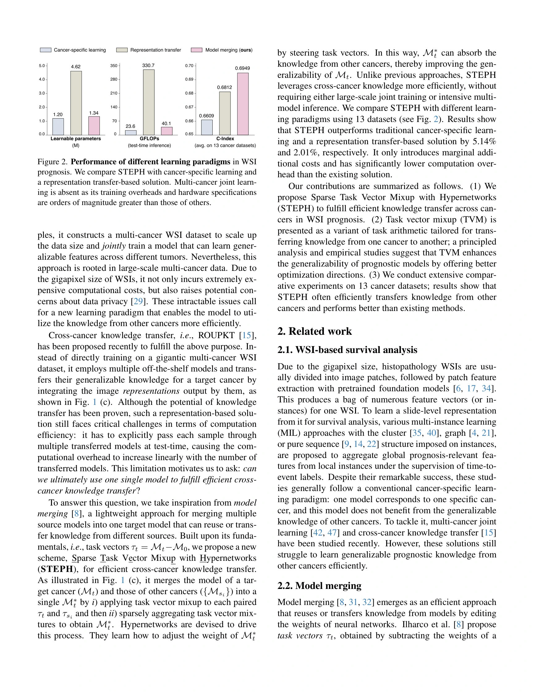
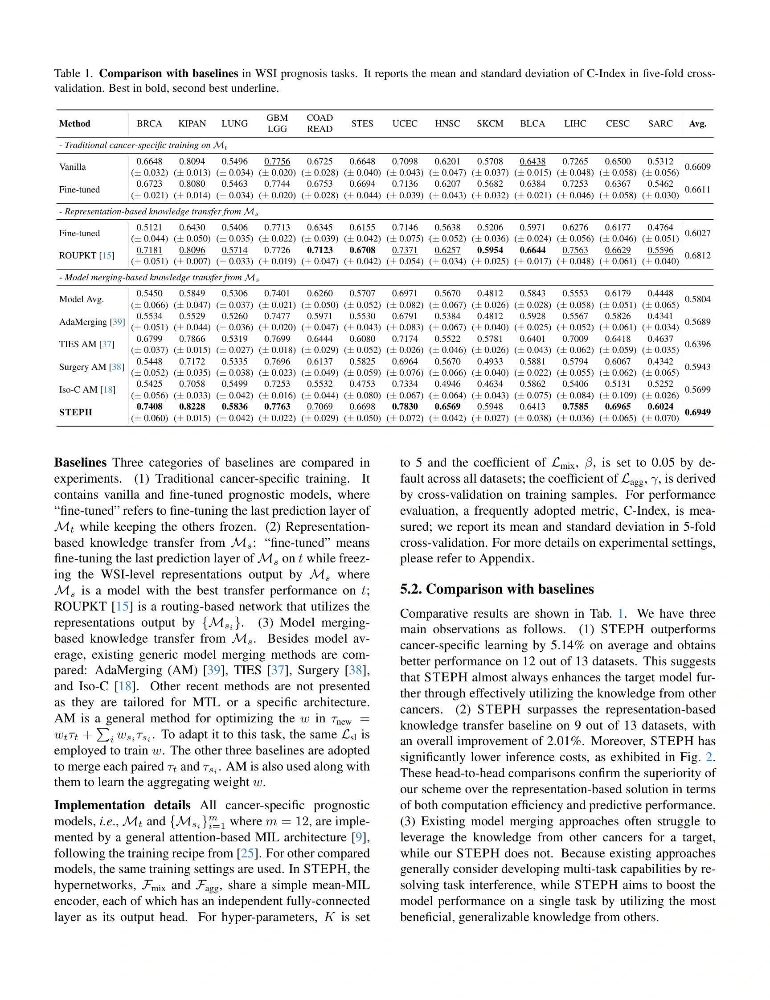
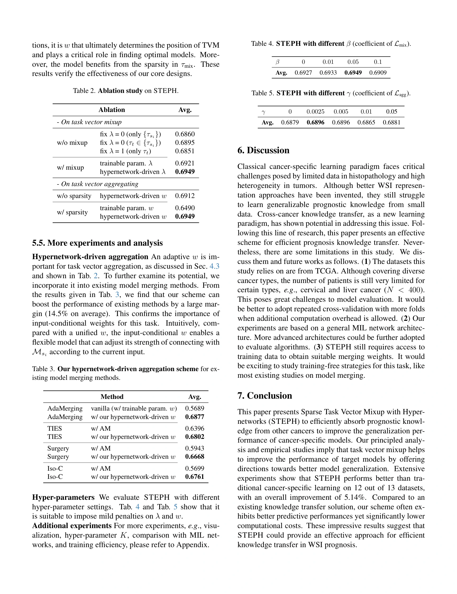

## Sparse Task Vector Mixup with Hypernetworks for Efficient Knowledge Transfer in Whole-Slide Image Prognosis

> data: 13 个 TCGA 癌种，8,818 张切片、7,268 位患者
>
> 收藏标记 CVPR 2026；所附链接为 arXiv 2026 版本 · [论文](https://arxiv.org/abs/2603.10526) · [作者代码](https://github.com/liupei101/STEPH)

#### 引言

通过超网络驱动的稀疏任务向量混合，将其他癌种的预后知识合入目标模型，减少大规模联合训练与多模型推理的开销。

#### 方法

（1）任务向量：计算各癌种模型相对初始化的参数变化。

（2）稀疏混合：以源癌种和目标癌种之间的向量插值形成候选知识。

（3）超网络：根据输入动态组合少量候选，输出目标癌种预测。

<!-- wsi-complete-model -->
##### 模型结构图

**图 3 · 模型结构**（PDF 第 4 页）

> 原文图注：Figure 3. Sparse Task Vector Mixup with Hypernetworks (STEPH) for efficient knowledge transfer in WSI prognosis. After computing task vectors, STEPH first applies mixup to each paired (τt, τs) to absorb prognostic knowledge from cross-cancer models. Then, the most beneficial mixtures are selected and aggregated to derive M∗ t for prediction. Hypernetworks drive these steps by steering task vectors.

[查看原尺寸](assest/STEPH/figure-3-complete.webp)

<!-- /wsi-complete-model -->

#### 实验

##### 实验设置

UNI 特征，疾病特异生存标签，每癌种五折；以相同 ABMIL 结构训练各癌种模型。

##### 主要结果

主表比较专病训练与跨癌种知识迁移，C-index 的均值/标准差按癌种保留。

<!-- wsi-complete-results -->
##### 完整实验指标与对照

下列实验原页保留表头、全部行列、子图、误差说明和脚注，点击可查看原尺寸。比较时请对应相同的数据集、特征编码器和训练设置；`±`、置信区间、百分比和小数均保留原文的单位与统计口径。

| 原表/图中指标 | 读取方式 |
| --- | --- |
| C-index | 越高越好；用于生存预测，需保留终点及删失设置 |

| 原文页 | 阅读内容 | 图表及正文引用 |
| --- | --- | --- |
| PDF 第 1 页 | 实验结果 | Figure 1 |
| PDF 第 2 页 | 实验结果 | Figure 2 |
| PDF 第 6 页 | 实验结果 | Table 1 |
| PDF 第 8 页 | 消融与参数分析 | Table 2、Table 3、Table 4、Table 5 |

**实验原页 · PDF 第 1 页**（图表及正文引用：Figure 1）

[查看原尺寸](assest/STEPH/experiment-page-01.webp)

**实验原页 · PDF 第 2 页**（图表及正文引用：Figure 2）

[查看原尺寸](assest/STEPH/experiment-page-02.webp)

**实验原页 · PDF 第 6 页**（图表及正文引用：Table 1）

[查看原尺寸](assest/STEPH/experiment-page-06.webp)

展开消融、参数、数据设置及效率原页

**实验原页 · PDF 第 8 页**（图表及正文引用：Table 2、Table 3、Table 4、Table 5）

[查看原尺寸](assest/STEPH/experiment-page-08.webp)

<!-- /wsi-complete-results -->

##### 消融与讨论

消融任务向量插值和稀疏混合，比较动态超网络权重与所有样本共用权重。

#### 参考文献

> Sparse Task Vector Mixup with Hypernetworks for Efficient Knowledge Transfer in Whole-Slide Image Prognosis
>
> 收藏标记 CVPR 2026；所附链接为 arXiv 2026 版本 · [论文](https://arxiv.org/abs/2603.10526) · [作者代码](https://github.com/liupei101/STEPH)
