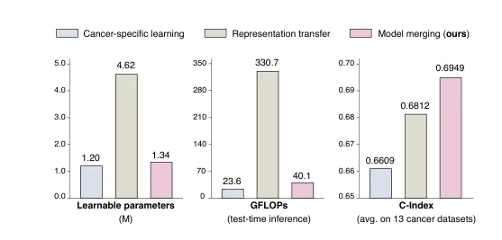

## Sparse Task Vector Mixup with Hypernetworks for Efficient Knowledge Transfer in Whole-Slide Image Prognosis

> data: 13 个 TCGA 癌种，8,818 张切片、7,268 位患者
>
> 收藏标记 CVPR 2026；所附链接为 arXiv 2026 版本 · [论文](https://arxiv.org/abs/2603.10526) · [作者代码](https://github.com/liupei101/STEPH)

#### 引言

通过超网络驱动的稀疏任务向量混合，将其他癌种的预后知识合入目标模型，减少大规模联合训练与多模型推理的开销。

#### 方法

（1）任务向量：计算各癌种模型相对初始化的参数变化。

（2）稀疏混合：以源癌种和目标癌种之间的向量插值形成候选知识。

（3）超网络：根据输入动态组合少量候选，输出目标癌种预测。

原文Figure 2，PDF 第 2 页。

#### 实验

##### 实验设置

UNI 特征，疾病特异生存标签，每癌种五折；以相同 ABMIL 结构训练各癌种模型。

##### 主要结果

主表比较专病训练与跨癌种知识迁移，C-index 的均值/标准差按癌种保留。

##### 消融与讨论

消融任务向量插值和稀疏混合，比较动态超网络权重与所有样本共用权重。

#### 参考文献

> Sparse Task Vector Mixup with Hypernetworks for Efficient Knowledge Transfer in Whole-Slide Image Prognosis
>
> 收藏标记 CVPR 2026；所附链接为 arXiv 2026 版本 · [论文](https://arxiv.org/abs/2603.10526) · [作者代码](https://github.com/liupei101/STEPH)
