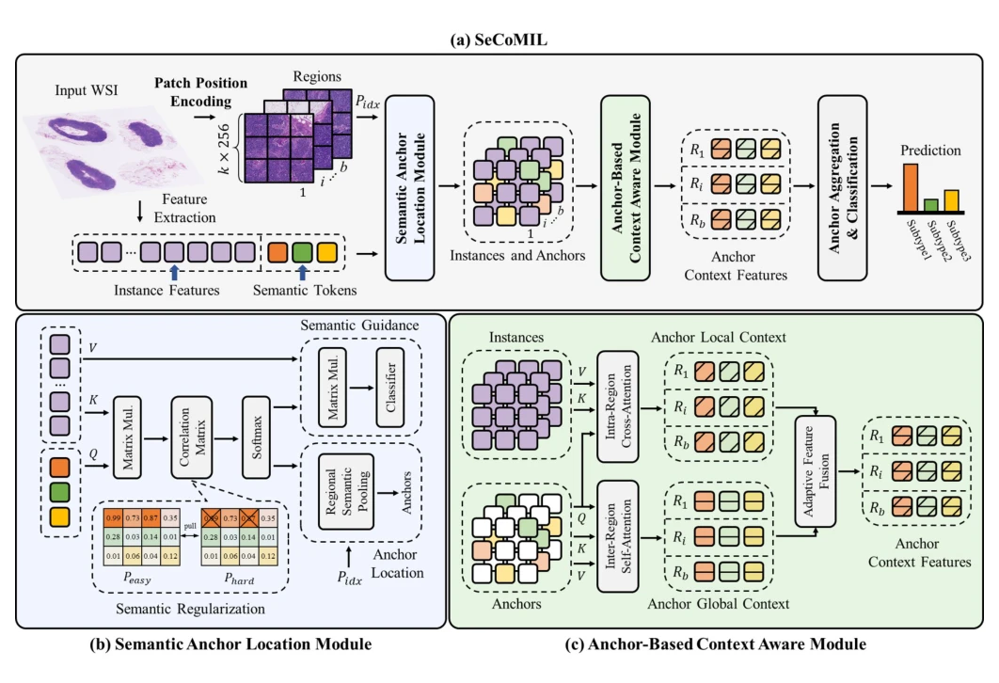

## SeCoMIL: Semantic Anchor-based Context-Aware Multiple Instance Learning for Whole Slide Image Classification

> data: CAMELYON16、CAMELYON17、TCGA-NSCLC、TCGA-RCC
>
> IEEE Transactions on Circuits and Systems for Video Technology 2026 · [论文](https://doi.org/10.1109/TCSVT.2025.3621757)

#### 引言

先划分区域并编码实例坐标，再选择区域语义锚点，结合锚点邻域与跨锚点全局上下文，减少冗余计算并保留空间信息。

#### 方法

（1）区域坐标：先按空间划分区域并编码实例位置。

（2）语义锚点：在每个区域选择最有代表性的组织特征。

（3）双层上下文：学习锚点邻域与跨锚点联系，减少全实例交互。

原文Fig. 2，PDF 第 3 页。

#### 实验

##### 实验设置

比较两类编码器和多个上下文 MIL；以 C16 训练、C17 测试检查域泛化，并记录参数量和 FLOPs。

##### 主要结果

语义锚点用于降低全实例交互冗余；性能与效率应结合主表及外部测试表同时判断。

##### 消融与讨论

考察区域划分、坐标编码及局部/全局锚点上下文，区分空间保留与实例压缩的贡献。

#### 参考文献

> SeCoMIL: Semantic Anchor-based Context-Aware Multiple Instance Learning for Whole Slide Image Classification
>
> IEEE Transactions on Circuits and Systems for Video Technology 2026 · [论文](https://doi.org/10.1109/TCSVT.2025.3621757)
