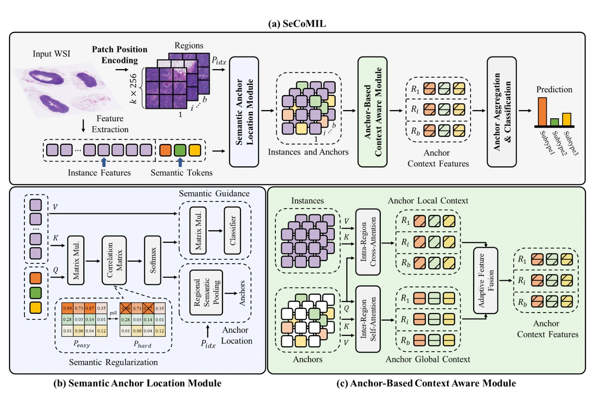
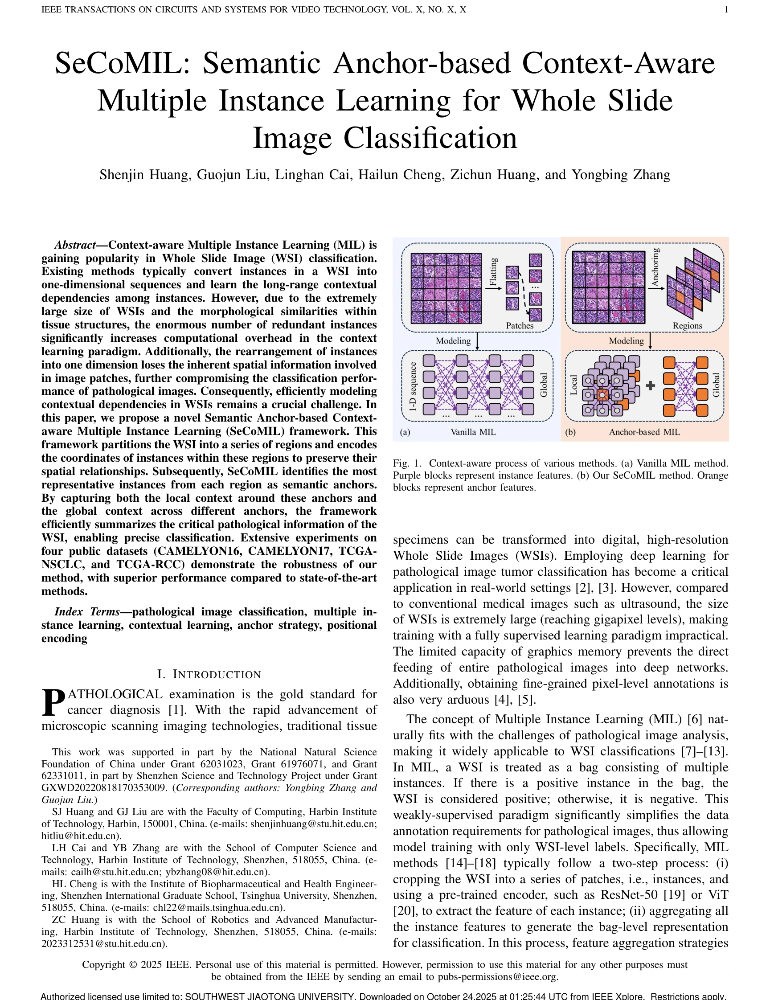
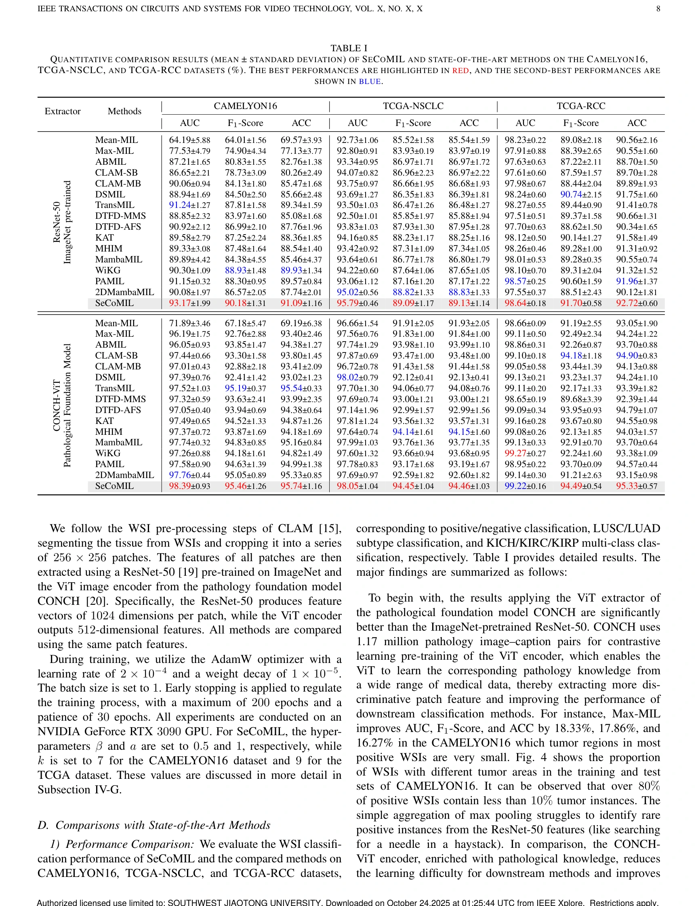
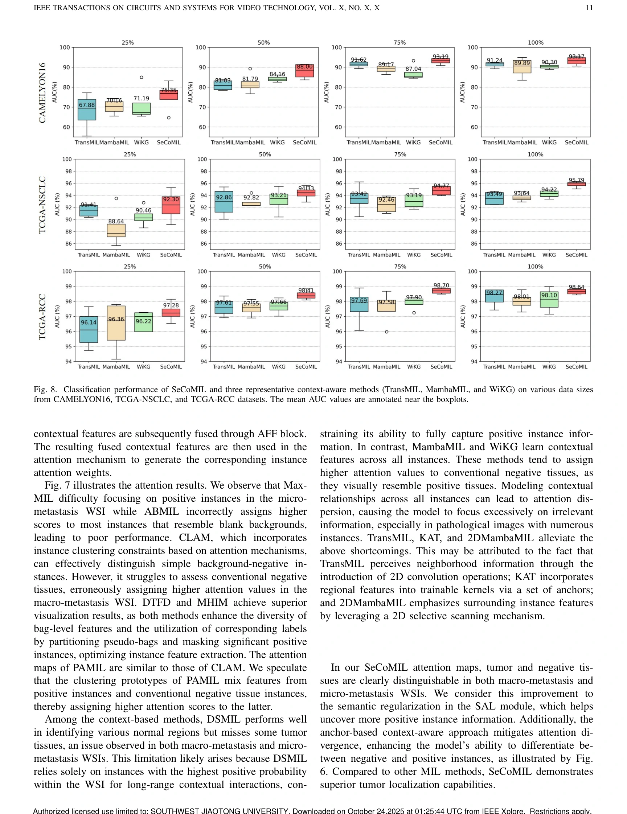
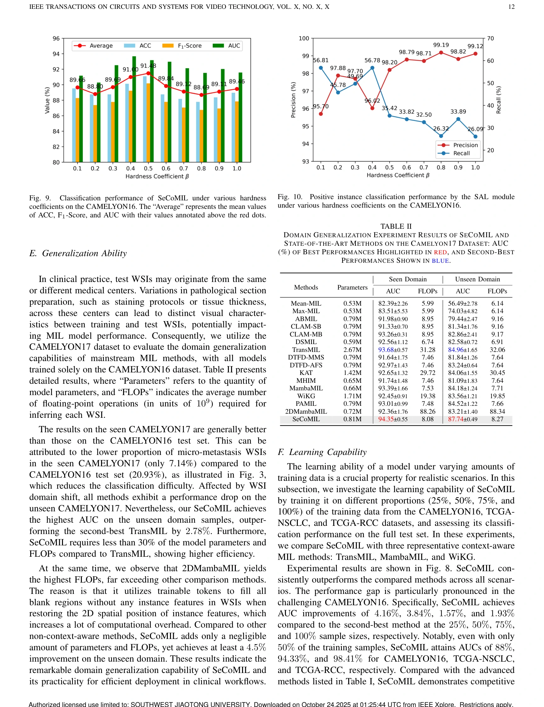
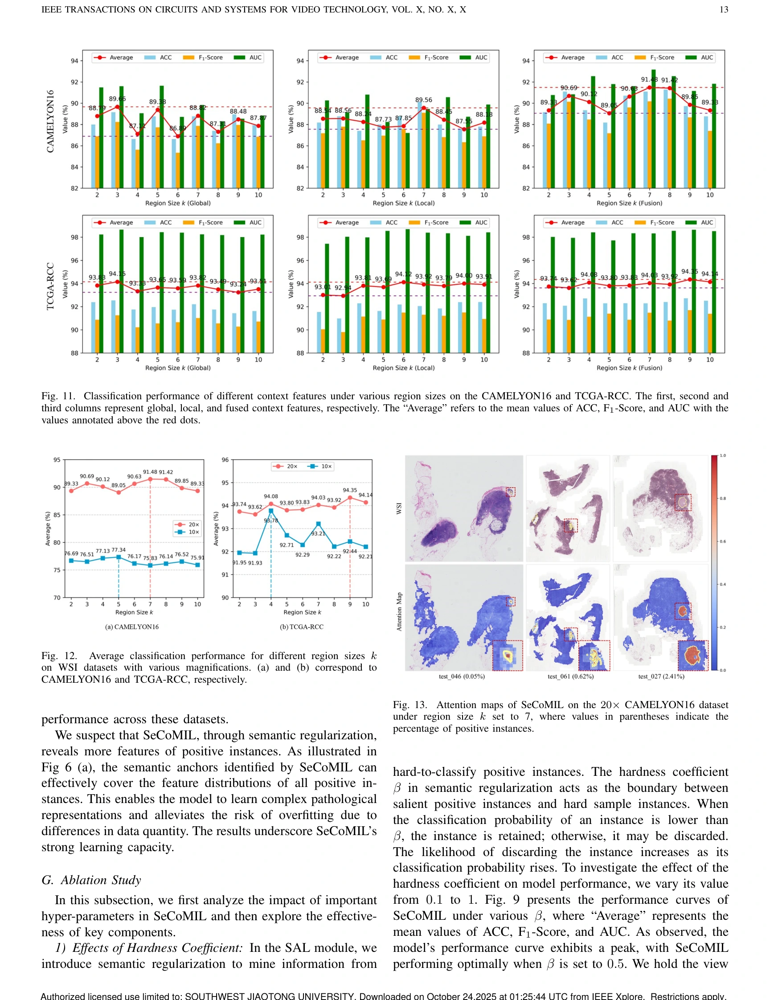
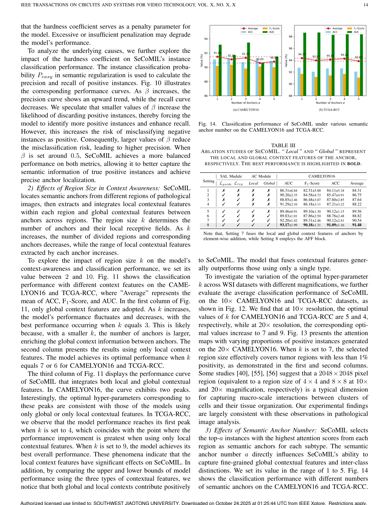
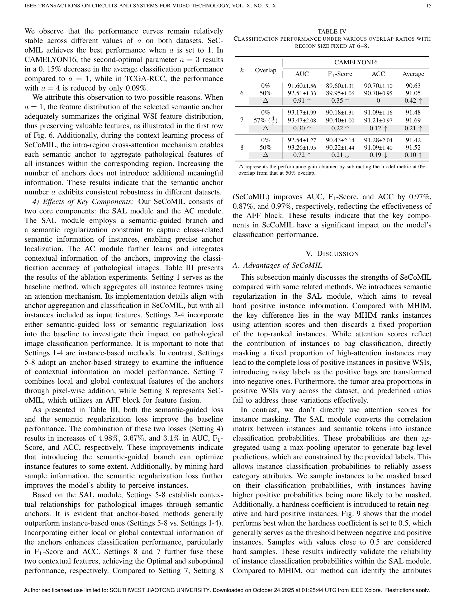

## SeCoMIL: Semantic Anchor-based Context-Aware Multiple Instance Learning for Whole Slide Image Classification

> data: CAMELYON16、CAMELYON17、TCGA-NSCLC、TCGA-RCC
>
> IEEE Transactions on Circuits and Systems for Video Technology 2026 · [论文](https://doi.org/10.1109/TCSVT.2025.3621757)

#### 引言

先划分区域并编码实例坐标，再选择区域语义锚点，结合锚点邻域与跨锚点全局上下文，减少冗余计算并保留空间信息。

#### 方法

（1）区域坐标：先按空间划分区域并编码实例位置。

（2）语义锚点：在每个区域选择最有代表性的组织特征。

（3）双层上下文：学习锚点邻域与跨锚点联系，减少全实例交互。

<!-- wsi-complete-model -->
##### 模型结构图

**图 2 · 模型结构**（PDF 第 3 页）

> 原文图注：Fig. 2. Overall framework of SeCoMIL and its main components: (a) shows the processing flow of SeCoMIL for a WSI. (b) shows the network structure of the SAL module, while (c) illustrates that of the AC module. Ri represents the i-th region.

[查看原尺寸](assest/SeCoMIL/figure-2-complete.webp)

<!-- /wsi-complete-model -->

#### 实验

##### 实验设置

比较两类编码器和多个上下文 MIL；以 C16 训练、C17 测试检查域泛化，并记录参数量和 FLOPs。

##### 主要结果

语义锚点用于降低全实例交互冗余；性能与效率应结合主表及外部测试表同时判断。

<!-- wsi-complete-results -->
##### 完整实验指标与对照

下列实验原页保留表头、全部行列、子图、误差说明和脚注，点击可查看原尺寸。比较时请对应相同的数据集、特征编码器和训练设置；`±`、置信区间、百分比和小数均保留原文的单位与统计口径。

| 原表/图中指标 | 读取方式 |
| --- | --- |
| ROC-AUC / AUROC | 越高越好；若原表明确为 PR-AUC，则按 PR 曲线面积读取 |
| ACC / Accuracy | 越高越好；平衡准确率、平均准确率以原表标注为准 |
| F1 | 越高越好；保留 macro / weighted / micro 等平均方式 |
| 时间 / FLOPs / 参数量 | 结合硬件、包长度和计时范围比较；小模型不一定推理更快 |

| 原文页 | 阅读内容 | 图表及正文引用 |
| --- | --- | --- |
| PDF 第 1 页 | 实验结果 | Figure 1 |
| PDF 第 8 页 | 实验结果 | Table I |
| PDF 第 11 页 | 实验结果 | Figure 8 |
| PDF 第 12 页 | 实验结果 | Figure 9、Figure 10、Table II |
| PDF 第 13 页 | 实验结果 | Figure 11、Figure 12 |
| PDF 第 14 页 | 实验结果 | Figure 14、Table III |
| PDF 第 15 页 | 实验结果 | Table IV |

**实验原页 · PDF 第 1 页**（图表及正文引用：Figure 1）

[查看原尺寸](assest/SeCoMIL/experiment-page-01.webp)

**实验原页 · PDF 第 8 页**（图表及正文引用：Table I）

[查看原尺寸](assest/SeCoMIL/experiment-page-08.webp)

**实验原页 · PDF 第 11 页**（图表及正文引用：Figure 8）

[查看原尺寸](assest/SeCoMIL/experiment-page-11.webp)

**实验原页 · PDF 第 12 页**（图表及正文引用：Figure 9、Figure 10、Table II）

[查看原尺寸](assest/SeCoMIL/experiment-page-12.webp)

**实验原页 · PDF 第 13 页**（图表及正文引用：Figure 11、Figure 12）

[查看原尺寸](assest/SeCoMIL/experiment-page-13.webp)

**实验原页 · PDF 第 14 页**（图表及正文引用：Figure 14、Table III）

[查看原尺寸](assest/SeCoMIL/experiment-page-14.webp)

**实验原页 · PDF 第 15 页**（图表及正文引用：Table IV）

[查看原尺寸](assest/SeCoMIL/experiment-page-15.webp)

<!-- /wsi-complete-results -->

##### 消融与讨论

考察区域划分、坐标编码及局部/全局锚点上下文，区分空间保留与实例压缩的贡献。

#### 参考文献

> SeCoMIL: Semantic Anchor-based Context-Aware Multiple Instance Learning for Whole Slide Image Classification
>
> IEEE Transactions on Circuits and Systems for Video Technology 2026 · [论文](https://doi.org/10.1109/TCSVT.2025.3621757)
