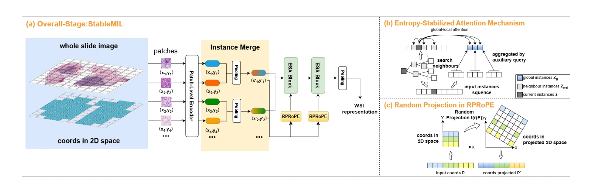

## StableMIL: Entropy-Stabilized Attention-Based Multiple Instance Learning for Morphologically Variable Whole Slide Images

> data: TCGA-NSCLC、Kidney、BRACS；BRCA/KIRC/COAD/STAD/UCEC/BLCA 生存队列
>
> IEEE Transactions on Medical Imaging 2026 · [论文](https://doi.org/10.1109/TMI.2026.3682009) · [作者代码](https://github.com/theeeqi/stableMIL)

#### 引言

以熵稳定注意力应对不同切片 patch 数量差异，并处理不均匀坐标下的位置表示问题，提高形态变化场景中的聚合稳定性。

#### 方法

（1）熵稳定：修正注意力对实例数量的敏感性。

（2）位置增强：以随机投影旋转位置编码处理不均匀坐标。

（3）确定性推理：测试阶段关闭随机变化，汇总为稳定切片表示。

##### 模型结构图

图 2（PDF 第 5 页）

#### 实验

##### 实验设置

TCGA 五折，BRACS 用官方测试；分类用 ACC/AUC/F1，生存使用疾病特异生存与 C-index。

##### 关键指标 { #key-results }

| 数据集 | AUC | ACC | F1 |
| --- | --- | --- | --- |
| TCGA-NSCLC | 0.9884 ± 0.0043 | 0.9486 ± 0.0165 | 0.9484 ± 0.0166 |
| TCGA-Kidney Cancer | 0.9951 ± 0.0020 | 0.9356 ± 0.0133 | 0.9226 ± 0.0156 |
| BRACS | 0.8917 | 0.7674 | 0.7343 |

数据来源为原文表 I，PDF 第 9 页，亚型预测，BRACS 为三分类。

##### 结果解读

关键验证是不同 patch 数与非均匀坐标下的稳定聚合，需结合分组/长度实验和主表。

##### 消融与讨论

考察熵稳定注意力与随机投影旋转位置编码；训练重采样投影，推理取消随机投影以保持确定性。

#### 参考文献

> StableMIL: Entropy-Stabilized Attention-Based Multiple Instance Learning for Morphologically Variable Whole Slide Images
>
> IEEE Transactions on Medical Imaging 2026 · [论文](https://doi.org/10.1109/TMI.2026.3682009) · [作者代码](https://github.com/theeeqi/stableMIL)
