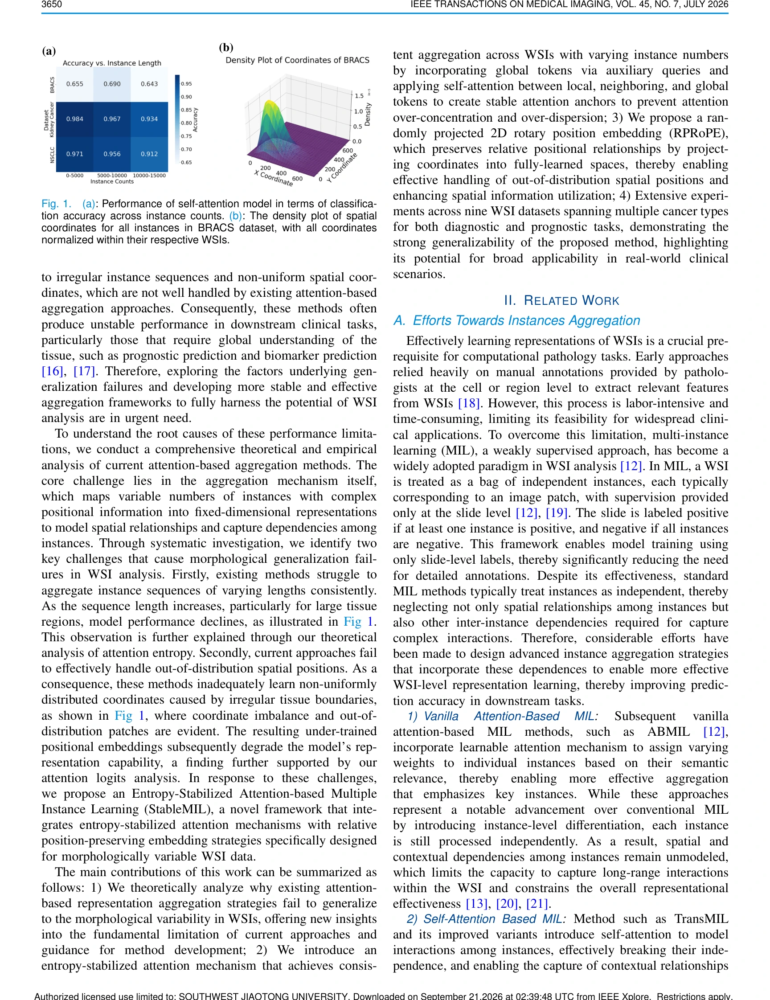
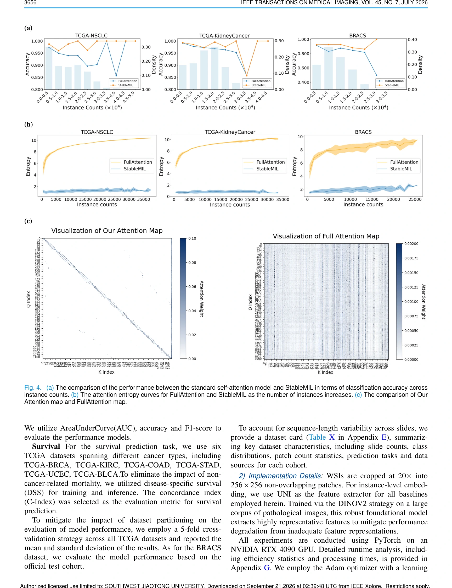
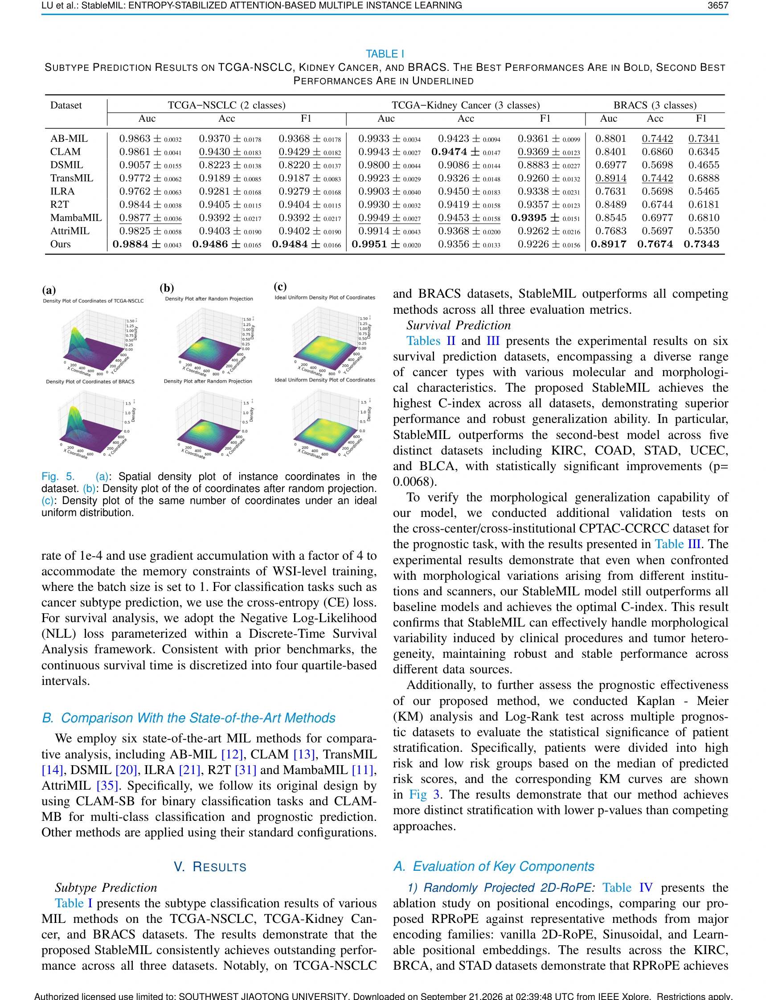
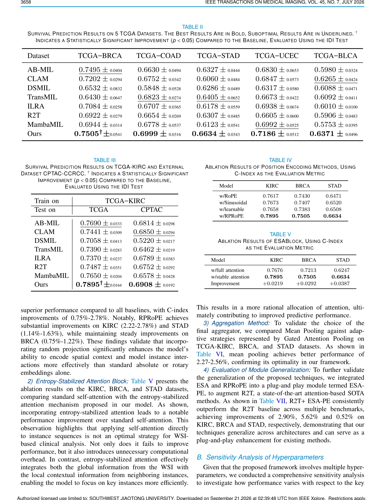
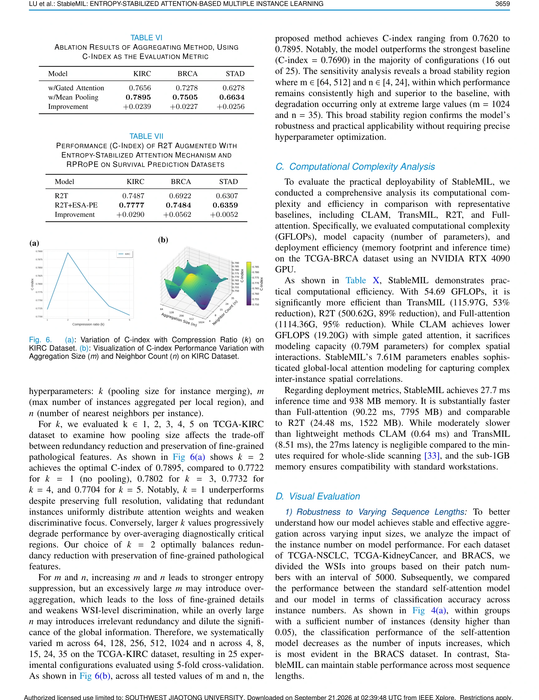
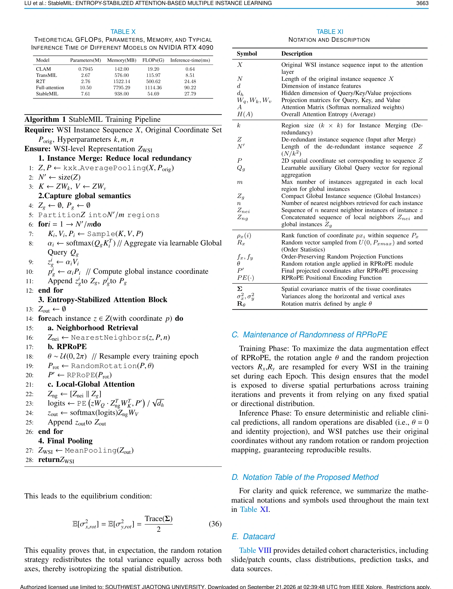
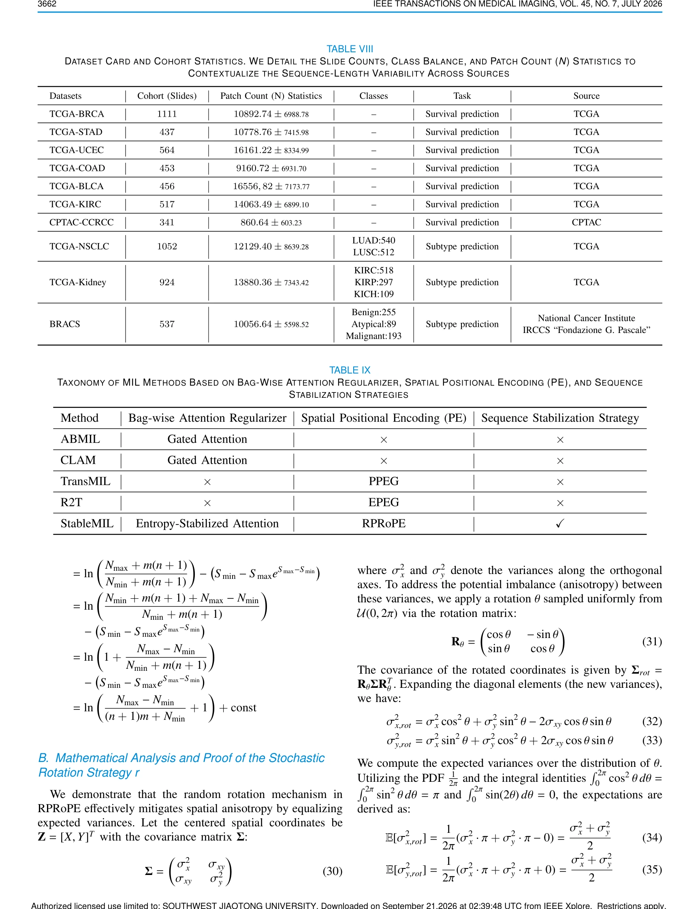

## StableMIL: Entropy-Stabilized Attention-Based Multiple Instance Learning for Morphologically Variable Whole Slide Images

> data: TCGA-NSCLC、Kidney、BRACS；BRCA/KIRC/COAD/STAD/UCEC/BLCA 生存队列
>
> IEEE Transactions on Medical Imaging 2026 · [论文](https://doi.org/10.1109/TMI.2026.3682009) · [作者代码](https://github.com/theeeqi/stableMIL)

#### 引言

以熵稳定注意力应对不同切片 patch 数量差异，并处理不均匀坐标下的位置表示问题，提高形态变化场景中的聚合稳定性。

#### 方法

（1）熵稳定：修正注意力对实例数量的敏感性。

（2）位置增强：以随机投影旋转位置编码处理不均匀坐标。

（3）确定性推理：测试阶段关闭随机变化，汇总为稳定切片表示。

<!-- wsi-complete-model -->
##### 模型结构图

**图 2 · 模型结构**（PDF 第 5 页）

> 原文图注：Fig. 2. The overall architecture of the model and the implementation details of each module are as follows: (a) the model’s overall architecture consisting of Entropy-Stabilized Attention block and Randomly projected 2D Position Embedding; (b) the entropy-stabilized attention mechanism; (c) the random projection strategy for spatial coordinates in RPRoPE.

[查看原尺寸](assest/StableMIL/figure-2-complete.webp)

<!-- /wsi-complete-model -->

#### 实验

##### 实验设置

TCGA 五折，BRACS 用官方测试；分类用 ACC/AUC/F1，生存使用疾病特异生存与 C-index。

##### 主要结果

关键验证是不同 patch 数与非均匀坐标下的稳定聚合，需结合分组/长度实验和主表。

<!-- wsi-complete-results -->
##### 完整实验指标与对照

下列实验原页保留表头、全部行列、子图、误差说明和脚注，点击可查看原尺寸。比较时请对应相同的数据集、特征编码器和训练设置；`±`、置信区间、百分比和小数均保留原文的单位与统计口径。

| 原表/图中指标 | 读取方式 |
| --- | --- |
| ROC-AUC / AUROC | 越高越好；若原表明确为 PR-AUC，则按 PR 曲线面积读取 |
| ACC / Accuracy | 越高越好；平衡准确率、平均准确率以原表标注为准 |
| F1 | 越高越好；保留 macro / weighted / micro 等平均方式 |
| C-index | 越高越好；用于生存预测，需保留终点及删失设置 |
| AP / AUPRC / mAP | 越高越好；与 ROC-AUC 不同，保留任务和召回定义 |
| 时间 / FLOPs / 参数量 | 结合硬件、包长度和计时范围比较；小模型不一定推理更快 |

| 原文页 | 阅读内容 | 图表及正文引用 |
| --- | --- | --- |
| PDF 第 2 页 | 实验结果 | Figure 1 |
| PDF 第 8 页 | 实验结果 | Figure 4 |
| PDF 第 9 页 | 实验结果 | Table I |
| PDF 第 10 页 | 实验结果 | Table II、Table III、Table IV、Table V |
| PDF 第 11 页 | 实验结果 | Table VI、Table VII、Figure 6 |
| PDF 第 14 页 | 数据与实验设置 | Table VIII、Table IX |
| PDF 第 15 页 | 实验结果 | Table X、Table XI |

**实验原页 · PDF 第 2 页**（图表及正文引用：Figure 1）

[查看原尺寸](assest/StableMIL/experiment-page-02.webp)

**实验原页 · PDF 第 8 页**（图表及正文引用：Figure 4）

[查看原尺寸](assest/StableMIL/experiment-page-08.webp)

**实验原页 · PDF 第 9 页**（图表及正文引用：Table I）

[查看原尺寸](assest/StableMIL/experiment-page-09.webp)

**实验原页 · PDF 第 10 页**（图表及正文引用：Table II、Table III、Table IV、Table V）

[查看原尺寸](assest/StableMIL/experiment-page-10.webp)

**实验原页 · PDF 第 11 页**（图表及正文引用：Table VI、Table VII、Figure 6）

[查看原尺寸](assest/StableMIL/experiment-page-11.webp)

**实验原页 · PDF 第 15 页**（图表及正文引用：Table X、Table XI）

[查看原尺寸](assest/StableMIL/experiment-page-15.webp)

展开消融、参数、数据设置及效率原页

**实验原页 · PDF 第 14 页**（图表及正文引用：Table VIII、Table IX）

[查看原尺寸](assest/StableMIL/experiment-page-14.webp)

<!-- /wsi-complete-results -->

##### 消融与讨论

考察熵稳定注意力与随机投影旋转位置编码；训练重采样投影，推理取消随机投影以保持确定性。

#### 参考文献

> StableMIL: Entropy-Stabilized Attention-Based Multiple Instance Learning for Morphologically Variable Whole Slide Images
>
> IEEE Transactions on Medical Imaging 2026 · [论文](https://doi.org/10.1109/TMI.2026.3682009) · [作者代码](https://github.com/theeeqi/stableMIL)
