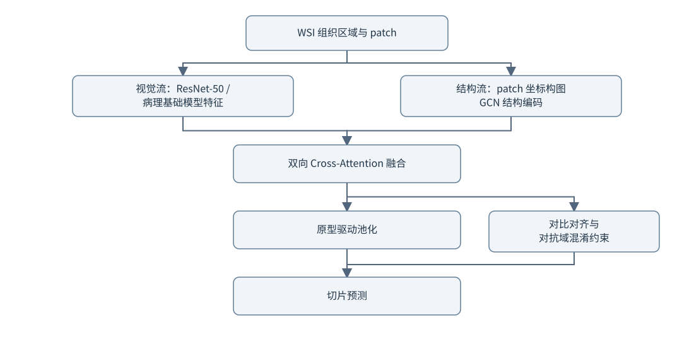
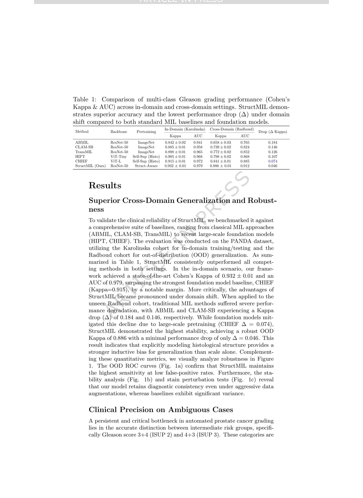
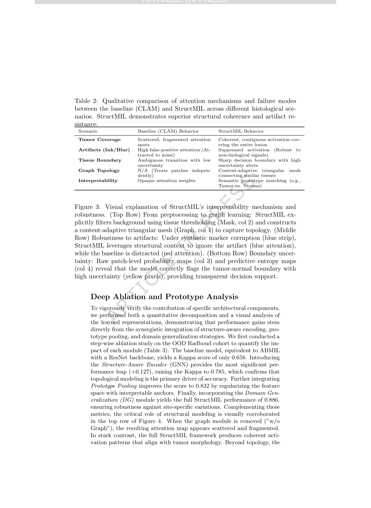
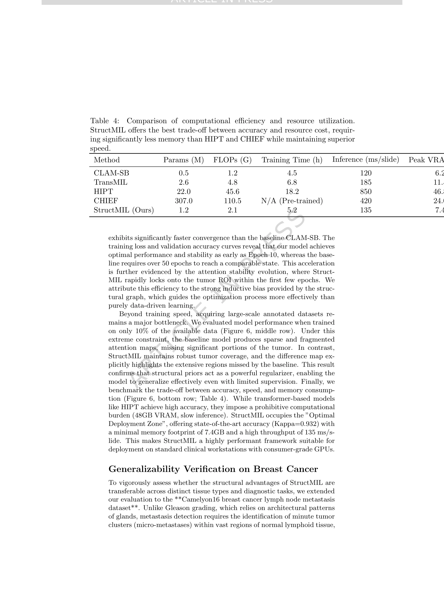
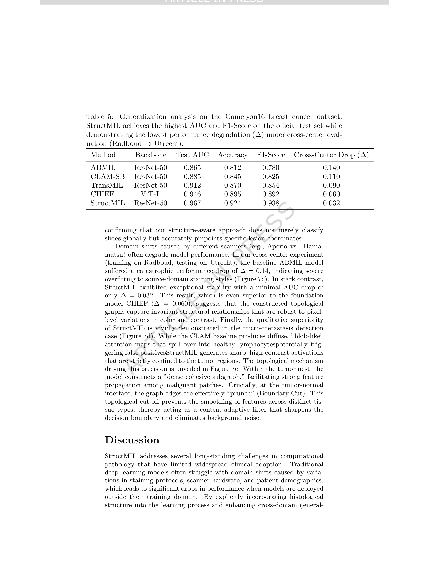
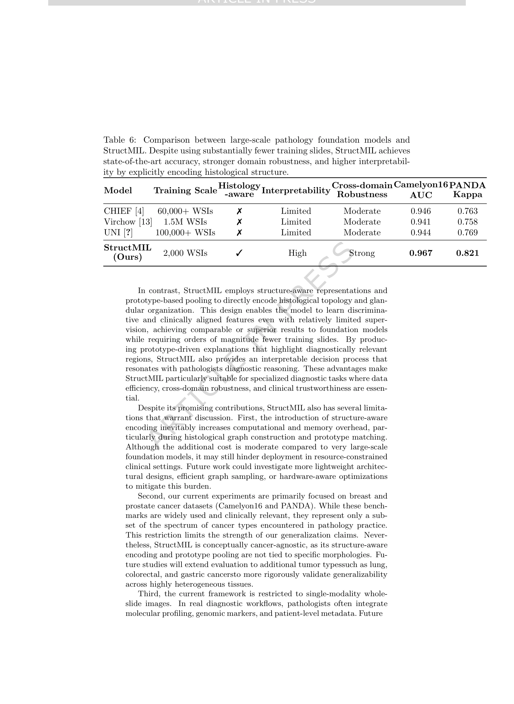
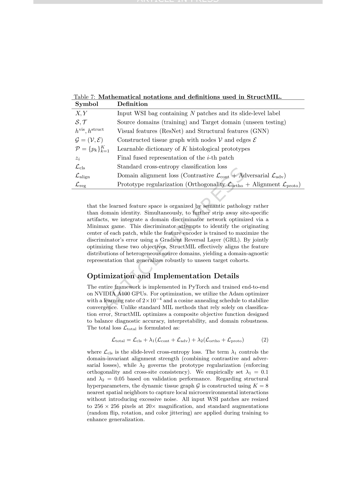
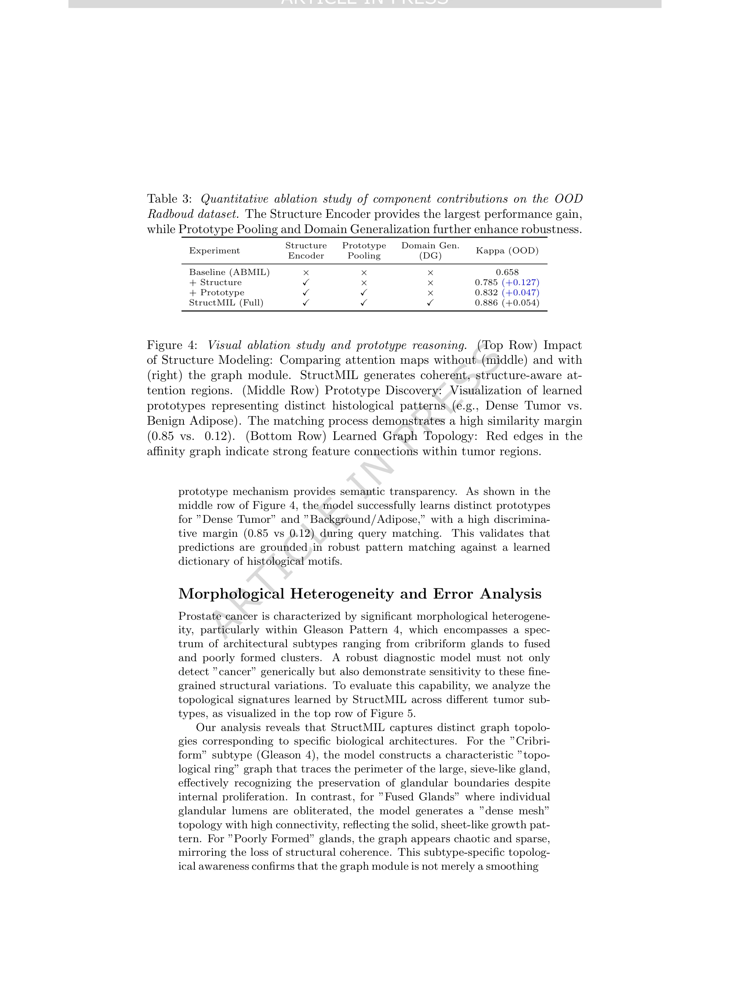

## Structure-aware generalization for heterogeneous histopathology via prototype-based multiple instance learning

> data: CAMELYON16、PANDA 的 Karolinska/Radboud 队列
>
> npj Digital Medicine 2026 · [论文](https://doi.org/10.1038/s41746-025-02289-4)

#### 引言

将组织拓扑、原型增强池化与域泛化目标结合，研究不同扫描仪和医疗中心间的癌症检测与分级稳定性。

#### 方法

（1）结构先验：在 patch 表征中加入组织拓扑与上下文。

（2）原型池化：稳定预测并提供原型归因。

（3）域泛化：联合对比对齐、域混淆和一致性约束，应对扫描仪与机构差异。

<!-- wsi-complete-model -->
##### 模型结构图

所提供 PDF 第 18 页的 Figure 8 只有图注，图像位置为空白；第 7、10、13、15 页相关结果图也有图注但缺少图像，因此不把这些空白区域当作结果展示。下图依据 PDF 第 17–20 页的 Methods 整理，不是原文模型图；定量结果使用可读取的原始表格。

[查看原尺寸](assest/StructMIL/structure-from-methods.svg)

<!-- /wsi-complete-model -->

#### 实验

##### 实验设置

PANDA 中以 Karolinska 为域内、Radboud 为域外，评价 Kappa/AUC 及跨扫描仪稳定性。

##### 主要结果

域内 Kappa/AUC 为 0.932/0.979；跨域优势应在相同训练与测试来源下比较。

<!-- wsi-complete-results -->
##### 完整实验指标与对照

下列实验原页保留表头、全部行列、子图、误差说明和脚注，点击可查看原尺寸。比较时请对应相同的数据集、特征编码器和训练设置；`±`、置信区间、百分比和小数均保留原文的单位与统计口径。

| 原表/图中指标 | 读取方式 |
| --- | --- |
| ROC-AUC / AUROC | 越高越好；若原表明确为 PR-AUC，则按 PR 曲线面积读取 |
| ACC / Accuracy | 越高越好；平衡准确率、平均准确率以原表标注为准 |
| F1 | 越高越好；保留 macro / weighted / micro 等平均方式 |
| Kappa / QWK | 越高越好；加权方式与类别顺序以原表为准 |

| 原文页 | 阅读内容 | 图表及正文引用 |
| --- | --- | --- |
| PDF 第 6 页 | 实验结果 | Table 1 |
| PDF 第 9 页 | 实验结果 | Table 2 |
| PDF 第 10 页 | 消融与参数分析 | Table 3 |
| PDF 第 12 页 | 实验结果 | Table 4 |
| PDF 第 14 页 | 实验结果 | Table 5 |
| PDF 第 16 页 | 实验结果 | Table 6 |
| PDF 第 20 页 | 实验结果 | Table 7 |

**实验原页 · PDF 第 6 页**（图表及正文引用：Table 1）

[查看原尺寸](assest/StructMIL/experiment-page-06.webp)

**实验原页 · PDF 第 9 页**（图表及正文引用：Table 2）

[查看原尺寸](assest/StructMIL/experiment-page-09.webp)

**实验原页 · PDF 第 12 页**（图表及正文引用：Table 4）

[查看原尺寸](assest/StructMIL/experiment-page-12.webp)

**实验原页 · PDF 第 14 页**（图表及正文引用：Table 5）

[查看原尺寸](assest/StructMIL/experiment-page-14.webp)

**实验原页 · PDF 第 16 页**（图表及正文引用：Table 6）

[查看原尺寸](assest/StructMIL/experiment-page-16.webp)

**实验原页 · PDF 第 20 页**（图表及正文引用：Table 7）

[查看原尺寸](assest/StructMIL/experiment-page-20.webp)

展开消融、参数、数据设置及效率原页

**实验原页 · PDF 第 10 页**（图表及正文引用：Table 3）

[查看原尺寸](assest/StructMIL/experiment-page-10.webp)

<!-- /wsi-complete-results -->

##### 消融与讨论

考察结构先验、原型池化、对比对齐与域混淆，另外分析伪影和不确定性可视化。

#### 参考文献

> Structure-aware generalization for heterogeneous histopathology via prototype-based multiple instance learning
>
> npj Digital Medicine 2026 · [论文](https://doi.org/10.1038/s41746-025-02289-4)
