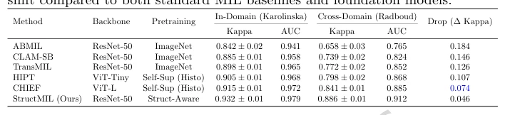

## Structure-aware generalization for heterogeneous histopathology via prototype-based multiple instance learning

> data: CAMELYON16、PANDA 的 Karolinska/Radboud 队列
>
> npj Digital Medicine 2026 · [论文](https://doi.org/10.1038/s41746-025-02289-4)

#### 引言

将组织拓扑、原型增强池化与域泛化目标结合，研究不同扫描仪和医疗中心间的癌症检测与分级稳定性。

#### 方法

（1）结构先验：在 patch 表征中加入组织拓扑与上下文。

（2）原型池化：稳定预测并提供原型归因。

（3）域泛化：联合对比对齐、域混淆和一致性约束，应对扫描仪与机构差异。

#### 实验

##### 实验设置

PANDA 中以 Karolinska 为域内、Radboud 为域外，评价 Kappa/AUC 及跨扫描仪稳定性。

##### 主要结果

域内 Kappa/AUC 为 0.932/0.979；跨域优势应在相同训练与测试来源下比较。

原文Table 1，PDF 第 6 页。

##### 消融与讨论

考察结构先验、原型池化、对比对齐与域混淆，另外分析伪影和不确定性可视化。

#### 参考文献

> Structure-aware generalization for heterogeneous histopathology via prototype-based multiple instance learning
>
> npj Digital Medicine 2026 · [论文](https://doi.org/10.1038/s41746-025-02289-4)
