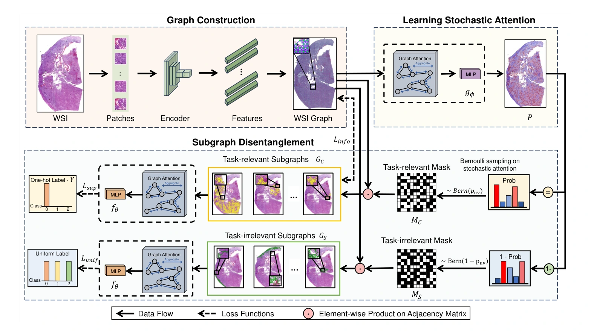
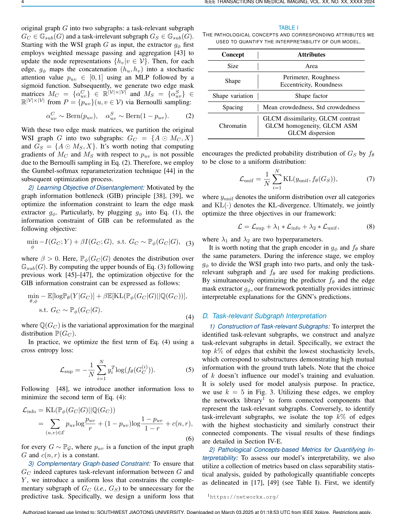
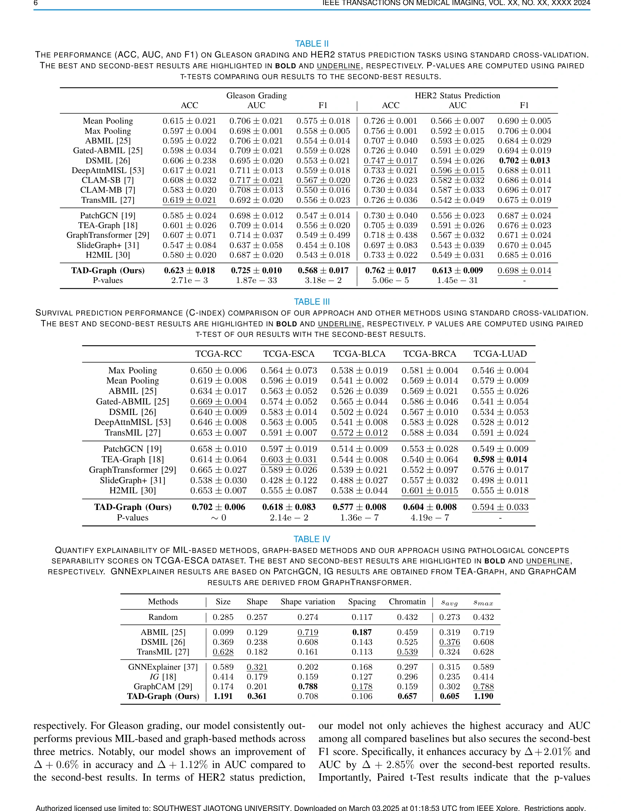
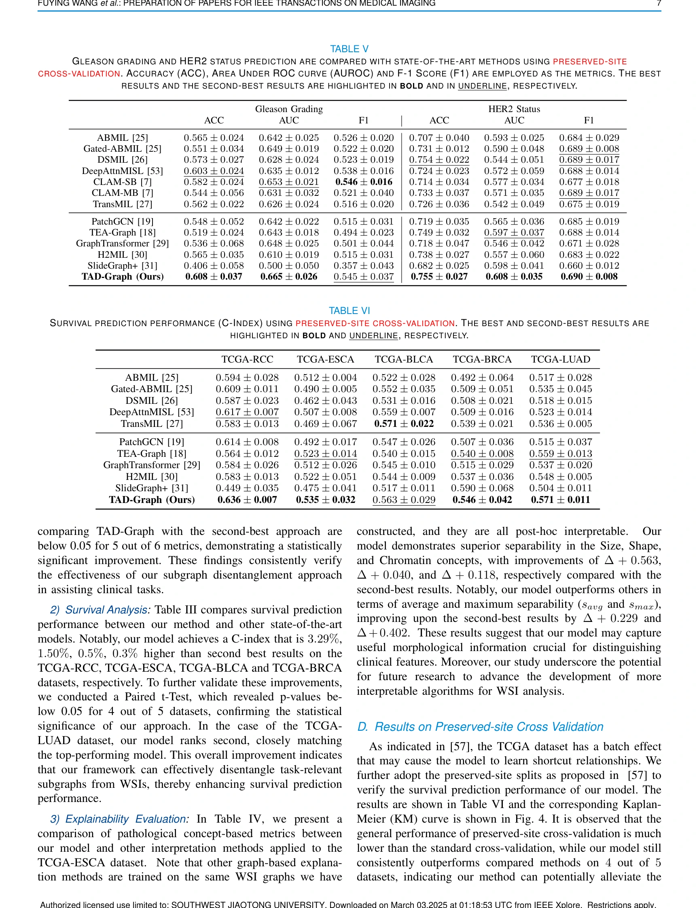
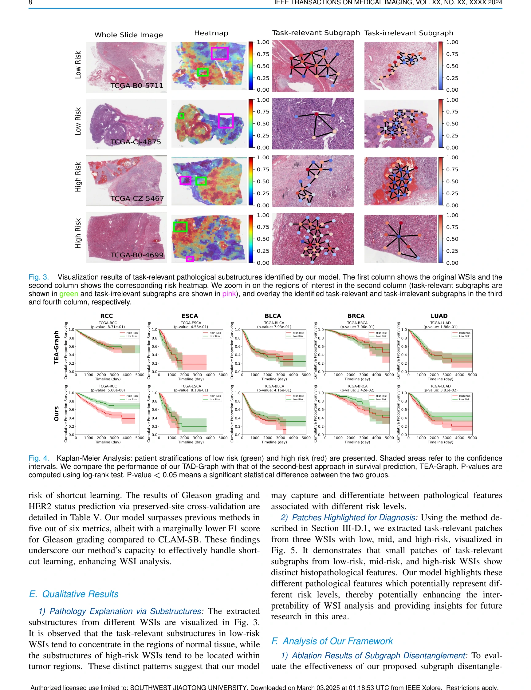
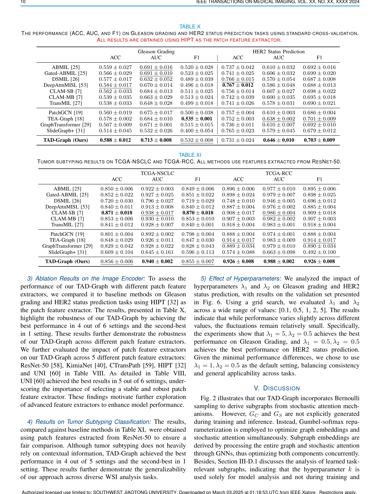
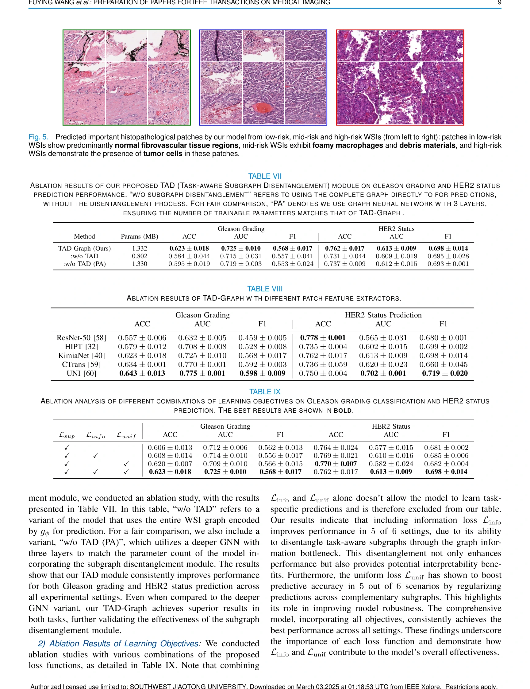
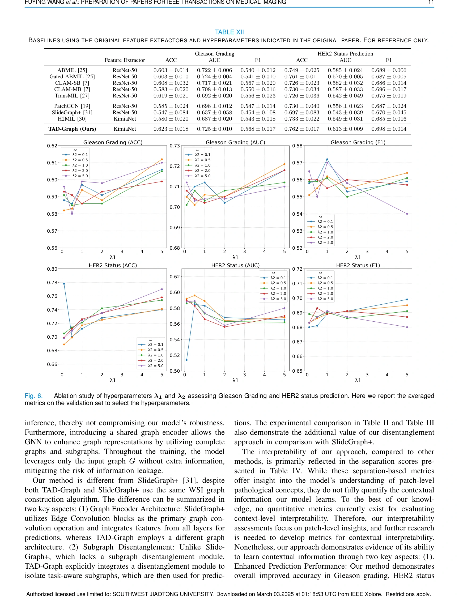

## TAD-Graph: Enhancing Whole Slide Image Analysis via Task-Aware Subgraph Disentanglement

> data: TCGA-PRAD、TCGA-BRCA 及 RCC/ESCA/BLCA/LUAD 等生存队列
>
> IEEE Transactions on Medical Imaging 2025 · [论文](https://doi.org/10.1109/TMI.2025.3545680) · [作者代码](https://github.com/fuying-wang/TAD-Graph)

#### 引言

将 WSI 图分解为任务相关和无关子图，以随机边连接及图信息瓶颈目标控制信息流，减少大图中的伪相关与过拟合。

#### 方法

（1）随机图：在 WSI 图的边上注入随机性以控制信息通路。

（2）任务解耦：将图划为相关与无关子图。

（3）信息瓶颈：约束相关图保留预测信息，同时抑制非任务关联。

<!-- wsi-complete-model -->
##### 模型结构图

**图 2 · 模型结构**（PDF 第 3 页）

> 原文图注：Fig. 2. The proposed TAD-Graph framework: we disentangle the constructed WSI graph into task-relevant and task-irrelevant subgraphs using Bernoulli sampling on learned stochastic attention edges. Both subgraphs are processed with the same prediction head, optimized to produce ground truth labels and uniform labels, respectively. Additionally, we incorporate an information loss derived from graph information bottleneck.

[查看原尺寸](assest/TAD-Graph/figure-2-complete.webp)

<!-- /wsi-complete-model -->

#### 实验

##### 实验设置

覆盖 Gleason 分级、HER2 状态和生存预测；生存结果报告 C-index，另做配对统计检验。

##### 主要结果

五个生存数据集中的四个达到所报显著性，LUAD 中位列第二；不能表述为每个任务均最佳。

<!-- wsi-complete-results -->
##### 完整实验指标与对照

下列实验原页保留表头、全部行列、子图、误差说明和脚注，点击可查看原尺寸。比较时请对应相同的数据集、特征编码器和训练设置；`±`、置信区间、百分比和小数均保留原文的单位与统计口径。

| 原表/图中指标 | 读取方式 |
| --- | --- |
| ROC-AUC / AUROC | 越高越好；若原表明确为 PR-AUC，则按 PR 曲线面积读取 |
| ACC / Accuracy | 越高越好；平衡准确率、平均准确率以原表标注为准 |
| F1 | 越高越好；保留 macro / weighted / micro 等平均方式 |
| C-index | 越高越好；用于生存预测，需保留终点及删失设置 |

| 原文页 | 阅读内容 | 图表及正文引用 |
| --- | --- | --- |
| PDF 第 4 页 | 实验结果 | Table I |
| PDF 第 6 页 | 实验结果 | Table II、Table III、Table IV |
| PDF 第 7 页 | 实验结果 | Table V、Table VI |
| PDF 第 8 页 | 实验结果 | Figure 4 |
| PDF 第 9 页 | 消融与参数分析 | Table VII、Table VIII、Table IX |
| PDF 第 10 页 | 实验结果 | Table X、Table XI |
| PDF 第 11 页 | 消融与参数分析 | Table XII、Figure 6 |

**实验原页 · PDF 第 4 页**（图表及正文引用：Table I）

[查看原尺寸](assest/TAD-Graph/experiment-page-04.webp)

**实验原页 · PDF 第 6 页**（图表及正文引用：Table II、Table III、Table IV）

[查看原尺寸](assest/TAD-Graph/experiment-page-06.webp)

**实验原页 · PDF 第 7 页**（图表及正文引用：Table V、Table VI）

[查看原尺寸](assest/TAD-Graph/experiment-page-07.webp)

**实验原页 · PDF 第 8 页**（图表及正文引用：Figure 4）

[查看原尺寸](assest/TAD-Graph/experiment-page-08.webp)

**实验原页 · PDF 第 10 页**（图表及正文引用：Table X、Table XI）

[查看原尺寸](assest/TAD-Graph/experiment-page-10.webp)

展开消融、参数、数据设置及效率原页

**实验原页 · PDF 第 9 页**（图表及正文引用：Table VII、Table VIII、Table IX）

[查看原尺寸](assest/TAD-Graph/experiment-page-09.webp)

**实验原页 · PDF 第 11 页**（图表及正文引用：Table XII、Figure 6）

[查看原尺寸](assest/TAD-Graph/experiment-page-11.webp)

<!-- /wsi-complete-results -->

##### 消融与讨论

比较任务相关/无关子图、随机边与信息瓶颈约束，并用病理概念检查子图解释。

#### 参考文献

> TAD-Graph: Enhancing Whole Slide Image Analysis via Task-Aware Subgraph Disentanglement
>
> IEEE Transactions on Medical Imaging 2025 · [论文](https://doi.org/10.1109/TMI.2025.3545680) · [作者代码](https://github.com/fuying-wang/TAD-Graph)
