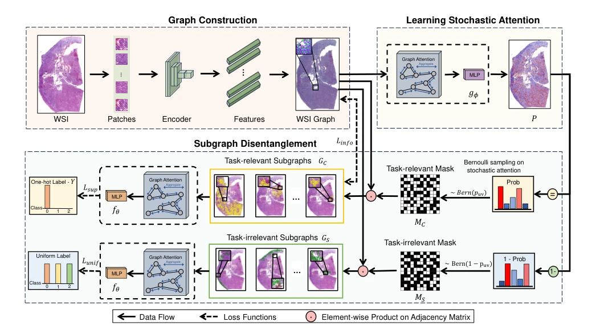

## TAD-Graph: Enhancing Whole Slide Image Analysis via Task-Aware Subgraph Disentanglement

> data: TCGA-PRAD、TCGA-BRCA 及 RCC/ESCA/BLCA/LUAD 等生存队列
>
> IEEE Transactions on Medical Imaging 2025 · [论文](https://doi.org/10.1109/TMI.2025.3545680) · [作者代码](https://github.com/fuying-wang/TAD-Graph)

#### 引言

将 WSI 图分解为任务相关和无关子图，以随机边连接及图信息瓶颈目标控制信息流，减少大图中的伪相关与过拟合。

#### 方法

（1）随机图：在 WSI 图的边上注入随机性以控制信息通路。

（2）任务解耦：将图划为相关与无关子图。

（3）信息瓶颈：约束相关图保留预测信息，同时抑制非任务关联。

原文Fig. 2，PDF 第 3 页。

#### 实验

##### 实验设置

覆盖 Gleason 分级、HER2 状态和生存预测；生存结果报告 C-index，另做配对统计检验。

##### 主要结果

五个生存数据集中的四个达到所报显著性，LUAD 中位列第二；不能表述为每个任务均最佳。

##### 消融与讨论

比较任务相关/无关子图、随机边与信息瓶颈约束，并用病理概念检查子图解释。

#### 参考文献

> TAD-Graph: Enhancing Whole Slide Image Analysis via Task-Aware Subgraph Disentanglement
>
> IEEE Transactions on Medical Imaging 2025 · [论文](https://doi.org/10.1109/TMI.2025.3545680) · [作者代码](https://github.com/fuying-wang/TAD-Graph)
