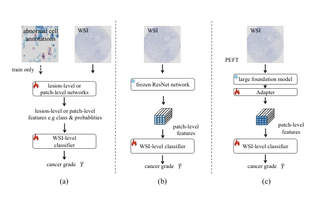
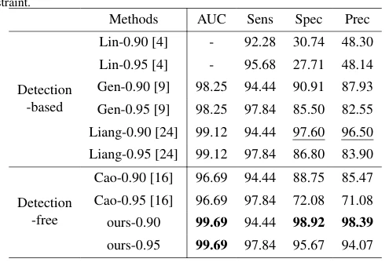

## An efficient framework based on large foundation model for cervical cytopathology whole slide image screening

> data: CSD、FNAC 2019
>
> arXiv 2024 · [论文](https://arxiv.org/abs/2407.11486) · [作者代码](https://github.com/CVIU-CSU/TCT-InfoNCE)

#### 引言

针对宫颈细胞学中稀疏异常细胞，先筛选高风险 patch，再以对比学习和轻量适配器微调基础模型，增强下游 MIL 特征。

#### 方法

（1）高风险筛选：先用已有基础模型选出可能含异常细胞的 Top-K patch。

（2）轻量适配：冻结主体，只训练新增线性适配器以控制时间和显存。

（3）对比学习：在筛选 patch 上增强任务特征，再交由切片级 MIL 分类。

原文Figure 1，PDF 第 2 页。

#### 实验

##### 实验设置

CSD 含 2,625 张宫颈 WSI，按 70%/30% 划分；FNAC 含 212 张乳腺细胞图像，按 80%/20% 划分。

##### 主要结果

除普通分类外，在敏感度至少为 0.90、0.95 时比较特异度和精确率，符合筛查中优先保证敏感度的评估逻辑。

原文Table 2，PDF 第 6 页。

##### 消融与讨论

比较风险 patch 筛选、对比学习和不同特征编码器；FNAC 的任务对象与宫颈 WSI 不同，属于迁移验证。

#### 参考文献

> An efficient framework based on large foundation model for cervical cytopathology whole slide image screening
>
> arXiv 2024 · [论文](https://arxiv.org/abs/2407.11486) · [作者代码](https://github.com/CVIU-CSU/TCT-InfoNCE)
