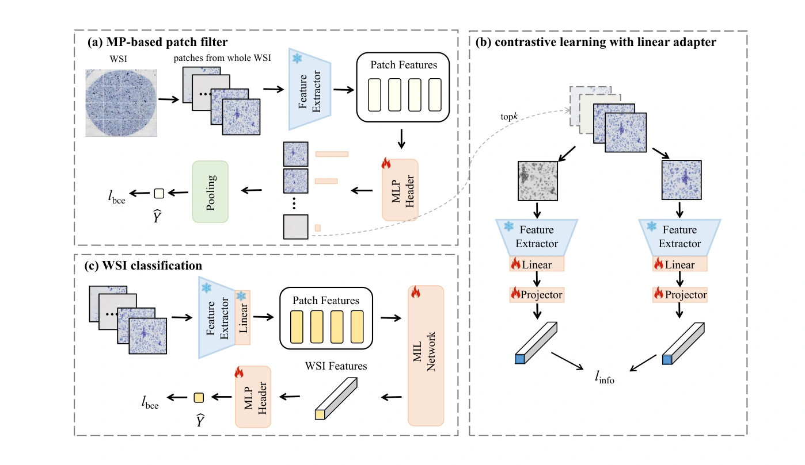
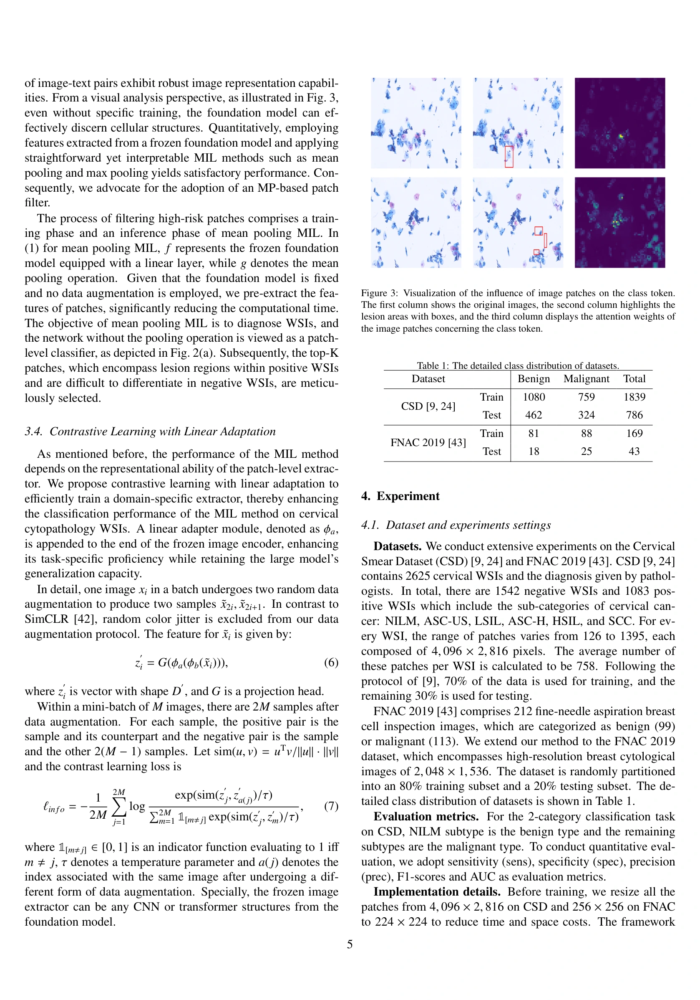
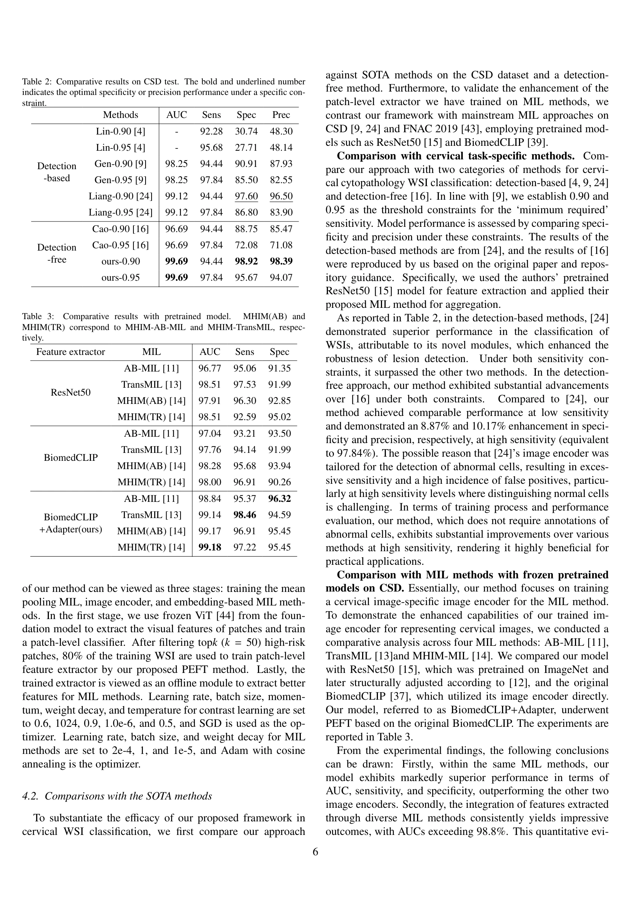
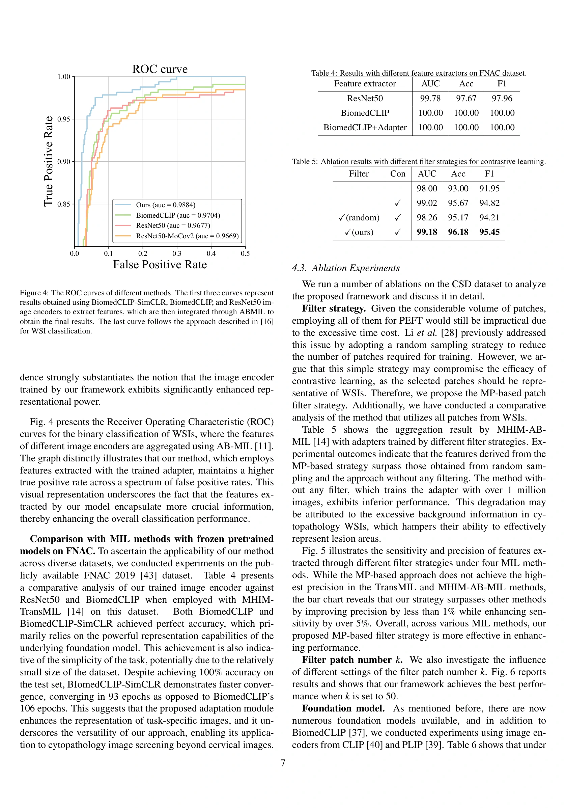
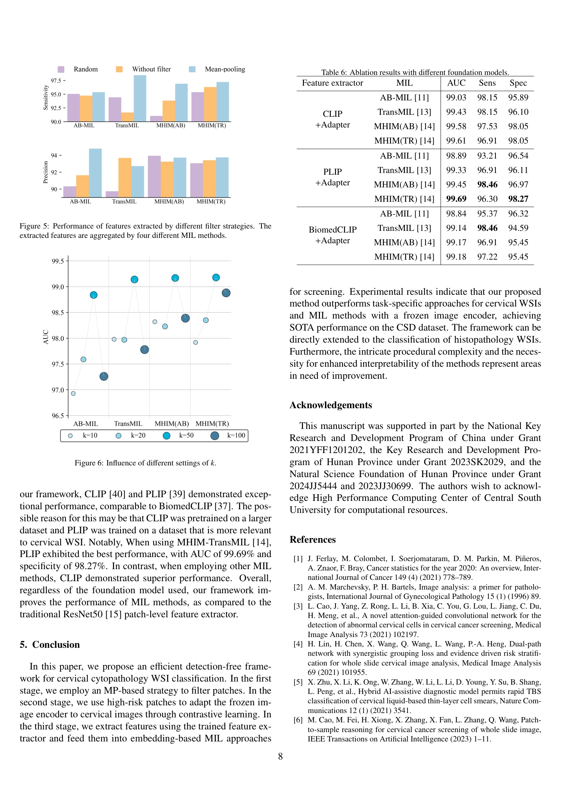

## An efficient framework based on large foundation model for cervical cytopathology whole slide image screening

> data: CSD、FNAC 2019
>
> arXiv 2024 · [论文](https://arxiv.org/abs/2407.11486) · [作者代码](https://github.com/CVIU-CSU/TCT-InfoNCE)

#### 引言

针对宫颈细胞学中稀疏异常细胞，先筛选高风险 patch，再以对比学习和轻量适配器微调基础模型，增强下游 MIL 特征。

#### 方法

（1）高风险筛选：先用已有基础模型选出可能含异常细胞的 Top-K patch。

（2）轻量适配：冻结主体，只训练新增线性适配器以控制时间和显存。

（3）对比学习：在筛选 patch 上增强任务特征，再交由切片级 MIL 分类。

<!-- wsi-complete-model -->
##### 模型结构图

**图 2 · 模型结构**（PDF 第 4 页）

> 原文图注：Figure 2: Framework of our method. (a) topk high-risk patches are selected by using filter strategy and used to train the frozen image encoder with adapter by contrastive learning. All patches are sent to the feature extractor with an adapter to extract patch features, and the patch features from one WSI are fed to the MIL network to make the final prediction. (b) Our filter strategy is training an MP-based method and using patch scores to filter patches.

[查看原尺寸](assest/TCT-InfoNCE/figure-2-complete.webp)

<!-- /wsi-complete-model -->

#### 实验

##### 实验设置

CSD 含 2,625 张宫颈 WSI，按 70%/30% 划分；FNAC 含 212 张乳腺细胞图像，按 80%/20% 划分。

##### 主要结果

除普通分类外，在敏感度至少为 0.90、0.95 时比较特异度和精确率，符合筛查中优先保证敏感度的评估逻辑。

<!-- wsi-complete-results -->
##### 完整实验指标与对照

下列实验原页保留表头、全部行列、子图、误差说明和脚注，点击可查看原尺寸。比较时请对应相同的数据集、特征编码器和训练设置；`±`、置信区间、百分比和小数均保留原文的单位与统计口径。

| 原表/图中指标 | 读取方式 |
| --- | --- |
| Precision | 越高越好；需结合 Recall 及分类阈值 |
| Specificity | 越高越好；若固定敏感度，须保留对应工作点 |

| 原文页 | 阅读内容 | 图表及正文引用 |
| --- | --- | --- |
| PDF 第 5 页 | 实验结果 | Table 1 |
| PDF 第 6 页 | 实验结果 | Table 2、Table 3 |
| PDF 第 7 页 | 实验结果 | Figure 4、Table 4、Table 5 |
| PDF 第 8 页 | 实验结果 | Figure 5、Table 6 |

**实验原页 · PDF 第 5 页**（图表及正文引用：Table 1）

[查看原尺寸](assest/TCT-InfoNCE/experiment-page-05.webp)

**实验原页 · PDF 第 6 页**（图表及正文引用：Table 2、Table 3）

[查看原尺寸](assest/TCT-InfoNCE/experiment-page-06.webp)

**实验原页 · PDF 第 7 页**（图表及正文引用：Figure 4、Table 4、Table 5）

[查看原尺寸](assest/TCT-InfoNCE/experiment-page-07.webp)

**实验原页 · PDF 第 8 页**（图表及正文引用：Figure 5、Table 6）

[查看原尺寸](assest/TCT-InfoNCE/experiment-page-08.webp)

<!-- /wsi-complete-results -->

##### 消融与讨论

比较风险 patch 筛选、对比学习和不同特征编码器；FNAC 的任务对象与宫颈 WSI 不同，属于迁移验证。

#### 参考文献

> An efficient framework based on large foundation model for cervical cytopathology whole slide image screening
>
> arXiv 2024 · [论文](https://arxiv.org/abs/2407.11486) · [作者代码](https://github.com/CVIU-CSU/TCT-InfoNCE)
