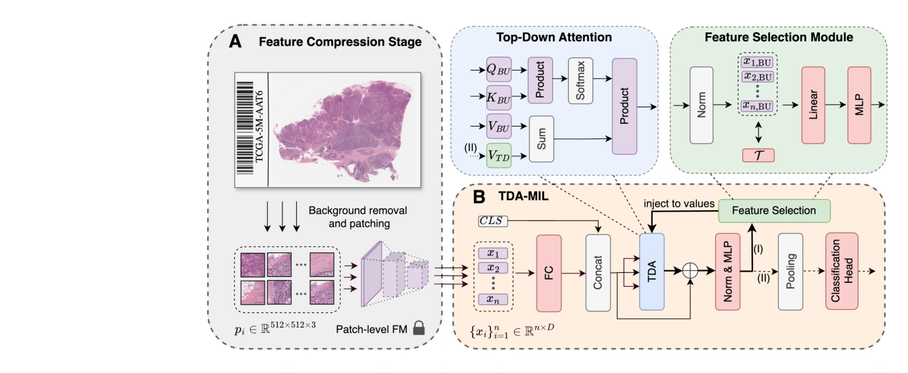
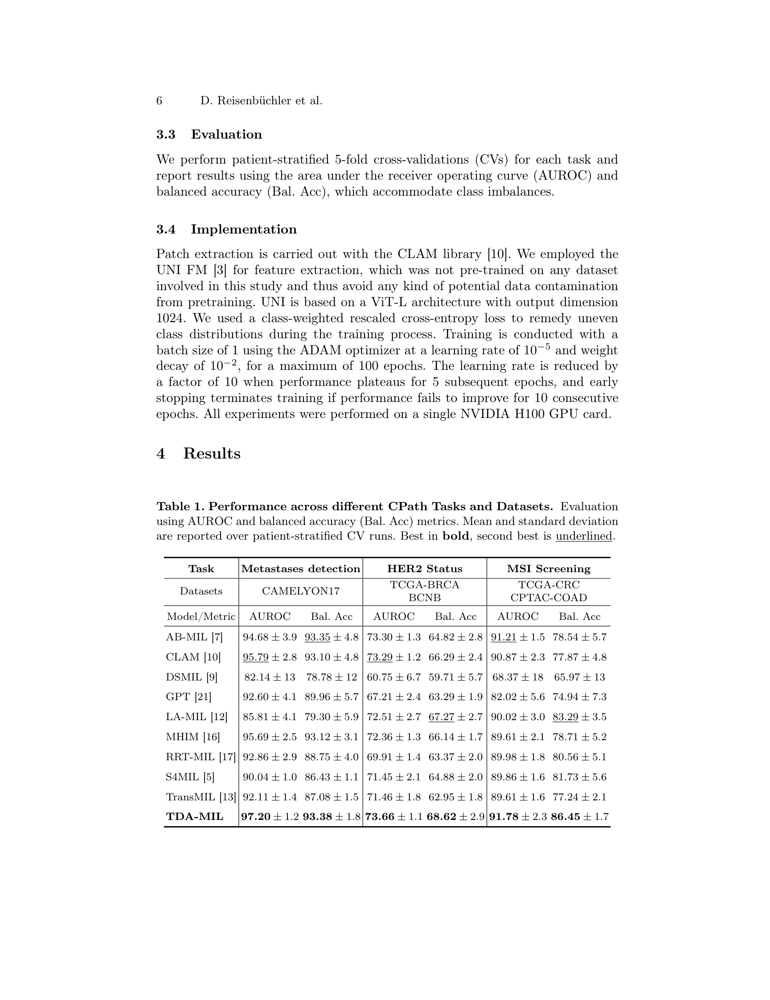
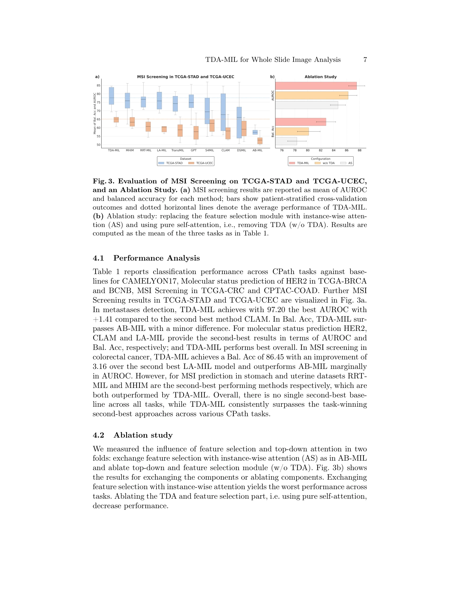

## Top-Down Attention-based Multiple Instance Learning for Whole Slide Image Analysis

> data: CAMELYON17、TCGA-CRC、CPTAC-COAD、TCGA-STAD、TCGA-UCEC、TCGA-BRCA
>
> MICCAI 2025（PDF 与作者代码） · [论文](https://papers.miccai.org/miccai-2025/0933-Paper2460.html) · [作者代码](https://github.com/agentdr1/TDA_MIL)

#### 引言

先用自注意力获得通用表示，再筛选任务相关实例并回注注意力进行第二轮推理，增强对细微病灶和分子状态线索的关注。

#### 方法

（1）首次推理：自注意力学习通用实例关系。

（2）任务筛选：从首轮表示中选出与目标任务相关的实例。

（3）回注推理：将选中实例再送入注意力，使第二轮聚焦任务细节。

<!-- wsi-complete-model -->
##### 模型结构图

**图 1 · 模型结构**（PDF 第 3 页）

> 原文图注：Fig. 1. Overview of the TDA-MIL pipeline. (A) The offline feature compression stage removes background areas, tessellates the WSI, and extracts patch-level features via a pathology foundation model. (B) The online aggregation stage then proceeds in two steps: (I) dimensionality reduction, self-attention-based contextualization, and feature selection, followed by (II) injecting the selected task-relevant features back into the self-attention mechanism for the final WSI-level prediction.

[查看原尺寸](assest/TDA-MIL/figure-1-complete.webp)

<!-- /wsi-complete-model -->

#### 实验

##### 实验设置

分别评估转移检测、MSI 和 HER2；用 AUROC 与平衡 ACC，病例分层交叉验证。

##### 主要结果

不同任务合并时保留各自阳性比例；例如 CAMELYON17 二分类有 182 阳性、318 阴性。

<!-- wsi-complete-results -->
##### 完整实验指标与对照

下列实验原页保留表头、全部行列、子图、误差说明和脚注，点击可查看原尺寸。比较时请对应相同的数据集、特征编码器和训练设置；`±`、置信区间、百分比和小数均保留原文的单位与统计口径。

| 原表/图中指标 | 读取方式 |
| --- | --- |
| ROC-AUC / AUROC | 越高越好；若原表明确为 PR-AUC，则按 PR 曲线面积读取 |
| ACC / Accuracy | 越高越好；平衡准确率、平均准确率以原表标注为准 |

| 原文页 | 阅读内容 | 图表及正文引用 |
| --- | --- | --- |
| PDF 第 6 页 | 实验结果 | Table 1 |
| PDF 第 7 页 | 消融与参数分析 | Figure 3 |

**实验原页 · PDF 第 6 页**（图表及正文引用：Table 1）

[查看原尺寸](assest/TDA-MIL/experiment-page-06.webp)

展开消融、参数、数据设置及效率原页

**实验原页 · PDF 第 7 页**（图表及正文引用：Figure 3）

[查看原尺寸](assest/TDA-MIL/experiment-page-07.webp)

<!-- /wsi-complete-results -->

##### 消融与讨论

比较特征选择替代为实例注意力、去掉 top-down 回注等配置，分析二次推理的任务针对性。

#### 参考文献

> Top-Down Attention-based Multiple Instance Learning for Whole Slide Image Analysis
>
> MICCAI 2025（PDF 与作者代码） · [论文](https://papers.miccai.org/miccai-2025/0933-Paper2460.html) · [作者代码](https://github.com/agentdr1/TDA_MIL)
