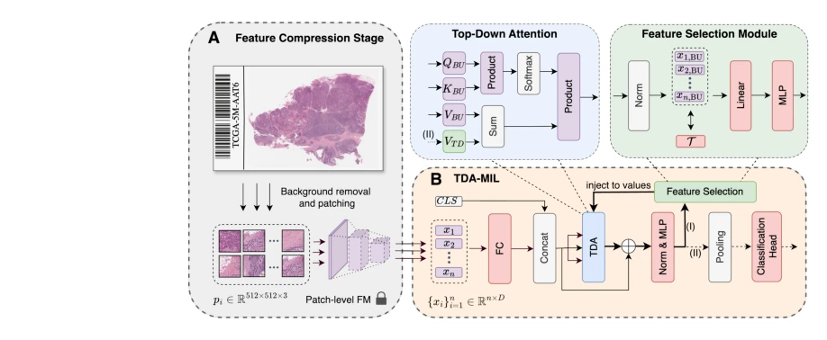
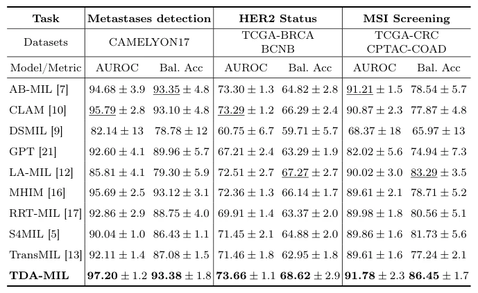

## Top-Down Attention-based Multiple Instance Learning for Whole Slide Image Analysis

> data: CAMELYON17、TCGA-CRC、CPTAC-COAD、TCGA-STAD、TCGA-UCEC、TCGA-BRCA
>
> MICCAI 2025（PDF 与作者代码） · [论文](https://papers.miccai.org/miccai-2025/0933-Paper2460.html) · [作者代码](https://github.com/agentdr1/TDA_MIL)

#### 引言

先用自注意力获得通用表示，再筛选任务相关实例并回注注意力进行第二轮推理，增强对细微病灶和分子状态线索的关注。

#### 方法

（1）首次推理：自注意力学习通用实例关系。

（2）任务筛选：从首轮表示中选出与目标任务相关的实例。

（3）回注推理：将选中实例再送入注意力，使第二轮聚焦任务细节。

原文Fig. 1，PDF 第 3 页。

#### 实验

##### 实验设置

分别评估转移检测、MSI 和 HER2；用 AUROC 与平衡 ACC，病例分层交叉验证。

##### 主要结果

不同任务合并时保留各自阳性比例；例如 CAMELYON17 二分类有 182 阳性、318 阴性。

原文Table 1，PDF 第 6 页。

##### 消融与讨论

比较特征选择替代为实例注意力、去掉 top-down 回注等配置，分析二次推理的任务针对性。

#### 参考文献

> Top-Down Attention-based Multiple Instance Learning for Whole Slide Image Analysis
>
> MICCAI 2025（PDF 与作者代码） · [论文](https://papers.miccai.org/miccai-2025/0933-Paper2460.html) · [作者代码](https://github.com/agentdr1/TDA_MIL)
