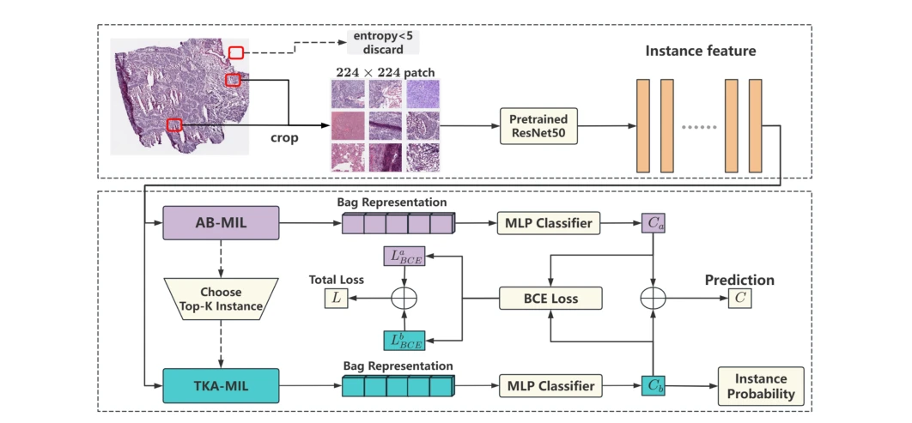
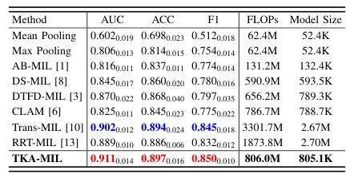

## TKA-MIL: Top-K Attention Multiple Instance Learning for Whole Slide Image Classification and Instance Probability Derivation

> data: CAMELYON16、TCGA Lung Cancer
>
> ICASSP 2025 · [论文](https://doi.org/10.1109/ICASSP49660.2025.10888939)

#### 引言

只建模全部实例与 Top-K 关键实例之间的关系，以降低注意力计算量，并从注意力权重推导实例阳性概率。

#### 方法

（1）Top-K 选择：先确定少量重要实例作为交互参照。

（2）简化注意力：只计算全部实例与关键实例之间的关系。

（3）概率推导：由模型结构与权重估计实例阳性概率，而非直接使用归一化注意力。

原文Fig. 1，PDF 第 3 页。

#### 实验

##### 实验设置

C16 在官方训练部分做五折；TCGA 采用 6:1.5:2.5 的四折划分；训练 200 epochs，K=20。

##### 主要结果

C16 上优于比较基线，TCGA 与 TransMIL/RRT-MIL 相近，同时计算复杂度更低；不能只看单一最优指标。

原文TABLE I，PDF 第 4 页。

##### 消融与讨论

同时检查 Top-K 关键实例关系与实例阳性概率推导，概率质量不能直接由注意力热图替代。

#### 参考文献

> TKA-MIL: Top-K Attention Multiple Instance Learning for Whole Slide Image Classification and Instance Probability Derivation
>
> ICASSP 2025 · [论文](https://doi.org/10.1109/ICASSP49660.2025.10888939)
