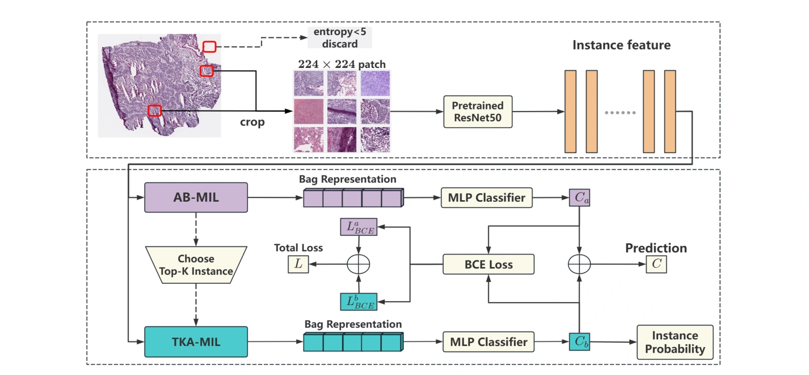
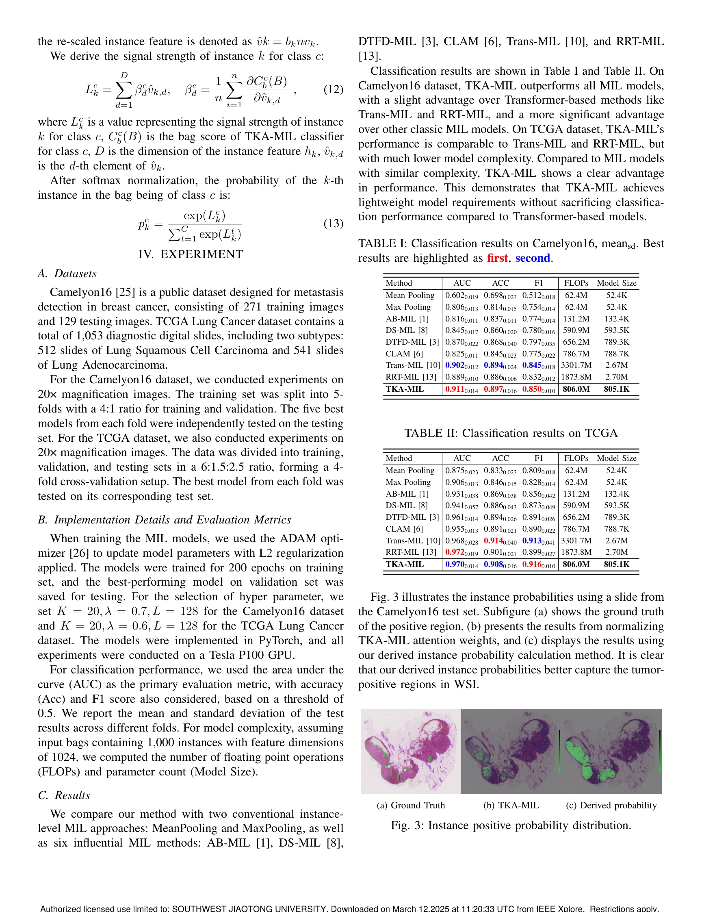

## TKA-MIL: Top-K Attention Multiple Instance Learning for Whole Slide Image Classification and Instance Probability Derivation

> data: CAMELYON16、TCGA Lung Cancer
>
> ICASSP 2025 · [论文](https://doi.org/10.1109/ICASSP49660.2025.10888939)

#### 引言

只建模全部实例与 Top-K 关键实例之间的关系，以降低注意力计算量，并从注意力权重推导实例阳性概率。

#### 方法

（1）Top-K 选择：先确定少量重要实例作为交互参照。

（2）简化注意力：只计算全部实例与关键实例之间的关系。

（3）概率推导：由模型结构与权重估计实例阳性概率，而非直接使用归一化注意力。

<!-- wsi-complete-model -->
##### 模型结构图

**图 1 · 模型结构**（PDF 第 3 页）

> 原文图注：Fig. 1: Overall model framework, including WSI preprocessing for feature extraction and the MIL aggregator. The latter is a dual-stream network for joint learning and inference, with TKA-MIL selecting the top K critical instances from AB-MIL.

[查看原尺寸](assest/TKA-MIL/figure-1-complete.webp)

<!-- /wsi-complete-model -->

#### 实验

##### 实验设置

C16 在官方训练部分做五折；TCGA 采用 6:1.5:2.5 的四折划分；训练 200 epochs，K=20。

##### 主要结果

C16 上优于比较基线，TCGA 与 TransMIL/RRT-MIL 相近，同时计算复杂度更低；不能只看单一最优指标。

<!-- wsi-complete-results -->
##### 完整实验指标与对照

下列实验原页保留表头、全部行列、子图、误差说明和脚注，点击可查看原尺寸。比较时请对应相同的数据集、特征编码器和训练设置；`±`、置信区间、百分比和小数均保留原文的单位与统计口径。

| 原文页 | 阅读内容 | 图表及正文引用 |
| --- | --- | --- |
| PDF 第 4 页 | 实验结果 | Table I、Table II |

**实验原页 · PDF 第 4 页**（图表及正文引用：Table I、Table II）

[查看原尺寸](assest/TKA-MIL/experiment-page-04.webp)

<!-- /wsi-complete-results -->

##### 消融与讨论

同时检查 Top-K 关键实例关系与实例阳性概率推导，概率质量不能直接由注意力热图替代。

#### 参考文献

> TKA-MIL: Top-K Attention Multiple Instance Learning for Whole Slide Image Classification and Instance Probability Derivation
>
> ICASSP 2025 · [论文](https://doi.org/10.1109/ICASSP49660.2025.10888939)
