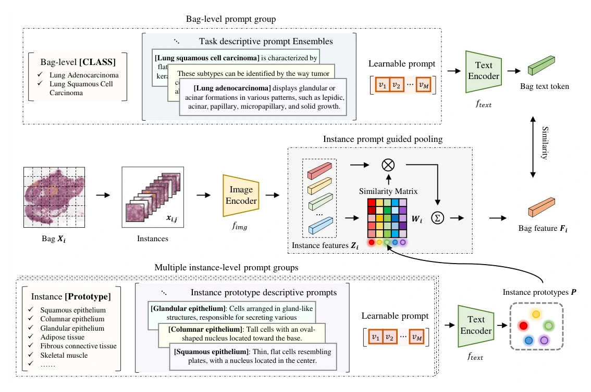
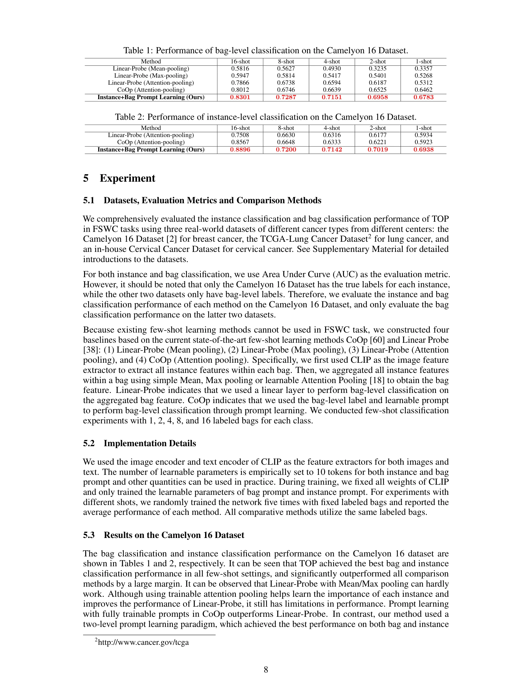
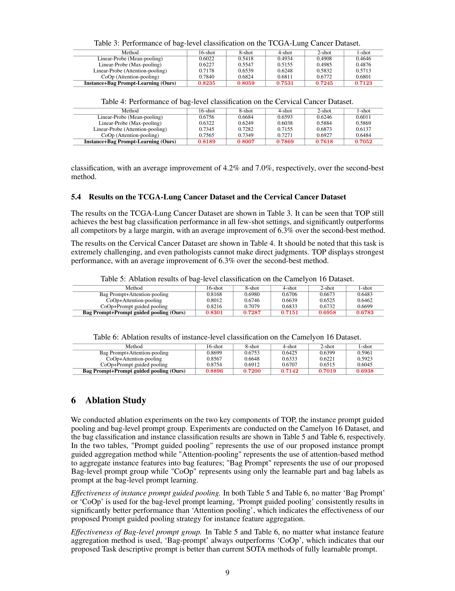
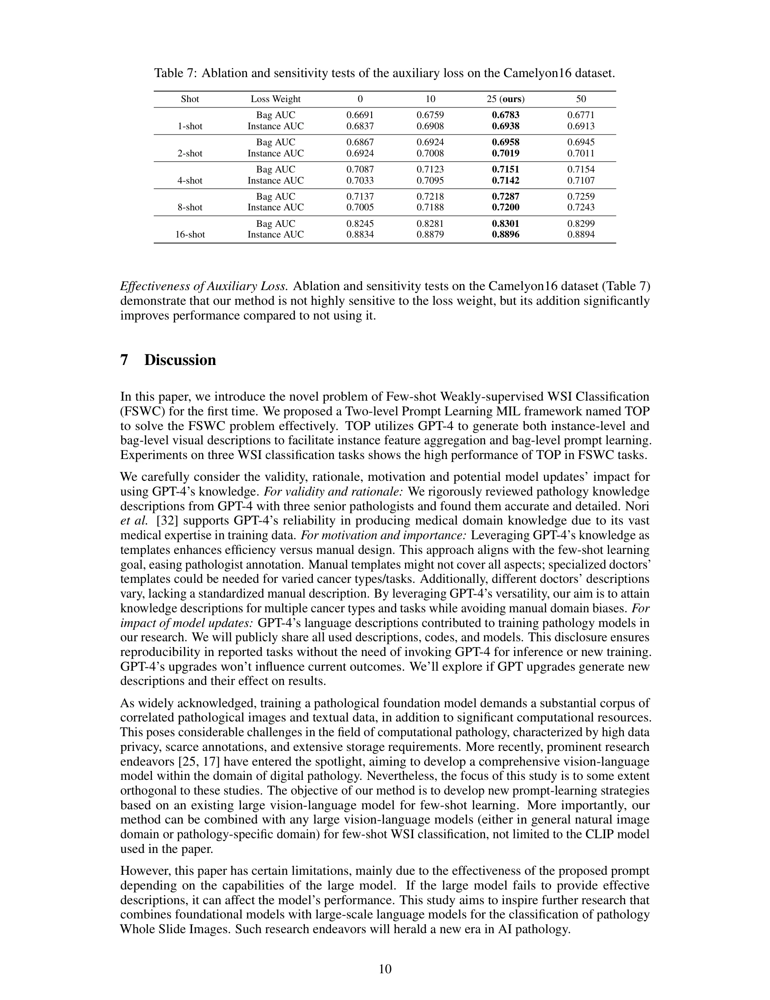

## The Rise of AI Language Pathologists: Exploring Two-level Prompt Learning for Few-shot Weakly-supervised Whole Slide Image Classification

> data: CAMELYON16、TCGA-Lung、内部宫颈癌数据
>
> NeurIPS 2023 · [论文](https://proceedings.neurips.cc/paper_files/paper/2023/hash/d599b81036fd1a3b3949b7d444f31082-Abstract-Conference.html) · [作者代码](https://github.com/miccaiif/TOP)

#### 引言

TOP 研究少样本弱监督 WSI 分类：每类只有少量带标签的切片，切片中的 patch 又没有独立标签。方法利用语言先验缓解同时存在的样本不足和实例监督歧义。

#### 方法

（1）实例级提示：借助 GPT-4 问答获得病理语言知识，将知识写入实例级文本提示，以 CLIP 对齐 patch 与描述。

（2）提示引导池化：利用实例与文本语义的对应关系聚合 patch，而不是只用固定平均或最大池化。

（3）包级提示：在切片表示上进行少样本提示学习；冻结 CLIP 权重，仅训练实例和包提示中的可学习 token。

<!-- wsi-complete-model -->
##### 模型结构图

**图 2 · 模型结构**（PDF 第 6 页）

> 原文图注：Figure 2: Framework of our proposed TOP. and optimize [V ]m in the prompt using cross-entropy loss. Other parameters, including the Image Encoder and Text Encoder of the V-L model, are frozen.

[查看原尺寸](assest/TOP/figure-2-complete.webp)

<!-- /wsi-complete-model -->

#### 实验

##### 实验设置

比较每类 1、2、4、8、16 张带标签切片的设置，采用 CLIP 图像和文本编码器。不同 shot 下固定相同的标注包，重复五次训练并报告平均结果。比较 Mean/Max/Attention Linear Probe 与 CoOp 等适配基线。

##### 主要结果

论文同时关注包分类与实例分类，但只有 CAMELYON16 具有实例真值，因此实例和包两级 AUC 仅在该数据上同时评价；肺癌与宫颈癌队列只评价包级 AUC。不同 shot 的结果应分别比较，不能把少样本实验解释成完整训练集下的常规 MIL 排名。

<!-- wsi-complete-results -->
##### 完整实验指标与对照

下列实验原页保留表头、全部行列、子图、误差说明和脚注，点击可查看原尺寸。比较时请对应相同的数据集、特征编码器和训练设置；`±`、置信区间、百分比和小数均保留原文的单位与统计口径。

| 原表/图中指标 | 读取方式 |
| --- | --- |
| ROC-AUC / AUROC | 越高越好；若原表明确为 PR-AUC，则按 PR 曲线面积读取 |
| Recall / Sensitivity | 越高越好；与固定敏感度下的特异度区别读取 |

| 原文页 | 阅读内容 | 图表及正文引用 |
| --- | --- | --- |
| PDF 第 8 页 | 实验结果 | Table 1、Table 2 |
| PDF 第 9 页 | 实验结果 | Table 3、Table 4、Table 5、Table 6 |
| PDF 第 10 页 | 消融与参数分析 | Table 7 |

**实验原页 · PDF 第 8 页**（图表及正文引用：Table 1、Table 2）

[查看原尺寸](assest/TOP/experiment-page-08.webp)

**实验原页 · PDF 第 9 页**（图表及正文引用：Table 3、Table 4、Table 5、Table 6）

[查看原尺寸](assest/TOP/experiment-page-09.webp)

展开消融、参数、数据设置及效率原页

**实验原页 · PDF 第 10 页**（图表及正文引用：Table 7）

[查看原尺寸](assest/TOP/experiment-page-10.webp)

<!-- /wsi-complete-results -->

##### 消融与讨论

需要区分实例级与包级语言先验、可学习 token 和提示引导聚合的作用。论文默认两层提示各使用 10 个可学习 token。语言模型用于提供先验，训练时并未完整微调 CLIP 或 GPT-4。

#### 参考文献

> Qu, Linhao et al. The Rise of AI Language Pathologists: Exploring Two-level Prompt Learning for Few-shot Weakly-supervised Whole Slide Image Classification. NeurIPS, 2023.

依据收藏 PDF 第 5 节实验设置与结果整理。收藏文件虽标记 TDP / 2024，正文对应 TOP / NeurIPS 2023；因此单独说明年份，不重复列入 2024 年论文。
