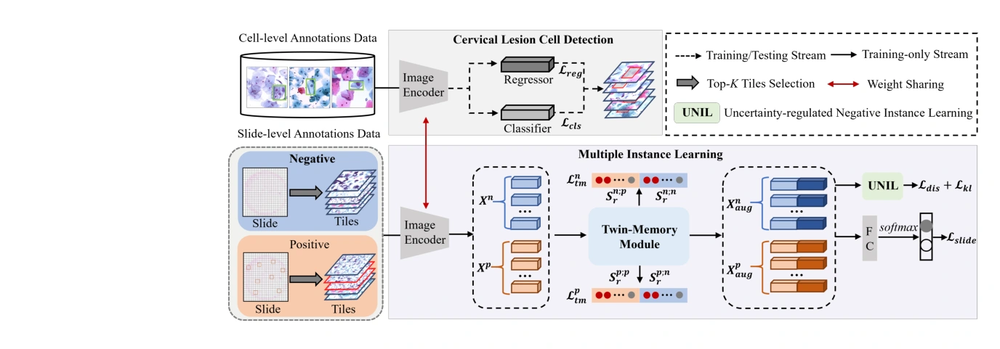
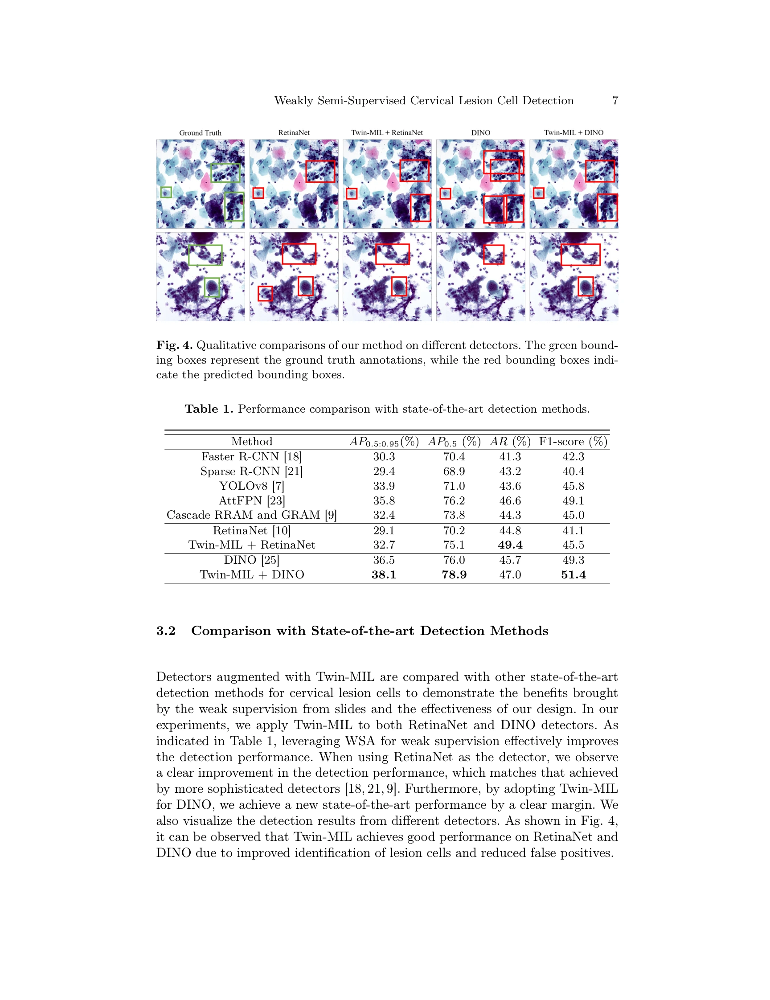
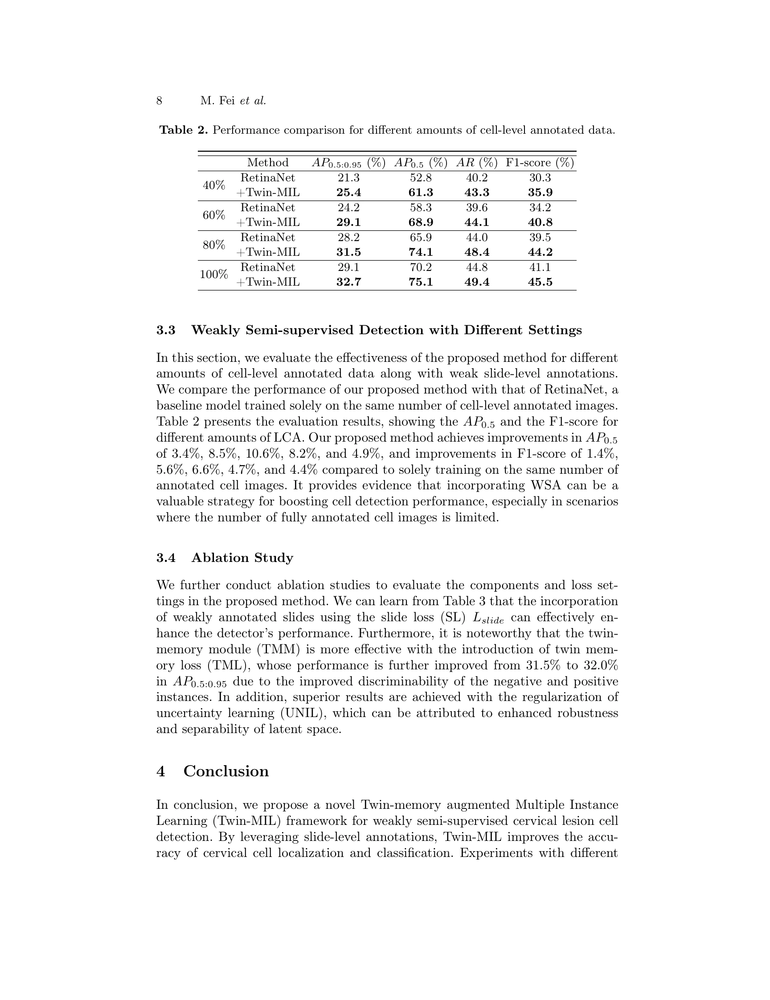
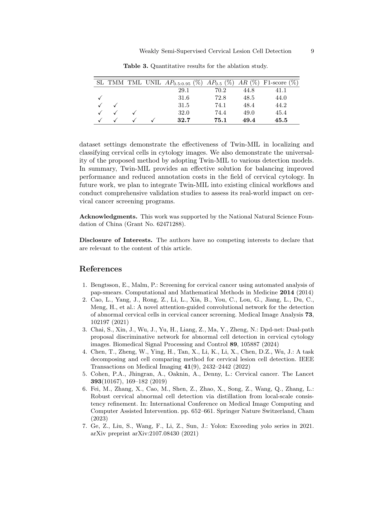

## Weakly Semi-Supervised Cervical Lesion Cell Detection via Twin-Memory Augmented Multiple Instance Learning

> data: LCA 细胞标注数据、WSA 切片弱标注数据
>
> MICCAI 2025 · [论文](https://papers.miccai.org/miccai-2025/paper/0999_paper.pdf)

#### 引言

以 MIL 连接切片级标签与细胞检测任务，通过正负双记忆模块及不确定性约束的负实例学习，减少宫颈病变细胞检测中的假阳性。

#### 方法

（1）MIL 桥接：把切片级弱标签转成可辅助细胞检测的训练信息。

（2）双记忆：分别保存阳性和阴性模式，减轻普通 MIL 假阳性。

（3）负实例约束：用不确定性控制负空间学习，增强正负分离。

<!-- wsi-complete-model -->
##### 模型结构图

**图 2 · 模型结构**（PDF 第 3 页）

> 原文图注：Fig. 2. The overview of Twin-MIL. The detection model is initially trained using LCA and further refined using WSA. The refinement process commences with top-K selection for relevant tiles, which are further encoded into positive features Xp and negative fea- tures Xn by the detector’s encoder. The twin-memory module processes these features to yield the similarity scores, and augmented features. The UNIL further constrains the negative augmented features and enlarges the margin between negative and positive.

[查看原尺寸](assest/Twin-MIL/figure-2-complete.webp)

<!-- /wsi-complete-model -->

#### 实验

##### 实验设置

LCA 含 5,035 个 tile、7,321 个标注细胞，按 8:1:1 划分；WSA 含各 1,000 张阳性和阴性切片。

##### 主要结果

不同细胞标注量下，加入弱标注使 RetinaNet 的 AP0.5 提高 3.4–10.6 个百分点，不能与完全相同标注预算之外的模型混比。

<!-- wsi-complete-results -->
##### 完整实验指标与对照

下列实验原页保留表头、全部行列、子图、误差说明和脚注，点击可查看原尺寸。比较时请对应相同的数据集、特征编码器和训练设置；`±`、置信区间、百分比和小数均保留原文的单位与统计口径。

| 原表/图中指标 | 读取方式 |
| --- | --- |
| AP / AUPRC / mAP | 越高越好；与 ROC-AUC 不同，保留任务和召回定义 |

| 原文页 | 阅读内容 | 图表及正文引用 |
| --- | --- | --- |
| PDF 第 7 页 | 实验结果 | Table 1 |
| PDF 第 8 页 | 实验结果 | Table 2 |
| PDF 第 9 页 | 消融与参数分析 | Table 3 |

**实验原页 · PDF 第 7 页**（图表及正文引用：Table 1）

[查看原尺寸](assest/Twin-MIL/experiment-page-07.webp)

**实验原页 · PDF 第 8 页**（图表及正文引用：Table 2）

[查看原尺寸](assest/Twin-MIL/experiment-page-08.webp)

展开消融、参数、数据设置及效率原页

**实验原页 · PDF 第 9 页**（图表及正文引用：Table 3）

[查看原尺寸](assest/Twin-MIL/experiment-page-09.webp)

<!-- /wsi-complete-results -->

##### 消融与讨论

比较双记忆、不确定性负实例学习，以及不同细胞级标注量，验证弱标注的补充价值。

#### 参考文献

> Weakly Semi-Supervised Cervical Lesion Cell Detection via Twin-Memory Augmented Multiple Instance Learning
>
> MICCAI 2025 · [论文](https://papers.miccai.org/miccai-2025/paper/0999_paper.pdf)
