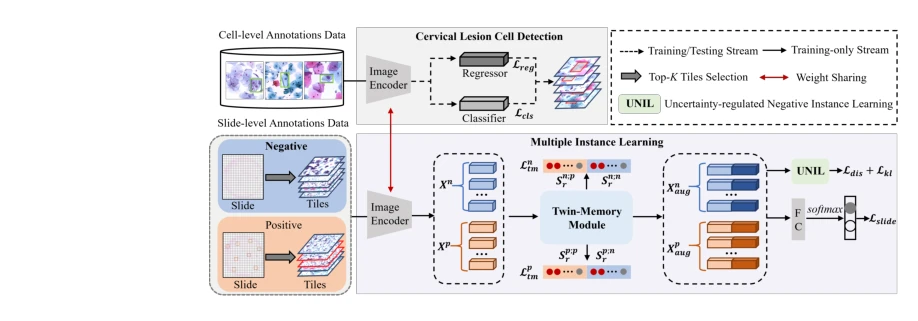
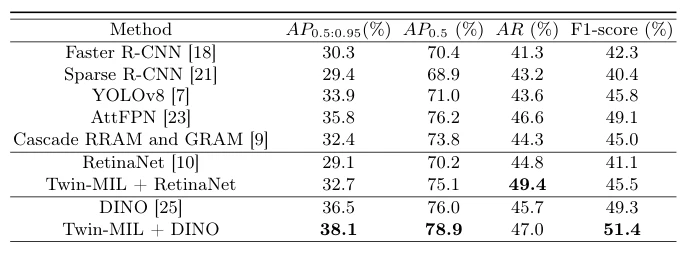

## Weakly Semi-Supervised Cervical Lesion Cell Detection via Twin-Memory Augmented Multiple Instance Learning

> data: LCA 细胞标注数据、WSA 切片弱标注数据
>
> MICCAI 2025 · [论文](https://papers.miccai.org/miccai-2025/paper/0999_paper.pdf)

#### 引言

以 MIL 连接切片级标签与细胞检测任务，通过正负双记忆模块及不确定性约束的负实例学习，减少宫颈病变细胞检测中的假阳性。

#### 方法

（1）MIL 桥接：把切片级弱标签转成可辅助细胞检测的训练信息。

（2）双记忆：分别保存阳性和阴性模式，减轻普通 MIL 假阳性。

（3）负实例约束：用不确定性控制负空间学习，增强正负分离。

原文Fig. 2，PDF 第 3 页。

#### 实验

##### 实验设置

LCA 含 5,035 个 tile、7,321 个标注细胞，按 8:1:1 划分；WSA 含各 1,000 张阳性和阴性切片。

##### 主要结果

不同细胞标注量下，加入弱标注使 RetinaNet 的 AP0.5 提高 3.4–10.6 个百分点，不能与完全相同标注预算之外的模型混比。

原文Table 1，PDF 第 7 页。

##### 消融与讨论

比较双记忆、不确定性负实例学习，以及不同细胞级标注量，验证弱标注的补充价值。

#### 参考文献

> Weakly Semi-Supervised Cervical Lesion Cell Detection via Twin-Memory Augmented Multiple Instance Learning
>
> MICCAI 2025 · [论文](https://papers.miccai.org/miccai-2025/paper/0999_paper.pdf)
