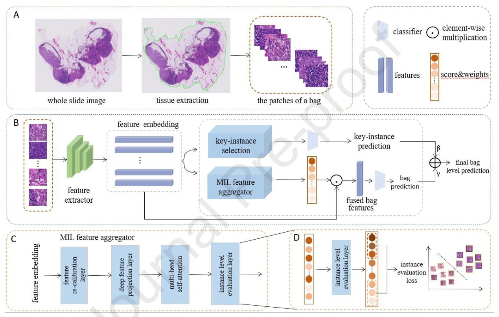
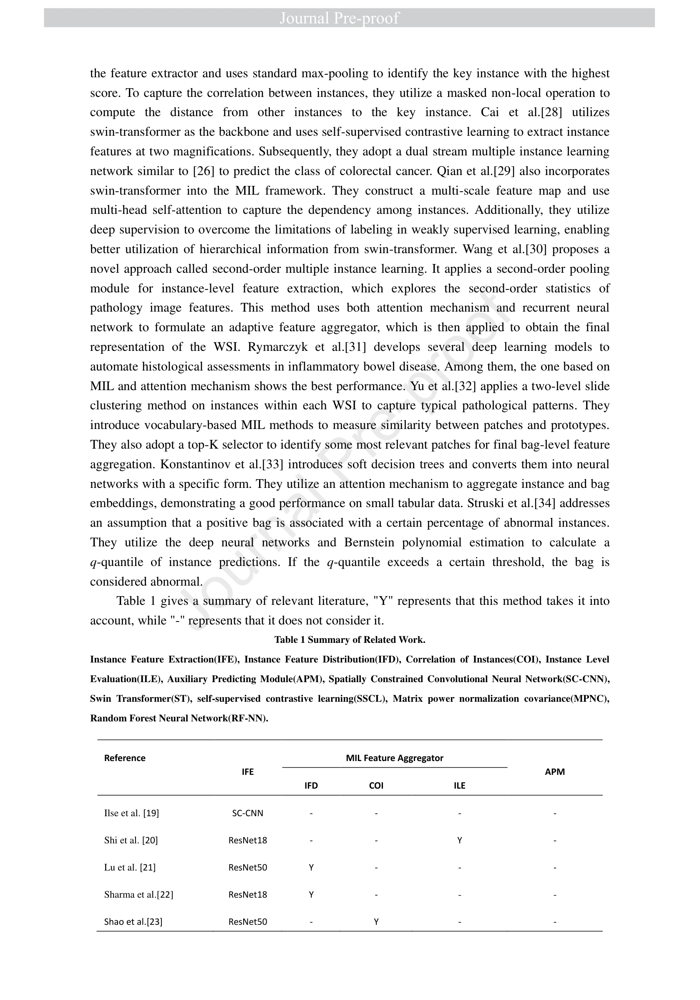
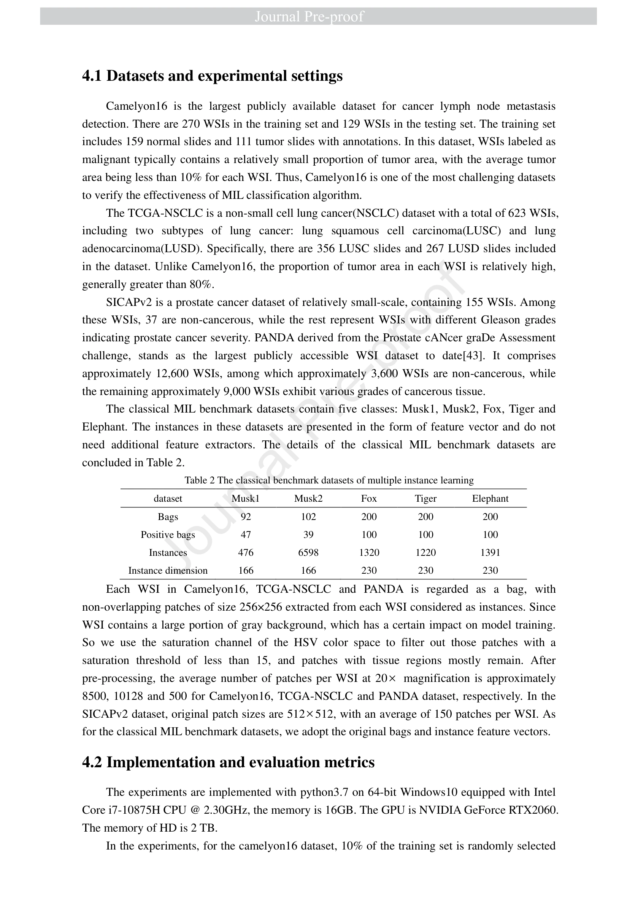
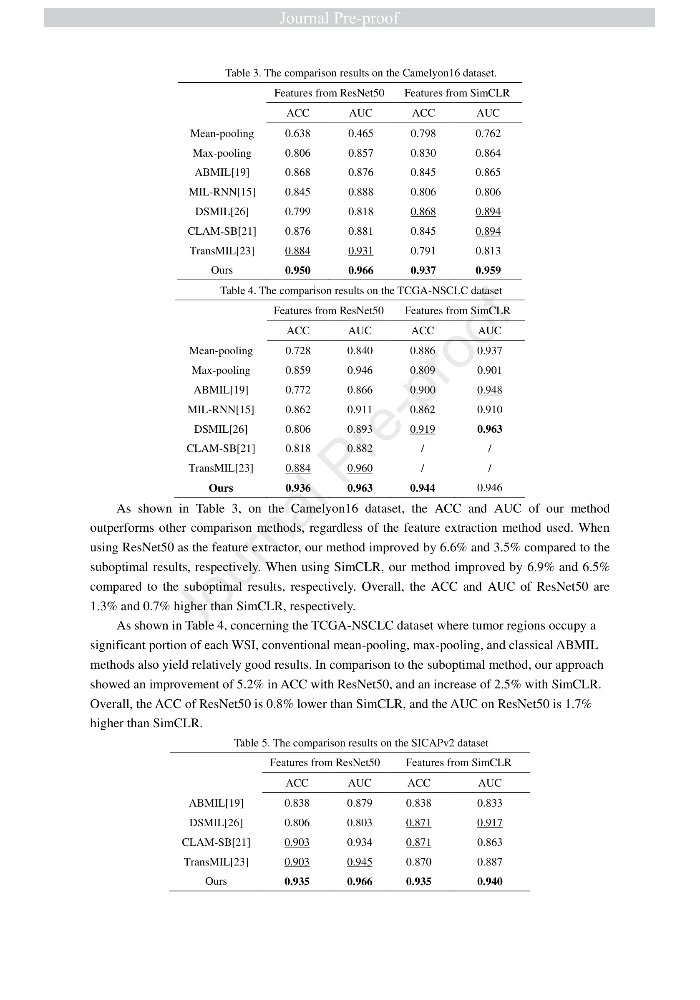
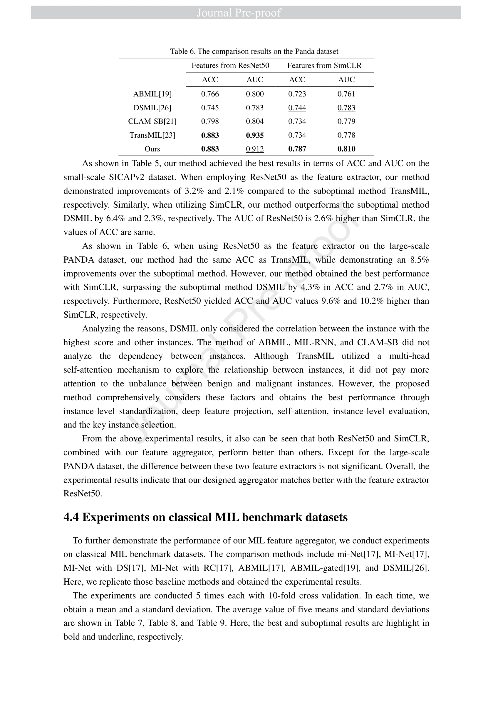
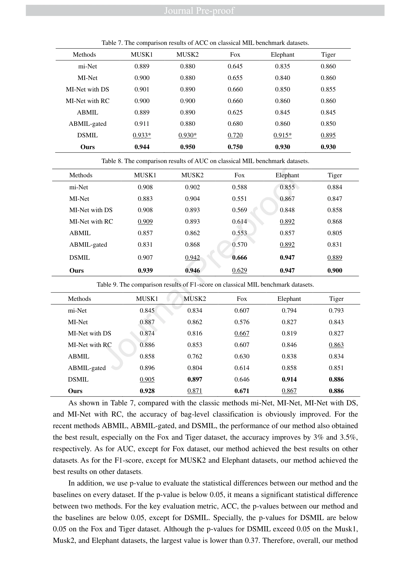
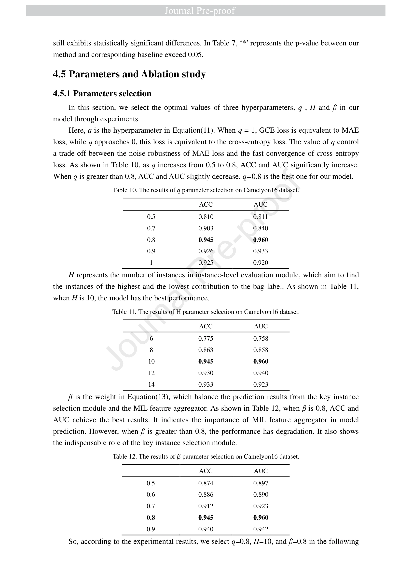
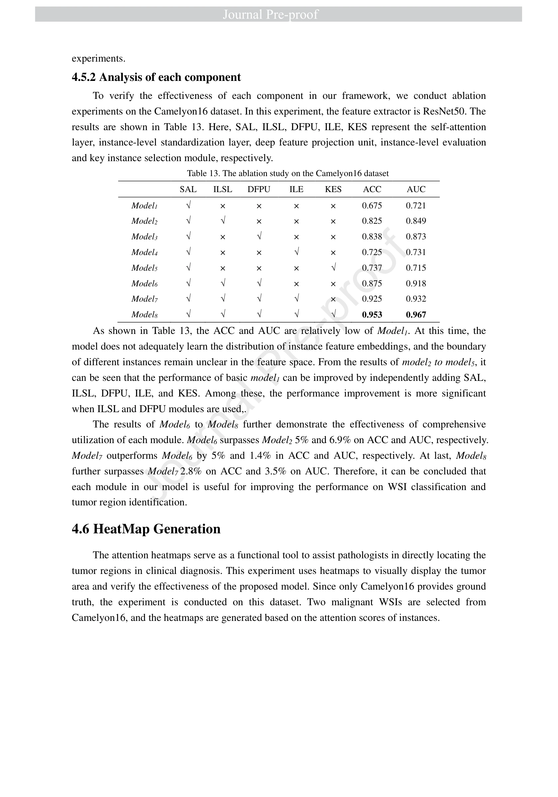

## A Universal Multiple Instance Learning Framework for Whole Slide Image Analysis

> data: CAMELYON16、TCGA-NSCLC、SICAPv2、PANDA；MUSK1/2、Fox、Tiger、Elephant
>
> Computers in Biology and Medicine 2024 · [论文](https://doi.org/10.1016/j.compbiomed.2024.108714)

#### 引言

联合实例标准化、深层投影、自注意力和实例伪标签评价进行聚合，再用关键实例选择强化局部特征，服务弱监督切片分类。

#### 方法

（1）实例标准化：调整特征分布并通过深层投影增强可分性。

（2）关系与伪标签：自注意力学习依赖，并以实例级评价补充弱监督。

（3）关键实例选择：在初步包预测外加强局部证据，再组合最终结果。

<!-- wsi-complete-model -->
##### 模型结构图

**图 1 · 模型结构**（PDF 第 7 页）

> 原文图注：Figure 1. The framework of proposed method. (a) Extracting the tissue region of WSI and dividing it into patches

[查看原尺寸](assest/Universal-MIL/figure-1-complete.webp)

<!-- /wsi-complete-model -->

#### 实验

##### 实验设置

同时检查 WSI 分类与经典 MIL 向量数据；不同任务中是否需要特征编码器不同。

##### 主要结果

实验分别比较聚合模块与关键实例选择；经典向量数据上的结果只能支持聚合泛化。

<!-- wsi-complete-results -->
##### 完整实验指标与对照

下列实验原页保留表头、全部行列、子图、误差说明和脚注，点击可查看原尺寸。比较时请对应相同的数据集、特征编码器和训练设置；`±`、置信区间、百分比和小数均保留原文的单位与统计口径。

| 原表/图中指标 | 读取方式 |
| --- | --- |
| ROC-AUC / AUROC | 越高越好；若原表明确为 PR-AUC，则按 PR 曲线面积读取 |
| ACC / Accuracy | 越高越好；平衡准确率、平均准确率以原表标注为准 |
| F1 | 越高越好；保留 macro / weighted / micro 等平均方式 |

| 原文页 | 阅读内容 | 图表及正文引用 |
| --- | --- | --- |
| PDF 第 5 页 | 实验结果 | Table 1 |
| PDF 第 13 页 | 实验结果 | Table 2 |
| PDF 第 15 页 | 实验结果 | Table 3、Table 4、Table 5 |
| PDF 第 16 页 | 实验结果 | Table 6 |
| PDF 第 17 页 | 实验结果 | Table 7、Table 8、Table 9 |
| PDF 第 18 页 | 实验结果 | Table 10、Table 11、Table 12 |
| PDF 第 19 页 | 消融与参数分析 | Table 13 |

**实验原页 · PDF 第 5 页**（图表及正文引用：Table 1）

[查看原尺寸](assest/Universal-MIL/experiment-page-05.webp)

**实验原页 · PDF 第 13 页**（图表及正文引用：Table 2）

[查看原尺寸](assest/Universal-MIL/experiment-page-13.webp)

**实验原页 · PDF 第 15 页**（图表及正文引用：Table 3、Table 4、Table 5）

[查看原尺寸](assest/Universal-MIL/experiment-page-15.webp)

**实验原页 · PDF 第 16 页**（图表及正文引用：Table 6）

[查看原尺寸](assest/Universal-MIL/experiment-page-16.webp)

**实验原页 · PDF 第 17 页**（图表及正文引用：Table 7、Table 8、Table 9）

[查看原尺寸](assest/Universal-MIL/experiment-page-17.webp)

**实验原页 · PDF 第 18 页**（图表及正文引用：Table 10、Table 11、Table 12）

[查看原尺寸](assest/Universal-MIL/experiment-page-18.webp)

展开消融、参数、数据设置及效率原页

**实验原页 · PDF 第 19 页**（图表及正文引用：Table 13）

[查看原尺寸](assest/Universal-MIL/experiment-page-19.webp)

<!-- /wsi-complete-results -->

##### 消融与讨论

考察标准化、自注意力、伪标签评价及关键实例选择；整体结果需区分第一阶段和增强预测阶段。

#### 参考文献

> A Universal Multiple Instance Learning Framework for Whole Slide Image Analysis
>
> Computers in Biology and Medicine 2024 · [论文](https://doi.org/10.1016/j.compbiomed.2024.108714)
