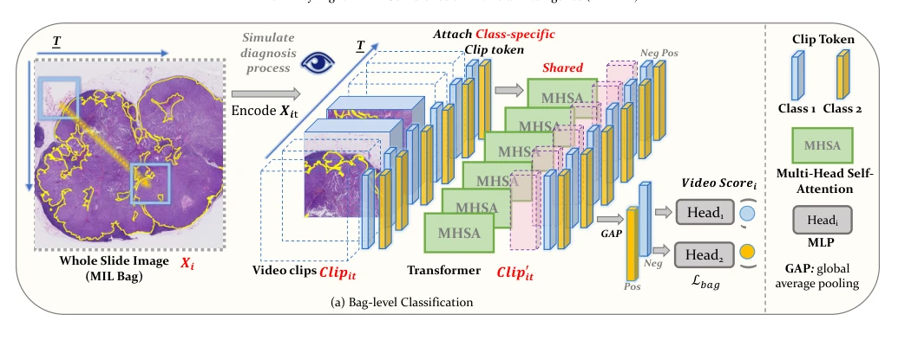
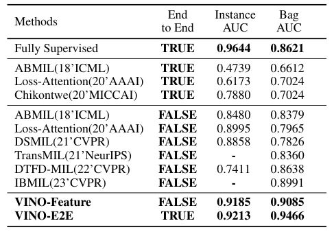

## Transformer-Based Video-Structure Multi-Instance Learning for Whole Slide Image Classification

> data: CAMELYON16、TCGA-NSCLC、PANDA
>
> AAAI 2024 · [论文](https://ojs.aaai.org/index.php/AAAI/article/view/29338)

#### 引言

把病理医生的浏览过程建模为视频片段，通过分治式 Transformer 兼顾上下文建模和端到端训练，用于切片分类与阳性区域检测。

#### 方法

（1）视频构建：把相邻 patch 按浏览轨迹组织成 clip，保留局部空间上下文。

（2）clip 建模：Transformer 学习片段内部关系并生成类别相关 token。

（3）切片聚合：由多个 clip 表示完成包预测，允许特征提取与聚合端到端优化。

原文Figure 2，PDF 第 3 页。

#### 实验

##### 实验设置

报告包级 AUC 与实例级 AUC；PANDA 按不同 Gleason 模式报告，另区分端到端与预提取特征版本。

##### 主要结果

CAMELYON16 上 VINO-E2E 的实例级和包级 AUC 分别为 0.9213、0.9466；端到端训练进一步增强包分类。

原文Table 1，PDF 第 6 页。

##### 消融与讨论

比较视频结构、clip 构建方式及端到端学习，不能将 VINO-Feature 与 VINO-E2E 混作同一配置。

#### 参考文献

> Transformer-Based Video-Structure Multi-Instance Learning for Whole Slide Image Classification
>
> AAAI 2024 · [论文](https://ojs.aaai.org/index.php/AAAI/article/view/29338)
