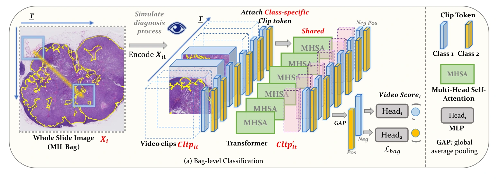
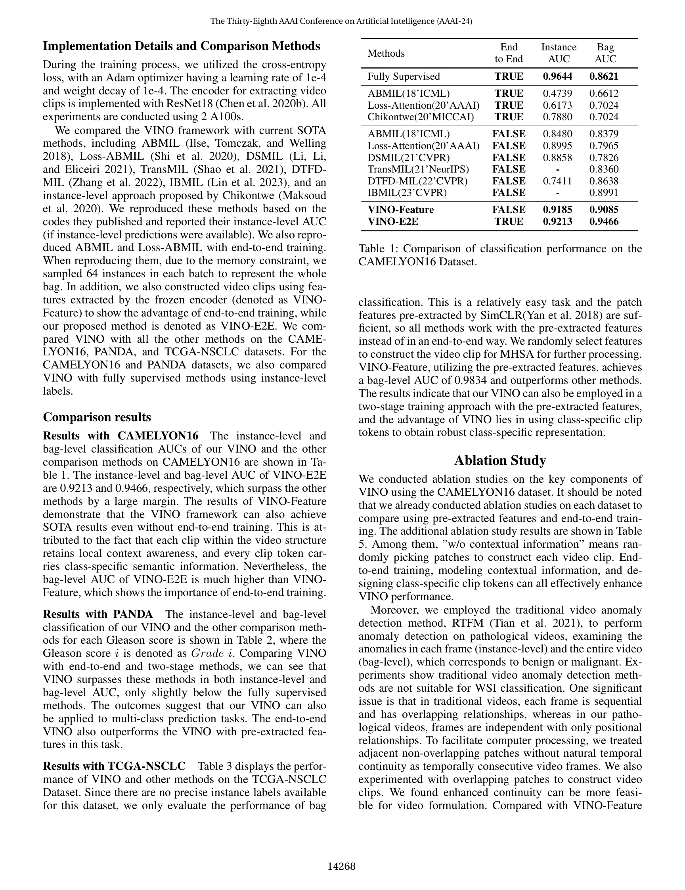
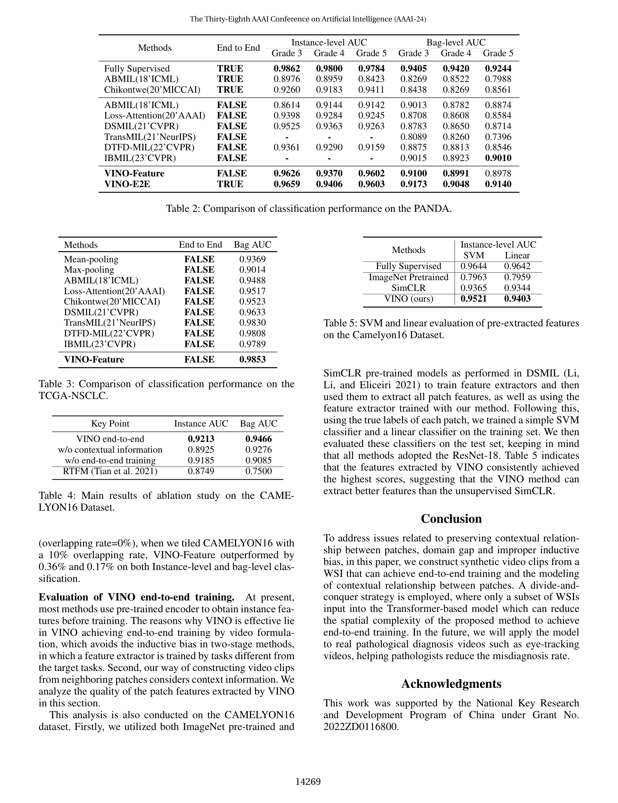

## Transformer-Based Video-Structure Multi-Instance Learning for Whole Slide Image Classification

> data: CAMELYON16、TCGA-NSCLC、PANDA
>
> AAAI 2024 · [论文](https://ojs.aaai.org/index.php/AAAI/article/view/29338)

#### 引言

把病理医生的浏览过程建模为视频片段，通过分治式 Transformer 兼顾上下文建模和端到端训练，用于切片分类与阳性区域检测。

#### 方法

（1）视频构建：把相邻 patch 按浏览轨迹组织成 clip，保留局部空间上下文。

（2）clip 建模：Transformer 学习片段内部关系并生成类别相关 token。

（3）切片聚合：由多个 clip 表示完成包预测，允许特征提取与聚合端到端优化。

<!-- wsi-complete-model -->
##### 模型结构图

**图 2 · 模型结构**（PDF 第 3 页）

> 原文图注：Figure 2: Overview of the proposed VINO framework for bag-level classification. We construct a series of synthetic video clips from a WSI which help achieve end-to-end training and modeling of contextual relationships between patches at the same time.

[查看原尺寸](assest/VINO/figure-2-complete.webp)

<!-- /wsi-complete-model -->

#### 实验

##### 实验设置

报告包级 AUC 与实例级 AUC；PANDA 按不同 Gleason 模式报告，另区分端到端与预提取特征版本。

##### 主要结果

CAMELYON16 上 VINO-E2E 的实例级和包级 AUC 分别为 0.9213、0.9466；端到端训练进一步增强包分类。

<!-- wsi-complete-results -->
##### 完整实验指标与对照

下列实验原页保留表头、全部行列、子图、误差说明和脚注，点击可查看原尺寸。比较时请对应相同的数据集、特征编码器和训练设置；`±`、置信区间、百分比和小数均保留原文的单位与统计口径。

| 原表/图中指标 | 读取方式 |
| --- | --- |
| ROC-AUC / AUROC | 越高越好；若原表明确为 PR-AUC，则按 PR 曲线面积读取 |

| 原文页 | 阅读内容 | 图表及正文引用 |
| --- | --- | --- |
| PDF 第 6 页 | 实验结果 | Table 1 |
| PDF 第 7 页 | 实验结果 | Table 2、Table 3、Table 4、Table 5 |

**实验原页 · PDF 第 6 页**（图表及正文引用：Table 1）

[查看原尺寸](assest/VINO/experiment-page-06.webp)

**实验原页 · PDF 第 7 页**（图表及正文引用：Table 2、Table 3、Table 4、Table 5）

[查看原尺寸](assest/VINO/experiment-page-07.webp)

<!-- /wsi-complete-results -->

##### 消融与讨论

比较视频结构、clip 构建方式及端到端学习，不能将 VINO-Feature 与 VINO-E2E 混作同一配置。

#### 参考文献

> Transformer-Based Video-Structure Multi-Instance Learning for Whole Slide Image Classification
>
> AAAI 2024 · [论文](https://ojs.aaai.org/index.php/AAAI/article/view/29338)
