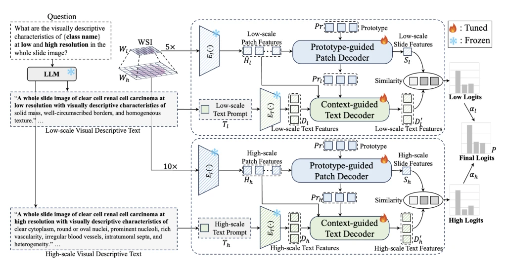
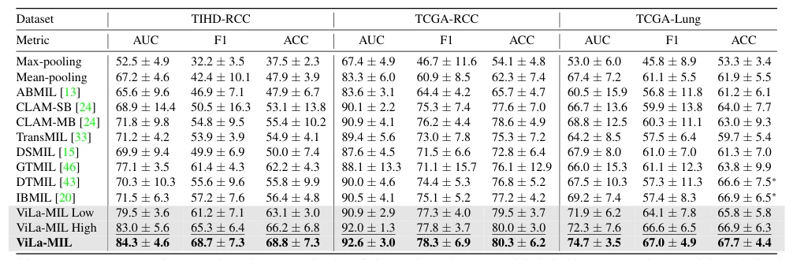

## ViLa-MIL: Dual-scale Vision-Language Multiple Instance Learning for Whole Slide Image Classification

> data: TIHD-RCC、TCGA-RCC、TCGA-Lung
>
> CVPR 2024 · [论文](https://openaccess.thecvf.com/content/CVPR2024/html/Shi_ViLa-MIL_Dual-scale_Vision-Language_Multiple_Instance_Learning_for_Whole_Slide_Image_CVPR_2024_paper.html)

#### 引言

用双尺度病理描述引入语言先验，以原型引导的 patch 解码和上下文引导的文本解码对齐视觉与文本，用于切片亚型分类。

#### 方法

（1）双尺度描述：由语言模型形成不同倍率的病理视觉描述。

（2）原型解码：按相似病理模式聚合 patch，逐步形成切片视觉表示。

（3）文本细化：用多粒度图像上下文更新文本表示，再进行跨模态分类。

原文Figure 2，PDF 第 4 页。

#### 实验

##### 实验设置

数据先按 4:3:3 划分，再从训练集中每类随机选 16 张切片；另做肾癌跨中心互测。

##### 主要结果

相对所比较 MIL 方法，三个数据集 AUC 提高范围为 1.7–7.2 个百分点，属于 16-shot 设定下的结果。

原文Table 1，PDF 第 6 页。

##### 消融与讨论

比较双尺度视觉描述提示、原型 patch 解码和文本上下文解码；少样本结论需保留每类 16 张的条件。

#### 参考文献

> ViLa-MIL: Dual-scale Vision-Language Multiple Instance Learning for Whole Slide Image Classification
>
> CVPR 2024 · [论文](https://openaccess.thecvf.com/content/CVPR2024/html/Shi_ViLa-MIL_Dual-scale_Vision-Language_Multiple_Instance_Learning_for_Whole_Slide_Image_CVPR_2024_paper.html)
