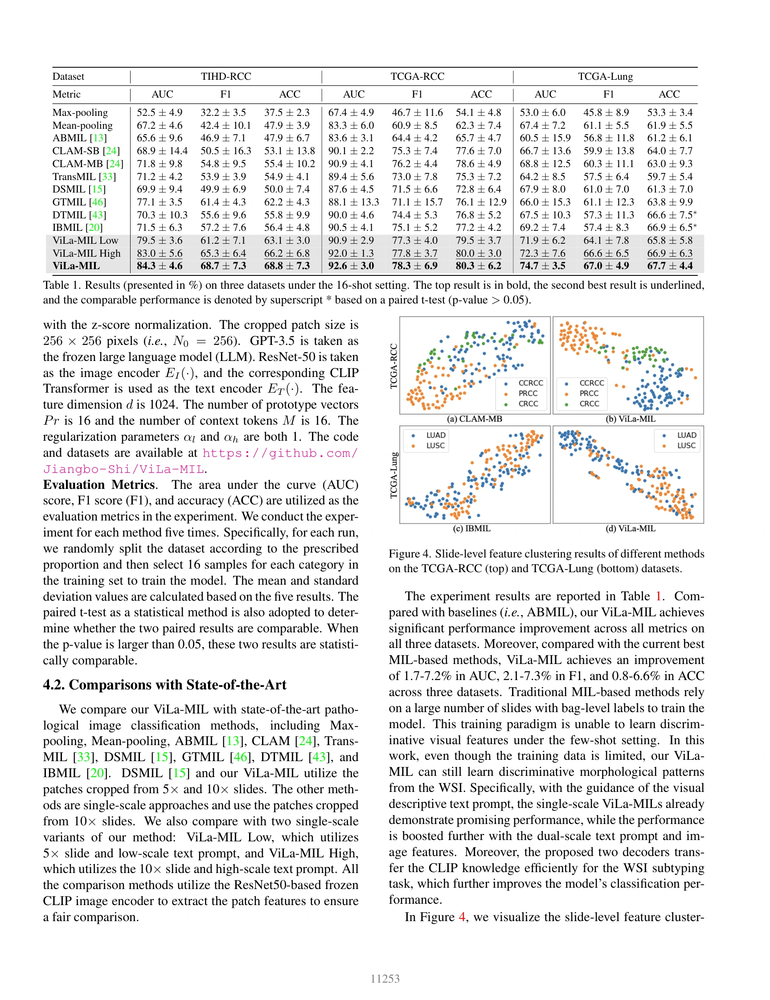
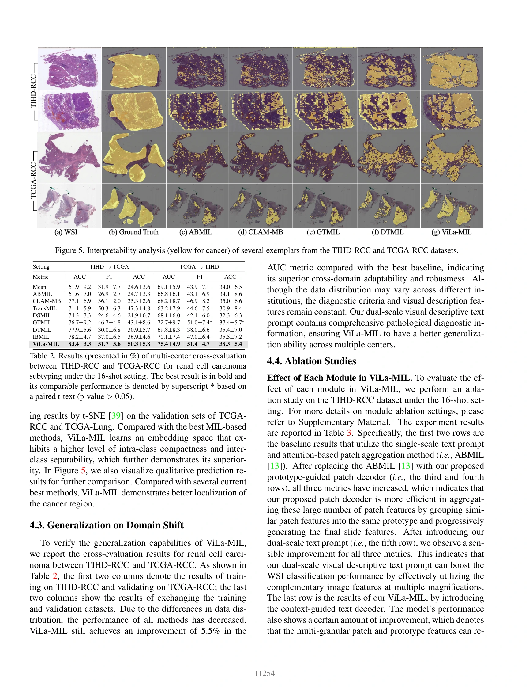
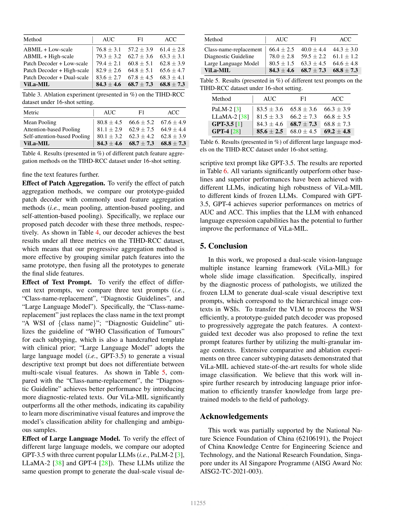

## ViLa-MIL: Dual-scale Vision-Language Multiple Instance Learning for Whole Slide Image Classification

> data: TIHD-RCC、TCGA-RCC、TCGA-Lung
>
> CVPR 2024 · [论文](https://openaccess.thecvf.com/content/CVPR2024/html/Shi_ViLa-MIL_Dual-scale_Vision-Language_Multiple_Instance_Learning_for_Whole_Slide_Image_CVPR_2024_paper.html)

#### 引言

用双尺度病理描述引入语言先验，以原型引导的 patch 解码和上下文引导的文本解码对齐视觉与文本，用于切片亚型分类。

#### 方法

（1）双尺度描述：由语言模型形成不同倍率的病理视觉描述。

（2）原型解码：按相似病理模式聚合 patch，逐步形成切片视觉表示。

（3）文本细化：用多粒度图像上下文更新文本表示，再进行跨模态分类。

<!-- wsi-complete-model -->
##### 模型结构图

**图 2 · 模型结构**（PDF 第 4 页）

> 原文图注：Figure 2. Pipeline of the proposed ViLa-MIL framework. The input of ViLa-MIL is a Question and WSI. The question is passed through a frozen large language model (LLM) to generate the dual-scale visual descriptive text prompt. The prototype-guided patch decoder is introduced to progressively fuse the patch features into the slide features. The context-guided text decoder is introduced to refine the text features further by utilizing the multi-granular image contexts.

[查看原尺寸](assest/ViLa-MIL/figure-2-complete.webp)

<!-- /wsi-complete-model -->

#### 实验

##### 实验设置

数据先按 4:3:3 划分，再从训练集中每类随机选 16 张切片；另做肾癌跨中心互测。

##### 主要结果

相对所比较 MIL 方法，三个数据集 AUC 提高范围为 1.7–7.2 个百分点，属于 16-shot 设定下的结果。

<!-- wsi-complete-results -->
##### 完整实验指标与对照

下列实验原页保留表头、全部行列、子图、误差说明和脚注，点击可查看原尺寸。比较时请对应相同的数据集、特征编码器和训练设置；`±`、置信区间、百分比和小数均保留原文的单位与统计口径。

| 原表/图中指标 | 读取方式 |
| --- | --- |
| ROC-AUC / AUROC | 越高越好；若原表明确为 PR-AUC，则按 PR 曲线面积读取 |

| 原文页 | 阅读内容 | 图表及正文引用 |
| --- | --- | --- |
| PDF 第 6 页 | 实验结果 | Table 1 |
| PDF 第 7 页 | 实验结果 | Table 2 |
| PDF 第 8 页 | 实验结果 | Table 3、Table 4、Table 5、Table 6 |

**实验原页 · PDF 第 6 页**（图表及正文引用：Table 1）

[查看原尺寸](assest/ViLa-MIL/experiment-page-06.webp)

**实验原页 · PDF 第 7 页**（图表及正文引用：Table 2）

[查看原尺寸](assest/ViLa-MIL/experiment-page-07.webp)

**实验原页 · PDF 第 8 页**（图表及正文引用：Table 3、Table 4、Table 5、Table 6）

[查看原尺寸](assest/ViLa-MIL/experiment-page-08.webp)

<!-- /wsi-complete-results -->

##### 消融与讨论

比较双尺度视觉描述提示、原型 patch 解码和文本上下文解码；少样本结论需保留每类 16 张的条件。

#### 参考文献

> ViLa-MIL: Dual-scale Vision-Language Multiple Instance Learning for Whole Slide Image Classification
>
> CVPR 2024 · [论文](https://openaccess.thecvf.com/content/CVPR2024/html/Shi_ViLa-MIL_Dual-scale_Vision-Language_Multiple_Instance_Learning_for_Whole_Slide_Image_CVPR_2024_paper.html)
