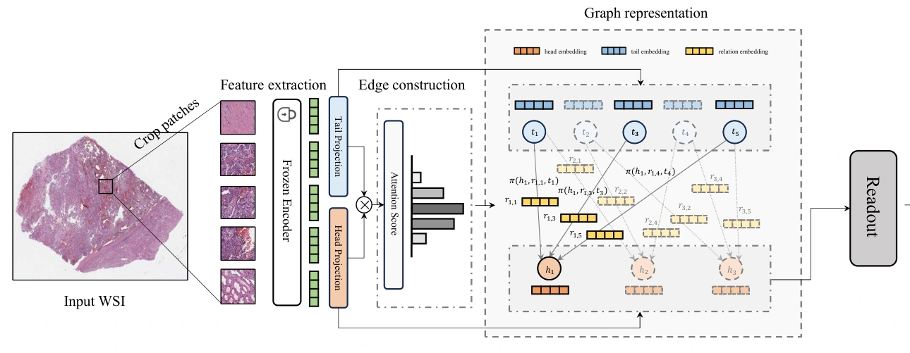
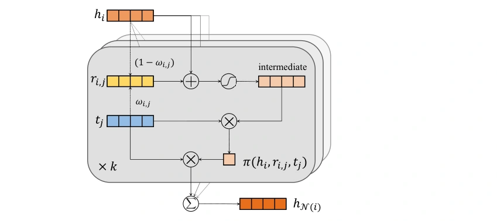
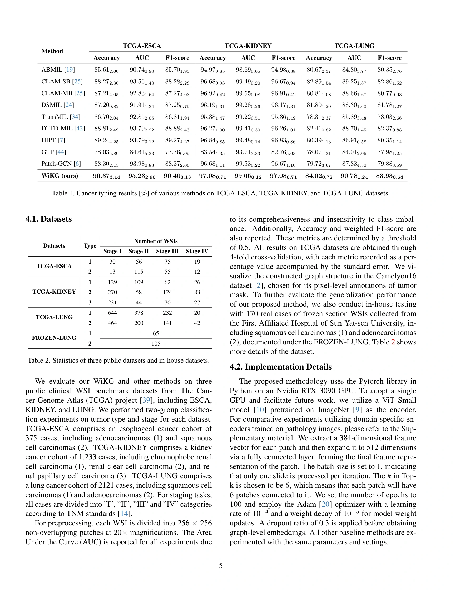
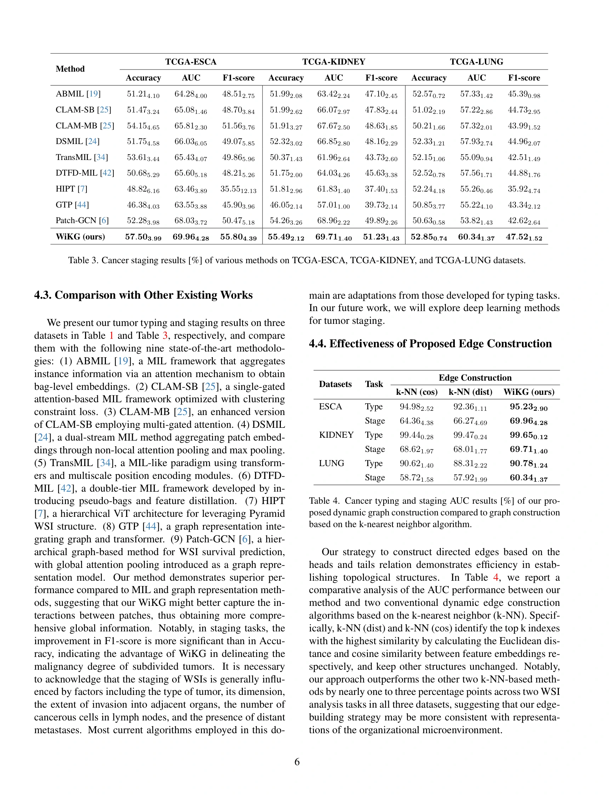
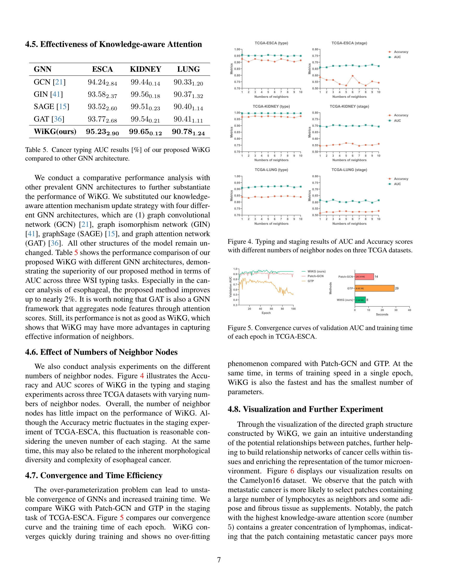
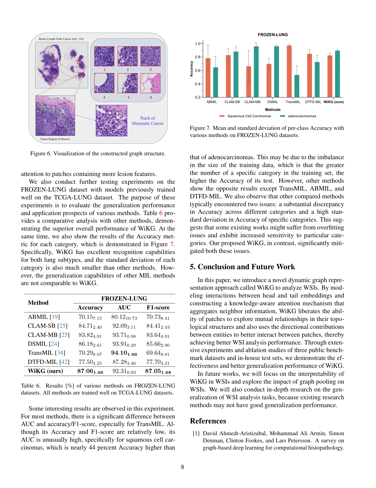

## Dynamic Graph Representation with Knowledge-aware Attention for Histopathology Whole Slide Image Analysis

> data: TCGA-ESCA、TCGA-KIDNEY、TCGA-LUNG；内部 FROZEN-LUNG
>
> CVPR 2024 · [论文](https://arxiv.org/abs/2403.07719) · [作者代码](https://github.com/WonderLandxD/WiKG)

#### 引言

把切片建模为动态知识图，根据实例头尾关系生成邻居和有向边，再通过知识感知注意力聚合节点与边信息。

#### 方法

（1）动态邻居：根据实例特征而非仅物理坐标选择相关节点。

（2）有向边编码：以头尾关系构建边表示，刻画实例间的非对称联系。

（3）知识注意力：联合邻居和边更新节点，再经全局池化输出图级表示。

<!-- wsi-complete-model -->
##### 模型结构图

**图 2 · 模型结构**（PDF 第 3 页）

> 原文图注：Figure 2. The framework of our proposed method for WSI analysis, including patch feature extraction, dynamic edge construction based on head and tail embeddings, graph representation learning, and the prediction of WSIs.

[查看原尺寸](assest/WiKG/figure-2-complete.webp)

**图 3 · 模型结构**（PDF 第 4 页）

> 原文图注：Figure 3. Illustration of our proposed knowledge-aware attention mechanism, including aggregation between head, tail, and edge embeddings.

[查看原尺寸](assest/WiKG/figure-3-complete.webp)

<!-- /wsi-complete-model -->

#### 实验

##### 实验设置

同时做组织类型与 TNM 分期，TCGA 使用四折评估；另外使用 170 例冷冻切片验证泛化。

##### 主要结果

重点是动态有向图优于仅按空间邻近构图的方案；论文另外报告图结构可视化和计算效率。

<!-- wsi-complete-results -->
##### 完整实验指标与对照

下列实验原页保留表头、全部行列、子图、误差说明和脚注，点击可查看原尺寸。比较时请对应相同的数据集、特征编码器和训练设置；`±`、置信区间、百分比和小数均保留原文的单位与统计口径。

| 原表/图中指标 | 读取方式 |
| --- | --- |
| ROC-AUC / AUROC | 越高越好；若原表明确为 PR-AUC，则按 PR 曲线面积读取 |
| ACC / Accuracy | 越高越好；平衡准确率、平均准确率以原表标注为准 |
| 时间 / FLOPs / 参数量 | 结合硬件、包长度和计时范围比较；小模型不一定推理更快 |

| 原文页 | 阅读内容 | 图表及正文引用 |
| --- | --- | --- |
| PDF 第 5 页 | 实验结果 | Table 1、Table 2 |
| PDF 第 6 页 | 实验结果 | Table 3、Table 4 |
| PDF 第 7 页 | 实验结果 | Table 5、Figure 4、Figure 5 |
| PDF 第 8 页 | 实验结果 | Table 6、Figure 7 |

**实验原页 · PDF 第 5 页**（图表及正文引用：Table 1、Table 2）

[查看原尺寸](assest/WiKG/experiment-page-05.webp)

**实验原页 · PDF 第 6 页**（图表及正文引用：Table 3、Table 4）

[查看原尺寸](assest/WiKG/experiment-page-06.webp)

**实验原页 · PDF 第 7 页**（图表及正文引用：Table 5、Figure 4、Figure 5）

[查看原尺寸](assest/WiKG/experiment-page-07.webp)

**实验原页 · PDF 第 8 页**（图表及正文引用：Table 6、Figure 7）

[查看原尺寸](assest/WiKG/experiment-page-08.webp)

<!-- /wsi-complete-results -->

##### 消融与讨论

考察边构建、知识感知注意力及邻居数，避免把动态邻居选择和最终池化混为同一机制。

#### 参考文献

> Dynamic Graph Representation with Knowledge-aware Attention for Histopathology Whole Slide Image Analysis
>
> CVPR 2024 · [论文](https://arxiv.org/abs/2403.07719) · [作者代码](https://github.com/WonderLandxD/WiKG)
