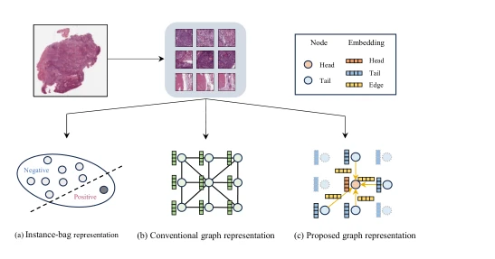

## Dynamic Graph Representation with Knowledge-aware Attention for Histopathology Whole Slide Image Analysis

> data: TCGA-ESCA、TCGA-KIDNEY、TCGA-LUNG；内部 FROZEN-LUNG
>
> CVPR 2024 · [论文](https://arxiv.org/abs/2403.07719) · [作者代码](https://github.com/WonderLandxD/WiKG)

#### 引言

把切片建模为动态知识图，根据实例头尾关系生成邻居和有向边，再通过知识感知注意力聚合节点与边信息。

#### 方法

（1）动态邻居：根据实例特征而非仅物理坐标选择相关节点。

（2）有向边编码：以头尾关系构建边表示，刻画实例间的非对称联系。

（3）知识注意力：联合邻居和边更新节点，再经全局池化输出图级表示。

原文Figure 1，PDF 第 1 页。

#### 实验

##### 实验设置

同时做组织类型与 TNM 分期，TCGA 使用四折评估；另外使用 170 例冷冻切片验证泛化。

##### 主要结果

重点是动态有向图优于仅按空间邻近构图的方案；论文另外报告图结构可视化和计算效率。

##### 消融与讨论

考察边构建、知识感知注意力及邻居数，避免把动态邻居选择和最终池化混为同一机制。

#### 参考文献

> Dynamic Graph Representation with Knowledge-aware Attention for Histopathology Whole Slide Image Analysis
>
> CVPR 2024 · [论文](https://arxiv.org/abs/2403.07719) · [作者代码](https://github.com/WonderLandxD/WiKG)
