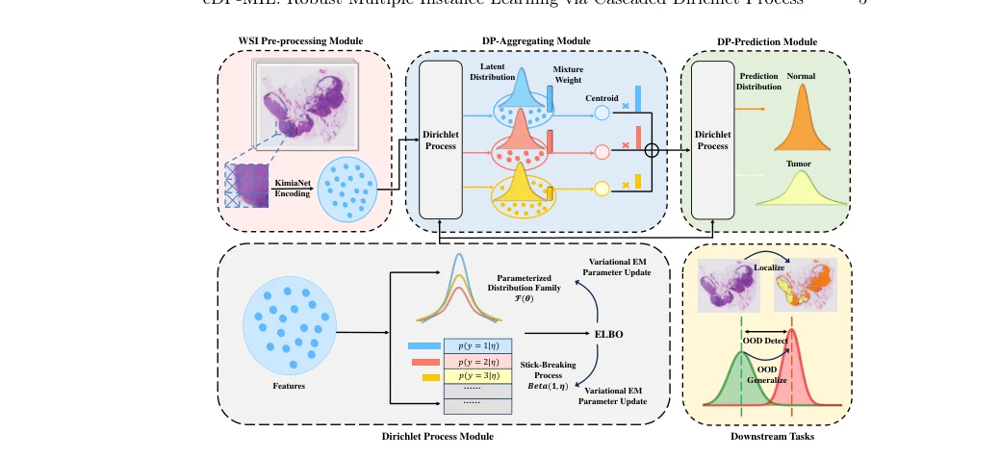

## cDP-MIL: Robust Multiple Instance Learning via Cascaded Dirichlet Process

> data: TCGA-COAD、TCGA-BRCA、TCGA-ESCA、TCGA-NSCLC、CAMELYON16
>
> ECCV 2024 · [论文](https://arxiv.org/abs/2407.11448) · [作者代码](https://github.com/HKU-MedAI/cDPMIL)

#### 引言

以级联 Dirichlet 过程分别建模实例聚类和包级预测，在聚合中考虑特征协方差，并提供后验不确定性估计。

#### 方法

（1）实例层 DP：以非参数聚类建模 patch 特征分布及协方差。

（2）包层 DP：在切片表示层再施加 Dirichlet 过程，形成自然正则。

（3）后验推断：以概率不确定性支持异常检测和病灶分析。

原文Fig. 2，PDF 第 5 页。

#### 实验

##### 实验设置

涵盖癌症分类、亚型分类、OOD 检测和跨域泛化；OOD 检测用 AUROC/AUPR。

##### 主要结果

将 COAD 作为域内、BRCA 作为域外进行不确定性评价；这些结果与常规亚型分类主表是不同任务。

##### 消融与讨论

考察级联 Dirichlet 建模、聚类与不确定性；后验分布的用途不应简化为普通 attention 热图。

#### 参考文献

> cDP-MIL: Robust Multiple Instance Learning via Cascaded Dirichlet Process
>
> ECCV 2024 · [论文](https://arxiv.org/abs/2407.11448) · [作者代码](https://github.com/HKU-MedAI/cDPMIL)
