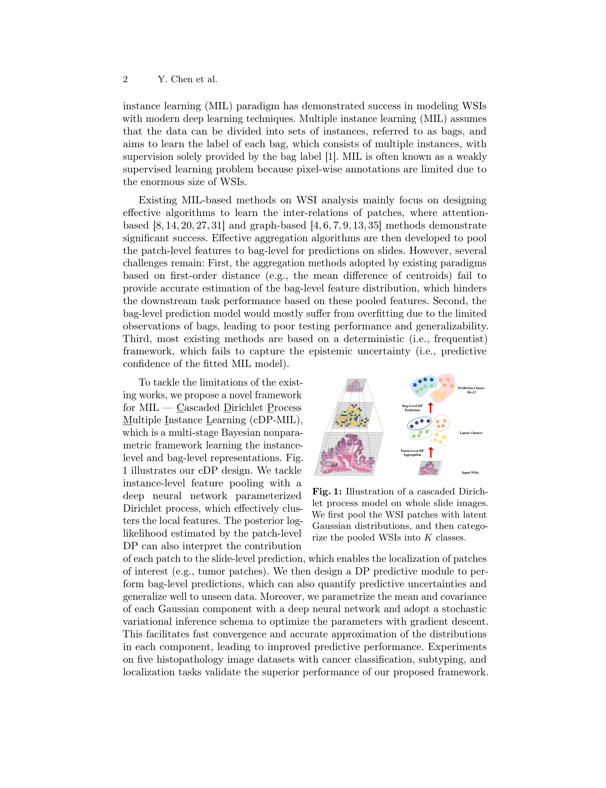
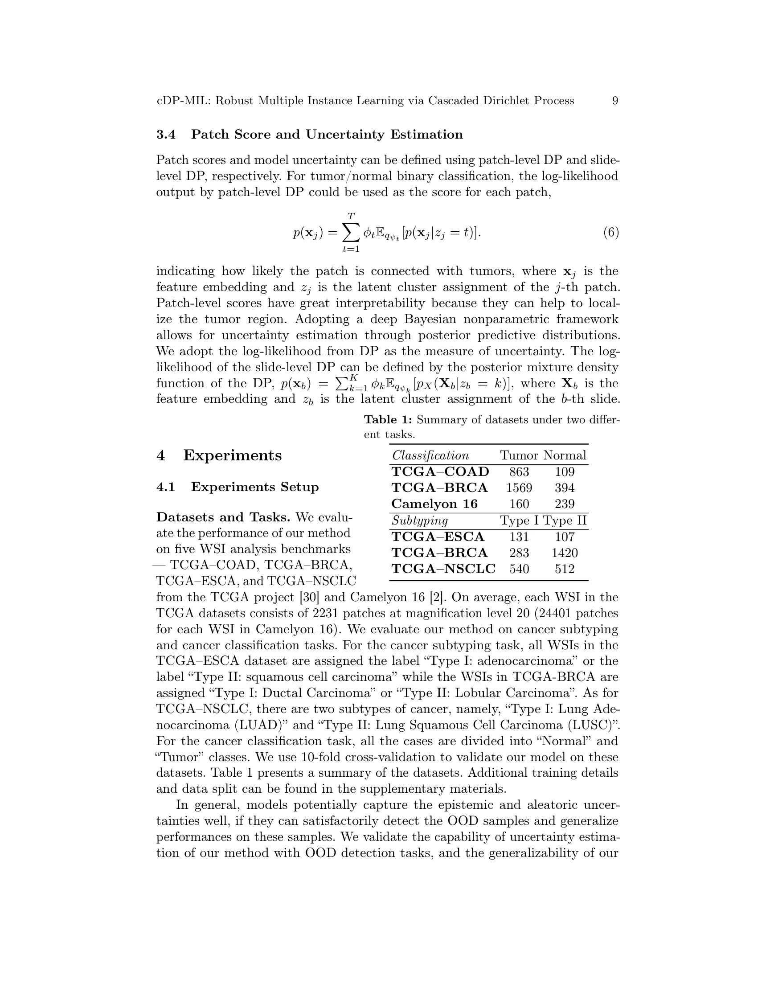
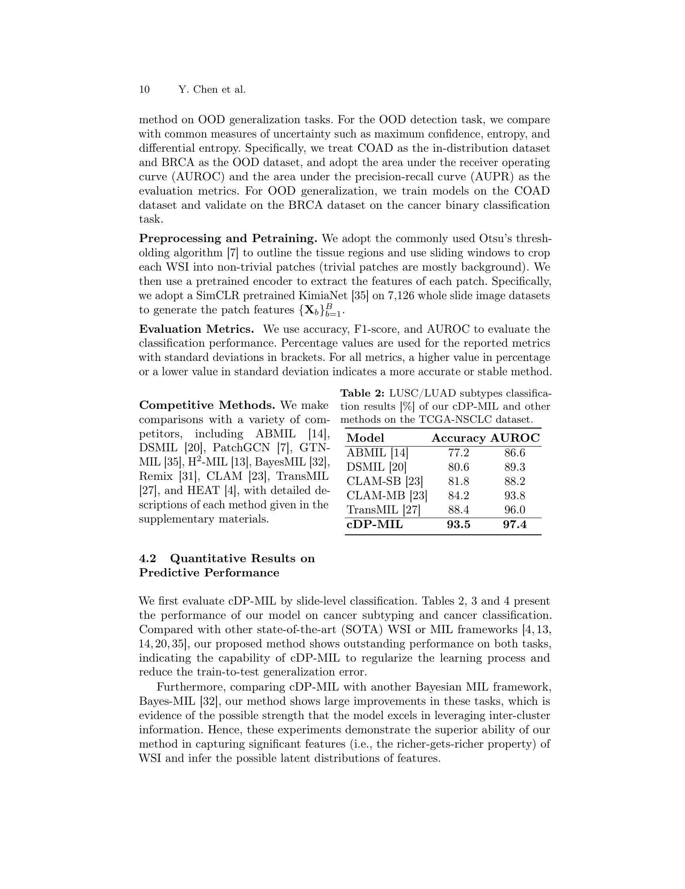
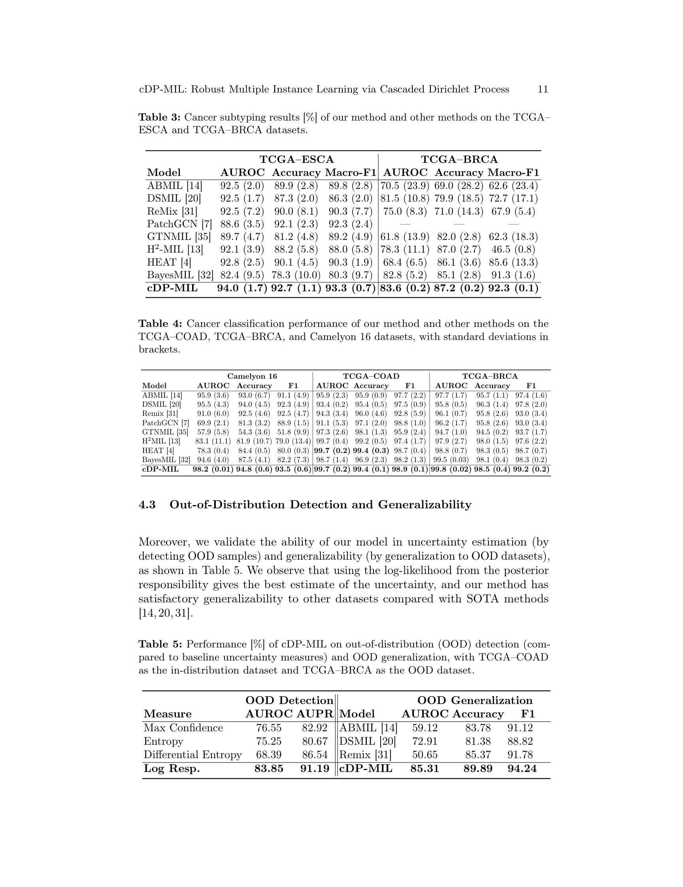
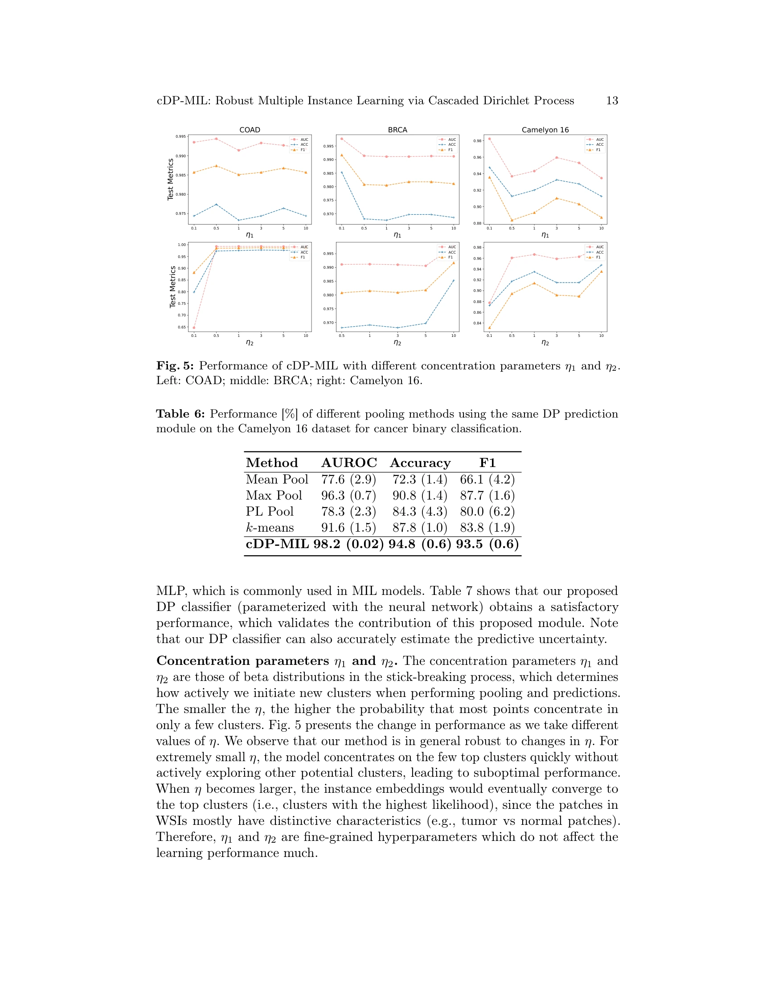
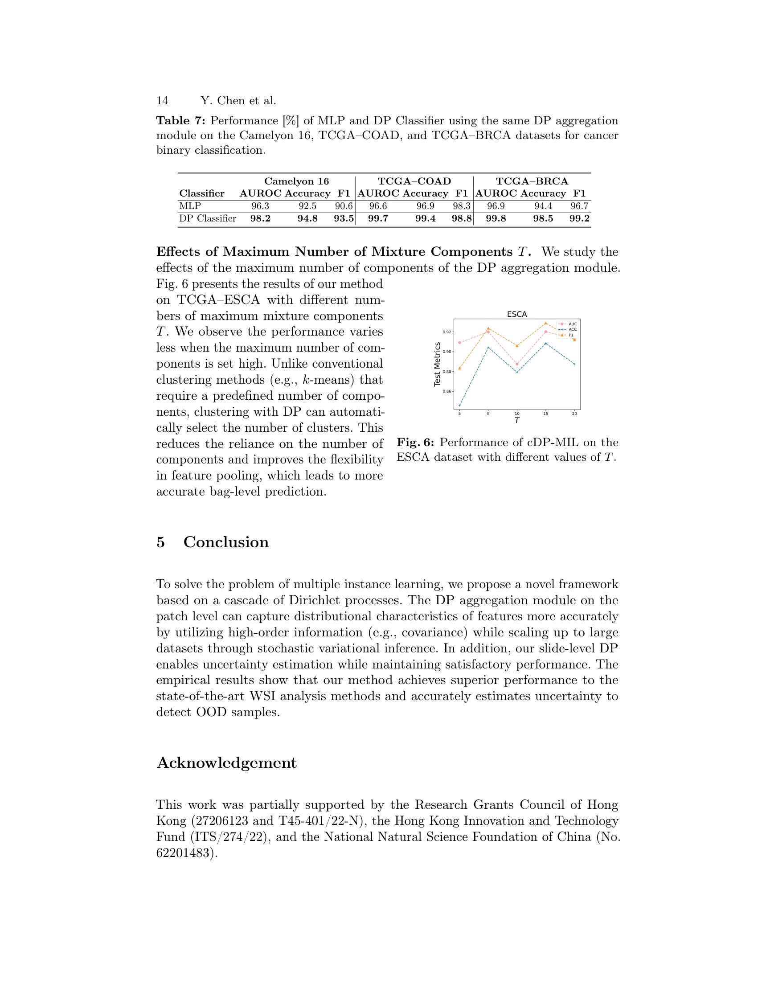

## cDP-MIL: Robust Multiple Instance Learning via Cascaded Dirichlet Process

> data: TCGA-COAD、TCGA-BRCA、TCGA-ESCA、TCGA-NSCLC、CAMELYON16
>
> ECCV 2024 · [论文](https://arxiv.org/abs/2407.11448) · [作者代码](https://github.com/HKU-MedAI/cDPMIL)

#### 引言

以级联 Dirichlet 过程分别建模实例聚类和包级预测，在聚合中考虑特征协方差，并提供后验不确定性估计。

#### 方法

（1）实例层 DP：以非参数聚类建模 patch 特征分布及协方差。

（2）包层 DP：在切片表示层再施加 Dirichlet 过程，形成自然正则。

（3）后验推断：以概率不确定性支持异常检测和病灶分析。

<!-- wsi-complete-model -->
##### 模型结构图

**图 2 · 模型结构**（PDF 第 5 页）

> 原文图注：Fig. 2: The overall framework of our proposed cascaded DP model. We first use Otsu’s segmentation to outline tissue regions and select foreground instances for MIL learning. We then design an aggregation module based on the Dirichlet process to cluster instance- level features into latent clusters. Finally, a prediction module based on DP would perform predictions based on the distribution learned for each cluster.

[查看原尺寸](assest/cDP-MIL/figure-2-complete.webp)

<!-- /wsi-complete-model -->

#### 实验

##### 实验设置

涵盖癌症分类、亚型分类、OOD 检测和跨域泛化；OOD 检测用 AUROC/AUPR。

##### 主要结果

将 COAD 作为域内、BRCA 作为域外进行不确定性评价；这些结果与常规亚型分类主表是不同任务。

<!-- wsi-complete-results -->
##### 完整实验指标与对照

下列实验原页保留表头、全部行列、子图、误差说明和脚注，点击可查看原尺寸。比较时请对应相同的数据集、特征编码器和训练设置；`±`、置信区间、百分比和小数均保留原文的单位与统计口径。

| 原表/图中指标 | 读取方式 |
| --- | --- |
| ROC-AUC / AUROC | 越高越好；若原表明确为 PR-AUC，则按 PR 曲线面积读取 |
| AP / AUPRC / mAP | 越高越好；与 ROC-AUC 不同，保留任务和召回定义 |

| 原文页 | 阅读内容 | 图表及正文引用 |
| --- | --- | --- |
| PDF 第 2 页 | 实验结果 | Figure 1 |
| PDF 第 9 页 | 实验结果 | Table 1 |
| PDF 第 10 页 | 实验结果 | Table 2 |
| PDF 第 11 页 | 实验结果 | Table 3、Table 4、Table 5 |
| PDF 第 13 页 | 实验结果 | Figure 5、Table 6 |
| PDF 第 14 页 | 实验结果 | Table 7、Figure 6 |

**实验原页 · PDF 第 2 页**（图表及正文引用：Figure 1）

[查看原尺寸](assest/cDP-MIL/experiment-page-02.webp)

**实验原页 · PDF 第 9 页**（图表及正文引用：Table 1）

[查看原尺寸](assest/cDP-MIL/experiment-page-09.webp)

**实验原页 · PDF 第 10 页**（图表及正文引用：Table 2）

[查看原尺寸](assest/cDP-MIL/experiment-page-10.webp)

**实验原页 · PDF 第 11 页**（图表及正文引用：Table 3、Table 4、Table 5）

[查看原尺寸](assest/cDP-MIL/experiment-page-11.webp)

**实验原页 · PDF 第 13 页**（图表及正文引用：Figure 5、Table 6）

[查看原尺寸](assest/cDP-MIL/experiment-page-13.webp)

**实验原页 · PDF 第 14 页**（图表及正文引用：Table 7、Figure 6）

[查看原尺寸](assest/cDP-MIL/experiment-page-14.webp)

<!-- /wsi-complete-results -->

##### 消融与讨论

考察级联 Dirichlet 建模、聚类与不确定性；后验分布的用途不应简化为普通 attention 热图。

#### 参考文献

> cDP-MIL: Robust Multiple Instance Learning via Cascaded Dirichlet Process
>
> ECCV 2024 · [论文](https://arxiv.org/abs/2407.11448) · [作者代码](https://github.com/HKU-MedAI/cDPMIL)
