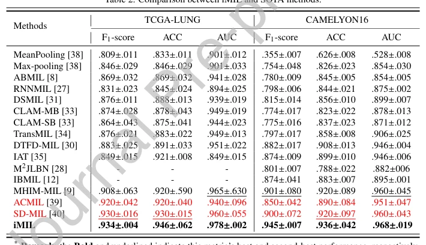

## Interactive Multiple Instance Learning Network for Whole Slide Image Analysis

> data: CAMELYON16、TCGA-LUNG
>
> Expert Systems with Applications 2026 · [论文](https://doi.org/10.1016/j.eswa.2025.129338)

#### 引言

融合局部实例、全局切片和临床文本信息，以提示引导注意力和交互式细化反馈增强弱监督分类与区域定位。

#### 方法

（1）MIAM：整合局部实例、全局切片及临床文本。

（2）PGAM：以可学习提示调整实例内和实例间注意力。

（3）IRM：通过多层特征与上下文反馈迭代细化表示和伪标签。

#### 实验

##### 实验设置

C16 使用 243/27/130 的训练/验证/测试切片；比较主流 MIL 与逐组件的交互式学习。

##### 主要结果

主表中 iMIL 表现最好；作者指出 TCGA 中较大病灶占比与 C16 的稀疏病灶使任务难度不同。

原文Table 2，PDF 第 11 页。

##### 消融与讨论

考察 MIAM、PGAM、IRM 对实例定位与切片分类的贡献，避免仅根据最终 AUC 推断文本使用是否有效。

#### 参考文献

> Interactive Multiple Instance Learning Network for Whole Slide Image Analysis
>
> Expert Systems with Applications 2026 · [论文](https://doi.org/10.1016/j.eswa.2025.129338)
